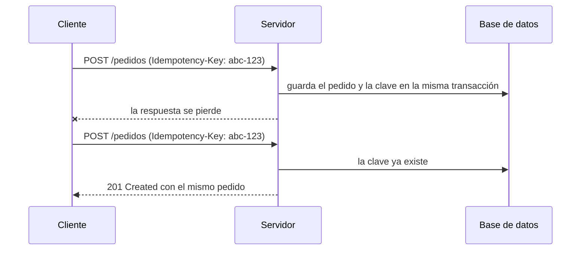

# Idempotencia y reintentos

<!-- cspell:words Brandur Leach Jena Tishkin idempotente idempotentes idempotencia DataIntegrityViolationException reintenta reintentan direccion timestamptz Reschke Dalal ietf httpapi -->

> **Tipo de página:** explicación. Te ayuda a entender por qué los reintentos pueden duplicar operaciones y cómo evitarlo; no es una guía de un *framework* concreto.

## El problema

Un cliente envía `POST /pedidos`. El servidor crea el pedido, cobra la tarjeta y responde `201 Created`, pero la conexión se corta antes de que la respuesta llegue. Desde el lado del cliente es imposible distinguir dos situaciones:

- La petición nunca llegó y no pasó nada.
- La petición llegó y se procesó, pero se perdió la respuesta.

Si el cliente no reintenta, el pedido puede no existir. Si reintenta a ciegas, el cliente puede terminar con dos pedidos y dos cobros. Las bibliotecas HTTP, los balanceadores y las aplicaciones móviles reintentan solas ante errores de red, así que este caso es más frecuente de lo que parece.

## La idea central

Una operación es **idempotente** cuando aplicarla una vez o varias veces con los mismos parámetros deja el servidor en el mismo estado.

El RFC 9110, que define la semántica de HTTP, clasifica los métodos:

- `GET`, `HEAD` y los demás métodos seguros, más `PUT` y `DELETE`, **son idempotentes por definición**.
- `POST` y `PATCH` **no lo son**.

El RFC explica para qué sirve la distinción: un cliente puede repetir de forma automática una petición idempotente si la conexión falla antes de recibir la respuesta. También dice que un cliente no debería reintentar de forma automática una petición no idempotente, salvo que tenga alguna forma de saber que es seguro.

La forma más extendida de volver seguro un `POST` es una **clave de idempotencia**. El cliente genera un identificador único para cada operación, por ejemplo un UUID, y lo envía en la cabecera `Idempotency-Key`. Si llega una segunda petición con la misma clave, el servidor no repite la operación: devuelve el resultado de la primera. El nombre viene de la API de Stripe, y la IETF está estandarizando esa cabecera en un borrador (*Internet-Draft*) que todavía no es un RFC.

## Cómo se estructura



Para que funcione, el servidor tiene que cumplir tres condiciones:

1. **Guardar la clave en la misma transacción que el efecto.** Si el pedido se guarda y la clave no, el reintento crea un duplicado. Brandur Leach lo desarrolla en su artículo sobre cómo implementar claves al estilo de Stripe en PostgreSQL: cada fase de la operación es atómica y deja registrado hasta dónde llegó.
2. **Una restricción única sobre la clave.** Si dos peticiones con la misma clave llegan a la vez, la base rechaza la segunda aunque las dos hayan pasado la comprobación "¿ya existe?".
3. **Comparar los parámetros.** Stripe compara la petición nueva con la original y responde con un error si no coinciden: la misma clave con otro contenido es un error del cliente, no un reintento.

Las claves no se guardan para siempre. Stripe, por ejemplo, permite eliminarlas cuando tienen al menos 24 horas, y si después llega la misma clave la trata como una petición nueva.

## Cuándo no usarlo

- **En operaciones que ya son idempotentes.** Un `PUT /pedidos/123/direccion` con la dirección completa o un `DELETE` no necesitan clave: repetirlos ya da el mismo resultado. Stripe ignora la clave en `GET` y `DELETE` por ese motivo.
- **Si el efecto ocurre fuera de tu transacción.** Si el servidor llama a una pasarela de pagos externa, guardar la clave en tu base no impide un cobro doble en la pasarela. Hay que pasar la misma clave también a ese servicio, si la admite, o registrar el avance por fases como propone Brandur Leach.
- **Si los clientes no generan claves estables.** Una clave nueva en cada reintento no protege nada. La clave se genera una vez por operación de negocio, antes del primer intento.

## Qué se gana y qué se pierde

| Se gana | Se pierde |
| --- | --- |
| Clientes que pueden reintentar un `POST` sin riesgo de duplicados | Una tabla extra y una restricción única |
| Un comportamiento predecible ante cortes de red y reintentos automáticos | Decidir cuánto tiempo se conservan las claves |
| La misma respuesta en el reintento que en el intento original | Más lógica en el servidor, sobre todo si hay servicios externos |

## Confusiones frecuentes

- **"`GET`, `PUT` y `DELETE` son idempotentes automáticamente porque lo dice HTTP."** El RFC dice qué efecto **deben** tener esos métodos. Que tu implementación lo cumpla depende de tu código. Un `PUT` que suma una cantidad en lugar de reemplazarla, o un `GET` que registra una visita contada para facturar, rompen la promesa.
- **"Idempotente significa que la respuesta es siempre la misma."** Se refiere al **efecto en el servidor**. El RFC lo aclara: repetir la petición tiene el mismo efecto, aunque la respuesta pueda ser distinta. Por ejemplo, un segundo `DELETE` puede responder `404` y seguir siendo idempotente, porque el recurso sigue borrado.
- **"Con un reintento con espera alcanza."** Reintentar es necesario; la idempotencia es lo que hace que reintentar sea seguro. Son dos mitades del mismo problema.
- **"La clave de idempotencia la genera el servidor."** La genera el cliente, antes de enviar la primera petición. Si la generara el servidor en la respuesta, se perdería justo en el caso que se quiere resolver.

## Ejemplo

Dominio de pedidos con Java 21, Spring Boot 3 y PostgreSQL. El fragmento es ilustrativo: omite los `import`, la entidad y el manejo de la carrera entre dos peticiones simultáneas.

La tabla de claves apunta al pedido creado. La clave primaria impide registrar dos veces la misma clave:

```sql
CREATE TABLE claves_de_idempotencia (
    clave      text PRIMARY KEY,
    pedido_id  uuid NOT NULL REFERENCES pedidos (id),
    creada_en  timestamptz NOT NULL DEFAULT now()
);
```

El servicio busca la clave antes de crear. Si existe, devuelve el pedido original; si no, crea el pedido y la clave en la misma transacción:

```java
@Service
class CrearPedidoIdempotente {
    private final PedidoRepository pedidos;
    private final ClaveDeIdempotenciaRepository claves;

    CrearPedidoIdempotente(PedidoRepository pedidos, ClaveDeIdempotenciaRepository claves) {
        this.pedidos = pedidos;
        this.claves = claves;
    }

    @Transactional
    Pedido crear(String clave, String clienteId, List<Linea> lineas) {
        var existente = claves.findById(clave);
        if (existente.isPresent()) {
            return pedidos.findById(existente.get().pedidoId()).orElseThrow();
        }
        var pedido = pedidos.save(Pedido.nuevo(clienteId, lineas));
        claves.save(new ClaveDeIdempotencia(clave, pedido.id()));
        return pedido;
    }
}
```

Si dos peticiones con la misma clave llegan a la vez, las dos pueden no encontrarla. La restricción única hace que la segunda falle al confirmar y que su pedido se deshaga. El controlador puede capturar esa `DataIntegrityViolationException` y volver a llamar al servicio, que esta vez encuentra la clave.

Comprobado en PostgreSQL 18: el reintento con la misma clave falla con *duplicate key value violates unique constraint*, su pedido se deshace y queda un solo pedido.

En C# con .NET 8 la estructura es la misma, con un índice único en EF Core y `DbUpdateException` en lugar de `DataIntegrityViolationException`.

## Referencias

- Fielding, R., Nottingham, M. y Reschke, J. (2022). *RFC 9110: HTTP Semantics*. <https://www.rfc-editor.org/rfc/rfc9110> (consultado el 2026-10-29; [copia archivada](https://web.archive.org/web/20260520194653/https://www.rfc-editor.org/rfc/rfc9110)). Sección 9.2.2: definición de métodos idempotentes, cuáles lo son y cuándo se puede reintentar automáticamente.
- Leach, B. (2017). *Implementing Stripe-like Idempotency Keys in Postgres*. <https://brandur.org/idempotency-keys> (consultado el 2026-10-29; [copia archivada](https://web.archive.org/web/20261022124434/https://brandur.org/idempotency-keys)). Origen del nombre en Stripe, la cabecera `Idempotency-Key` y las fases atómicas con puntos de recuperación.
- Stripe (s. f.). *Idempotent requests*. <https://docs.stripe.com/api/idempotent_requests> (consultado el 2026-10-29; [copia archivada](https://web.archive.org/web/20261021202245/https://docs.stripe.com/api/idempotent_requests)). Comparación de parámetros, eliminación de claves después de 24 horas y claves ignoradas en `GET` y `DELETE`.
- Jena, J., Dalal, S. y Tishkin, D. (2026). *The Idempotency-Key HTTP Header Field* (draft-ietf-httpapi-idempotency-key-header-08, Internet-Draft). <https://datatracker.ietf.org/doc/draft-ietf-httpapi-idempotency-key-header/> (consultado el 2026-10-29; [copia archivada](https://web.archive.org/web/20260903124749/https://datatracker.ietf.org/doc/draft-ietf-httpapi-idempotency-key-header/)). Propuesta de estandarización de la cabecera; todavía no es un RFC.

Última revisión: 2026-10-29
