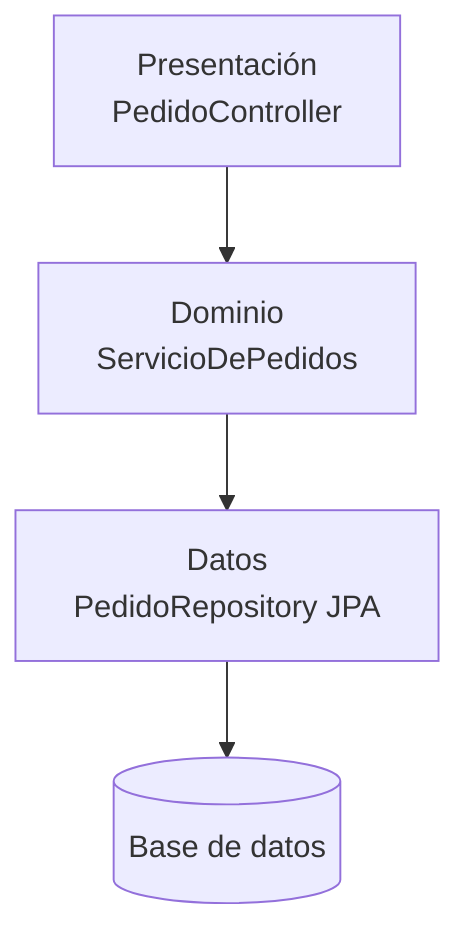

# Arquitectura en capas

<!-- cspell:words Buschmann Edsger Meunier Rohnert Sommerlad Stal -->

> **Tipo de página:** explicación. Te ayuda a entender la idea y a decidir si te conviene; no es un tutorial paso a paso.

## El problema

Cuando una aplicación crece sin estructura, cada clase hace un poco de todo: lee la petición HTTP, valida reglas de negocio y arma la consulta SQL. Eric Evans describe el resultado: el código de interfaz, de base de datos y de soporte termina escrito directamente dentro de los objetos de negocio, y la lógica de negocio queda tan dispersa que cuesta verla y razonar sobre ella.

Hace falta una forma de separar responsabilidades a gran escala, para que cada parte del código se pueda entender, cambiar y probar sin tener que leer todo lo demás.

## La idea central

El código se organiza en **capas horizontales**. Cada capa tiene una responsabilidad y solo usa los servicios de la capa que está debajo; lo que hay más abajo queda oculto detrás de ella.

La idea es anterior a las aplicaciones web. En 1968 Edsger Dijkstra describió el sistema operativo THE como una jerarquía de niveles, en la que cada nivel implementa abstracciones sobre el nivel inferior. Buschmann y sus coautores la formalizaron en 1996 como el patrón *Layers*, y es la forma más común de organizar aplicaciones empresariales.

## Cómo se estructura

La versión más difundida tiene tres capas. Martin Fowler la llama *presentation-domain-data layering*:

| Capa | Responsabilidad | Ejemplos en el dominio de pedidos |
| --- | --- | --- |
| Presentación | Recibir peticiones y mostrar resultados | Controlador REST, vistas |
| Dominio o negocio | Reglas de negocio | Validar que un pedido tenga líneas, calcular el total |
| Datos | Guardar y recuperar información | Repositorio JPA, consultas SQL |

Evans propone cuatro capas: interfaz de usuario, **aplicación** (coordina las tareas, sin reglas de negocio propias), dominio e infraestructura.

Las dependencias van **de arriba hacia abajo**: la presentación depende del dominio y el dominio depende de los datos. En la variante **estricta**, cada capa solo conoce a la inmediatamente inferior. En la **relajada**, una capa puede usar cualquiera de las inferiores, por ejemplo la presentación leyendo datos directamente para un listado. La relajada es más cómoda y más fácil de degradar, así que conviene decidirla de forma explícita.



## Cuándo no usarlo

- **Como única división de un sistema grande.** Fowler recomienda que, a medida que el sistema crece, el primer nivel se divida en módulos por dominio (pedidos, pagos, envíos), y que cada módulo tenga sus capas por dentro. Las carpetas `controller/`, `service/` y `repository/` en la raíz funcionan en sistemas chicos.
- **Cuando necesitas probar el dominio sin base de datos o cambiar la tecnología de persistencia.** Como el dominio depende de la capa de datos, cualquier cambio en ella lo toca. En ese caso conviene invertir la dependencia, que es lo que hace la [arquitectura hexagonal](hexagonal.md).
- **Para organizar equipos.** Un equipo "de base de datos" y otro "de interfaz" convierten cada funcionalidad en una negociación entre equipos. Fowler lo resume así: los desarrolladores no tienen que ser *full-stack*, pero los equipos sí.

## Qué se gana y qué se pierde

| Se gana | Se pierde |
| --- | --- |
| Una estructura que casi cualquier desarrollador reconoce | El dominio depende de la persistencia y hereda sus cambios |
| Separar presentación, negocio y datos con poco esfuerzo | Probar el dominio suele requerir la base de datos o *mocks* de su tecnología |
| Encaja con los frameworks: Spring y ASP.NET Core la sugieren por defecto | Una funcionalidad atraviesa todas las capas y se reparte en varias carpetas |
| Reemplazar la presentación sin tocar el negocio | Capas que solo delegan en la de abajo y agregan código sin agregar valor |

## Confusiones frecuentes

- **Capas no es lo mismo que niveles físicos.** Una capa (*layer*) es una separación lógica dentro del código. Un nivel (*tier*) es una separación física: procesos o máquinas distintas. Una aplicación de tres capas puede ejecutarse en un solo proceso.
- **"Tener paquetes `controller`, `service` y `repository` ya es arquitectura en capas."** Solo si las dependencias respetan la dirección. Un repositorio que llama a un servicio, o un controlador con reglas de negocio, tiene las carpetas pero no las capas.
- **"La hexagonal es capas con otro dibujo."** La diferencia está en la dirección de una dependencia: en capas, el dominio depende de los datos; en hexagonal, la persistencia depende de un puerto que define el dominio. Fowler señala que esa variación, en la que el dominio no depende de sus fuentes de datos, suele llamarse arquitectura hexagonal.
- **"La capa de servicio es obligatoria aunque solo delegue."** Si un servicio se limita a pasar la llamada al repositorio, es código sin responsabilidad. La capa de aplicación de Evans coordina tareas; si no hay nada que coordinar, no hace falta.

## Ejemplo

Dominio de pedidos con Spring Boot 3 y Spring Data JPA. El fragmento es ilustrativo: omite los `import` y la configuración, y no se compiló.

Capa de datos: la entidad y el repositorio dependen de JPA.

```java
@Entity
class PedidoEntity {
    @Id UUID id;
    String clienteId;
    int cantidadDeLineas;
    // constructor, getters y setters
}

interface PedidoRepository extends JpaRepository<PedidoEntity, UUID> {}
```

Capa de dominio: contiene la regla de negocio y usa la capa de datos directamente.

```java
@Service
class ServicioDePedidos {
    private final PedidoRepository repositorio;

    ServicioDePedidos(PedidoRepository repositorio) {
        this.repositorio = repositorio;
    }

    @Transactional
    UUID realizar(String clienteId, List<LineaRequest> lineas) {
        if (lineas.isEmpty()) {
            throw new IllegalArgumentException("Un pedido necesita al menos una línea");
        }
        var pedido = new PedidoEntity(UUID.randomUUID(), clienteId, lineas.size());
        return repositorio.save(pedido).id;
    }
}
```

Capa de presentación: traduce HTTP y delega en el dominio.

```java
@RestController
@RequestMapping("/pedidos")
class PedidoController {
    private final ServicioDePedidos servicio;

    PedidoController(ServicioDePedidos servicio) {
        this.servicio = servicio;
    }

    @PostMapping
    ResponseEntity<UUID> crear(@RequestBody PedidoRequest request) {
        var id = servicio.realizar(request.clienteId(), request.lineas());
        return ResponseEntity.status(HttpStatus.CREATED).body(id);
    }
}
```

Fíjate en la dependencia de `ServicioDePedidos` hacia `PedidoRepository`, que extiende `JpaRepository`: la regla de negocio está atada a JPA. Para probarla necesitas una base de datos o un *mock* de una interfaz de Spring Data. Compáralo con el [ejemplo de la arquitectura hexagonal](hexagonal.md#ejemplo), donde el servicio solo conoce un puerto propio.

En C# con ASP.NET Core la estructura es la misma: un `Controller`, un servicio registrado en el contenedor y un `DbContext` de Entity Framework Core como capa de datos.

## Referencias

- Dijkstra, E. W. (1968). The Structure of the "THE"-Multiprogramming System. *Communications of the ACM*, 11(5), 341-346. <https://doi.org/10.1145/363095.363143>. Origen de la organización en niveles jerárquicos de abstracción.
- Buschmann, F., Meunier, R., Rohnert, H., Sommerlad, P. y Stal, M. (1996). *Pattern-Oriented Software Architecture, Volume 1: A System of Patterns*. Wiley. Patrón *Layers*, incluida la variante relajada.
- Fowler, M. (2002). *Patterns of Enterprise Application Architecture*. Addison-Wesley, cap. 1 ("Layering").
- Fowler, M. (2015). *PresentationDomainDataLayering*. <https://martinfowler.com/bliki/PresentationDomainDataLayering.html> (consultado el 2026-10-22). Fuente de las tres capas, la dirección de las dependencias, la recomendación de módulos por dominio con capas internas, la observación sobre los equipos y la relación con la arquitectura hexagonal.
- Evans, E. (2003). *Domain-Driven Design: Tackling Complexity in the Heart of Software*. Addison-Wesley, cap. 4 ("Isolating the Domain"), sección *Layered Architecture*. Fuente de las cuatro capas y de la descripción del problema.

Última revisión: 2026-10-22
