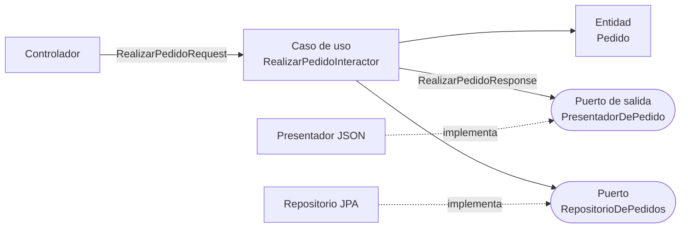

# Clean Architecture

<!-- cspell:words Christerson Ivar Jonsson Övergaard interactor -->

> **Tipo de página:** explicación. Te ayuda a entender la idea y a decidir si te conviene; no es un tutorial paso a paso.

## El problema

En 2012 había varias propuestas para proteger la lógica de negocio de la tecnología: la [arquitectura hexagonal](hexagonal.md), la *Onion Architecture* de Jeffrey Palermo, el patrón *Entity-Control-Boundary* (BCE) de Ivar Jacobson y otras. Tenían nombres, dibujos y vocabularios distintos, pero perseguían lo mismo.

Robert C. Martin propuso la *Clean Architecture* como una síntesis de todas ellas. Según él, esas arquitecturas comparten cinco propiedades: el sistema es independiente de los frameworks, de la interfaz, de la base de datos y de cualquier agente externo, y se puede probar sin ninguno de ellos.

## La idea central

Todo se resume en la **regla de dependencias**: las dependencias del código fuente solo pueden apuntar hacia adentro. Ningún nombre de un círculo externo (una clase, una función, un framework) puede aparecer en un círculo interno.

Cuanto más adentro está algo, más general y estable es: las reglas de negocio están en el centro y los detalles, como la base de datos o la web, en el borde.

## Cómo se estructura

Martin dibuja cuatro círculos concéntricos:

| Círculo (de adentro hacia afuera) | Contiene | En el dominio de pedidos |
| --- | --- | --- |
| Entidades (*Entities*) | Reglas de negocio de toda la empresa | `Pedido` y la regla "un pedido necesita al menos una línea" |
| Casos de uso (*Use Cases*) | Reglas propias de esta aplicación; coordinan a las entidades | `RealizarPedido` |
| Adaptadores de interfaz (*Interface Adapters*) | Conversión entre el formato de los casos de uso y el de afuera: controladores, presentadores, gateways | Controlador REST, presentador JSON, repositorio |
| Frameworks y drivers | Herramientas concretas, casi todo código de pegamento | Spring, JPA, la base de datos |

Dos reglas completan la estructura:

- **Cruzar un límite hacia afuera invierte la dependencia.** Cuando un caso de uso necesita llamar a algo externo, por ejemplo al presentador, define en su propio círculo una interfaz (un **puerto de salida**) y el círculo externo la implementa. Es el principio de inversión de dependencias aplicado a la arquitectura.
- **Por los límites solo pasan estructuras de datos simples.** No se pasan entidades hacia afuera ni filas de la base de datos hacia adentro, para que ningún círculo interno dependa de formatos externos.

Martin aclara que los cuatro círculos son esquemáticos: puede haber más o menos, pero la regla de dependencias siempre se cumple.



## Cuándo no usarlo

- **Aplicaciones con poca lógica de negocio.** Cuatro círculos, modelos de petición y respuesta, presentadores y puertos para un CRUD multiplican los archivos sin proteger nada.
- **Cuando el equipo aplica los círculos como plantilla de carpetas.** Si cada funcionalidad obliga a crear diez clases "porque la arquitectura lo pide", el costo supera al beneficio. Los círculos son esquemáticos; lo obligatorio es la regla de dependencias.
- **Si la [arquitectura hexagonal](hexagonal.md) ya te alcanza.** Para muchos sistemas, distinguir adentro y afuera con puertos y adaptadores da casi todo el beneficio con menos estructura.

## Qué se gana y qué se pierde

| Se gana | Se pierde |
| --- | --- |
| Reglas de negocio que se prueban sin framework, base de datos ni web | Muchas clases por caso de uso: petición, respuesta, interactor, presentador, puertos |
| Una regla simple y verificable: las dependencias apuntan hacia adentro | Conversiones de datos en cada límite |
| Postergar decisiones de tecnología hasta tener más información | Una curva de aprendizaje real, sobre todo con el presentador como puerto de salida |
| Un vocabulario común para comparar hexagonal, onion y BCE | Riesgo de seguir el dibujo de los círculos al pie de la letra en lugar de la regla |

## Confusiones frecuentes

- **"Clean Architecture y Clean Code son lo mismo."** Son libros distintos del mismo autor. *Clean Code* trata sobre el código a pequeña escala (nombres, funciones); *Clean Architecture*, sobre la estructura del sistema.
- **"Hay que tener exactamente cuatro capas."** El propio Martin dice que los círculos son esquemáticos. Lo que no se negocia es la dirección de las dependencias.
- **"Es distinta de la hexagonal."** Es una síntesis que la incluye. La diferencia está en que la *Clean Architecture* da nombre a anillos dentro de la aplicación (entidades y casos de uso) y la hexagonal no prescribe nada sobre el interior.
- **"Las entidades son las entidades de JPA."** En la *Clean Architecture*, una entidad es una regla de negocio de la empresa, independiente de cualquier framework. Una clase con `@Entity` pertenece al círculo de frameworks y drivers.
- **"El caso de uso devuelve la respuesta al controlador."** En el esquema de Martin el caso de uso entrega el resultado a un puerto de salida que implementa el presentador. Devolver la respuesta directamente es una simplificación común y válida mientras respete la regla de dependencias; en el ejemplo de esta página se usa el puerto de salida para mostrar el esquema original.

## Ejemplo

Dominio de pedidos en Java 21. Las entidades y los casos de uso no importan nada de Spring ni de JPA.

Entidad, con la regla de negocio de la empresa:

```java
public record Linea(String productoId, int cantidad) {}

public record Pedido(UUID id, String clienteId, List<Linea> lineas) {
    public Pedido {
        if (lineas.isEmpty()) {
            throw new IllegalArgumentException("Un pedido necesita al menos una línea");
        }
        lineas = List.copyOf(lineas);
    }
}
```

Caso de uso, con sus modelos de petición y respuesta (estructuras simples) y sus puertos:

```java
public record RealizarPedidoRequest(String clienteId, List<Linea> lineas) {}

public record RealizarPedidoResponse(UUID pedidoId, int cantidadDeLineas) {}

public interface RealizarPedido {
    void ejecutar(RealizarPedidoRequest request);
}

public interface PresentadorDePedido {
    void presentar(RealizarPedidoResponse response);
}

public interface RepositorioDePedidos {
    void guardar(Pedido pedido);
}

public class RealizarPedidoInteractor implements RealizarPedido {
    private final RepositorioDePedidos repositorio;
    private final PresentadorDePedido presentador;

    public RealizarPedidoInteractor(RepositorioDePedidos repositorio, PresentadorDePedido presentador) {
        this.repositorio = repositorio;
        this.presentador = presentador;
    }

    @Override
    public void ejecutar(RealizarPedidoRequest request) {
        var pedido = new Pedido(UUID.randomUUID(), request.clienteId(), request.lineas());
        repositorio.guardar(pedido);
        presentador.presentar(new RealizarPedidoResponse(pedido.id(), pedido.lineas().size()));
    }
}
```

Adaptador de interfaz: un presentador que convierte la respuesta al formato que necesita la web. El caso de uso no sabe que existe.

```java
public class PresentadorJson implements PresentadorDePedido {
    private String json;

    @Override
    public void presentar(RealizarPedidoResponse response) {
        json = "{\"id\":\"%s\",\"lineas\":%d}".formatted(response.pedidoId(), response.cantidadDeLineas());
    }

    public String json() {
        return json;
    }
}
```

El controlador de Spring y el repositorio JPA quedan en los círculos externos y se conectan igual que en el [ejemplo de la arquitectura hexagonal](hexagonal.md#ejemplo). En C# con .NET 8 la estructura es la misma: interfaces para los puertos, `record` para las peticiones y respuestas, y el contenedor de inyección de dependencias de ASP.NET Core conectando los círculos externos.

## Referencias

- Martin, R. C. (2012). *The Clean Architecture*. <https://blog.cleancoder.com/uncle-bob/2012/08/13/the-clean-architecture.html> (consultado el 2026-10-22). Fuente de las arquitecturas que sintetiza, las cinco propiedades, los cuatro círculos, la regla de dependencias, el cruce de límites con inversión de dependencias, las estructuras de datos simples y la aclaración de que los círculos son esquemáticos.
- Martin, R. C. (2017). *Clean Architecture: A Craftsman's Guide to Software Structure and Design*. Prentice Hall. ISBN 978-0-13-449416-6. Desarrollo extenso de la idea por su autor, en el capítulo "The Clean Architecture".
- Palermo, J. (2008). *The Onion Architecture: part 1*. <https://jeffreypalermo.com/2008/07/the-onion-architecture-part-1/> (consultado el 2026-10-22).
- Jacobson, I., Christerson, M., Jonsson, P. y Övergaard, G. (1992). *Object-Oriented Software Engineering: A Use Case Driven Approach*. Addison-Wesley. ISBN 0-201-54435-0. Origen del patrón *Entity-Control-Boundary*.
- Cockburn, A. (2005). *Hexagonal Architecture*. <https://alistair.cockburn.us/hexagonal-architecture/> (consultado el 2026-10-22).

Última revisión: 2026-10-22
