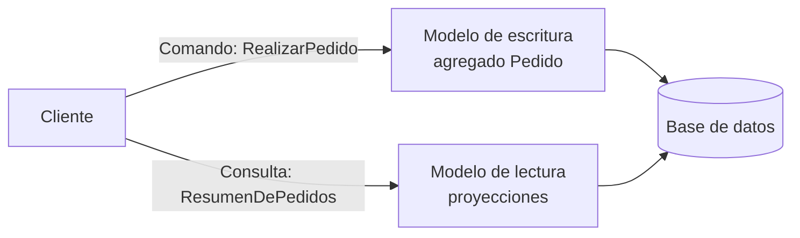

# CQRS (*Command Query Responsibility Segregation*)

<!-- cspell:words CQRS CQS Meyer DTOs paginación riesgosa Manejador manejador Jdbc jdbc LINQ -->

> **Tipo de página:** explicación. Te ayuda a entender la idea y a decidir si te conviene; no es un tutorial paso a paso.

## El problema

En muchas aplicaciones el mismo modelo sirve para escribir y para leer. La entidad `Pedido` valida las reglas al confirmar un pedido, pero también se usa para armar la pantalla "mis pedidos", que necesita el nombre del cliente, el total y la cantidad de líneas.

Con el tiempo, el modelo de escritura se deforma para servir a las lecturas. Greg Young describe los síntomas: repositorios con muchos métodos de lectura con paginación y orden, *getters* que exponen el estado interno de las entidades solo para construir DTOs, y consultas que cargan varios agregados para armar una sola respuesta.

## La idea central

**CQRS** propone usar **un modelo para modificar la información y otro modelo distinto para leerla**. Los cambios entran como **comandos** y pasan por el modelo de escritura, que protege las reglas de negocio. Las lecturas pasan por un modelo de consulta pensado para lo que cada pantalla necesita.

El nombre viene del principio **CQS** (*Command-Query Separation*) de Bertrand Meyer: cada método debería ser un comando que cambia el estado o una consulta que devuelve un resultado, pero no las dos cosas. Young cuenta que CQRS se discutió al principio como CQS aplicado a mayor escala y que con el tiempo se lo consideró un patrón distinto. CQS separa **métodos** dentro de un objeto. CQRS separa **modelos** completos.

Fowler, que conoció el patrón por Young, agrega una advertencia: para la mayoría de los sistemas, CQRS agrega una complejidad riesgosa.

## Cómo se estructura



En la versión más simple, los dos modelos comparten la misma base de datos: el lado de escritura usa entidades y el de lectura usa consultas SQL que devuelven exactamente lo que la vista necesita. Fowler lo describe así: la base de datos actúa como medio de comunicación entre los dos modelos.

Una variante más avanzada usa bases separadas, una optimizada para escribir y otra para leer, sincronizadas por eventos. Esa variante trae consistencia eventual: la pantalla puede mostrar datos de hace unos segundos.

## Cuándo no usarlo

- **Sistemas que encajan en CRUD.** Si leer y escribir usan la misma forma de los datos, dos modelos duplican trabajo sin beneficio. Fowler insiste en que el caso donde CQRS conviene es minoritario.
- **En todo el sistema a la vez.** Fowler recomienda aplicarlo solo en partes concretas (un *bounded context* en el vocabulario de DDD), no como arquitectura general.
- **Si el problema es solo una consulta lenta.** Para descargar unas pocas consultas pesadas, Fowler sugiere una base de datos de reportes (*ReportingDatabase*) antes que separar todos los modelos.
- **Si el equipo no puede convivir con consistencia eventual.** Con bases separadas, alguien va a crear un pedido y no verlo de inmediato en su lista. Si eso no es aceptable para el negocio, quédate con una sola base.

## Qué se gana y qué se pierde

| Se gana | Se pierde |
| --- | --- |
| Un modelo de escritura enfocado en reglas, sin *getters* para pantallas | Dos modelos que mantener y mantener alineados |
| Consultas optimizadas para cada vista, sin pasar por el ORM | Más código y más conceptos para el equipo |
| Escalar lecturas y escrituras por separado, si se usan bases distintas | Con bases separadas: consistencia eventual y mecanismos de sincronización |
| Repositorios con pocos métodos: guardar y buscar por identificador | Riesgo alto si se aplica a un dominio que no lo necesita |

## Confusiones frecuentes

- **"CQRS exige *Event Sourcing*, colas de mensajes y dos bases de datos."** No. Fowler menciona que los modelos pueden compartir la misma base, y Young describe la separación de lecturas como un cambio de costo bajo o nulo frente a la arquitectura original. Young sí considera que CQRS y *Event Sourcing* se complementan bien, pero son patrones distintos.
- **"CQRS es lo mismo que CQS."** CQS es una regla para métodos: un método cambia el estado o devuelve un dato. CQRS aplica la separación a modelos enteros.
- **"Los comandos nunca devuelven nada."** Esa es la regla de CQS para métodos. En una API con CQRS es habitual que crear un pedido devuelva su identificador; lo importante es que el modelo de escritura no se use para armar consultas.
- **"CQRS es una arquitectura para todo el sistema."** Fowler la recomienda solo en partes del sistema donde el beneficio compensa el costo.

## Ejemplo

Dominio de pedidos con Java 21 y Spring Boot 3, con una sola base de datos. El fragmento es ilustrativo: omite los `import` y la configuración.

El **lado de escritura** recibe un comando y usa el agregado `Pedido`, que valida las invariantes. El repositorio solo guarda y busca por identificador:

```java
record RealizarPedido(String clienteId, List<Linea> lineas) {}

@Service
class ManejadorDeRealizarPedido {
    private final RepositorioDePedidos pedidos;

    ManejadorDeRealizarPedido(RepositorioDePedidos pedidos) {
        this.pedidos = pedidos;
    }

    @Transactional
    UUID manejar(RealizarPedido comando) {
        var pedido = Pedido.nuevo(comando.clienteId(), comando.lineas());
        pedidos.guardar(pedido);
        return pedido.id();
    }
}
```

El **lado de lectura** no usa el agregado. Una consulta SQL devuelve un `record` con lo que la pantalla necesita:

```java
record ResumenDePedido(UUID id, LocalDate fecha, String estado, BigDecimal total) {}

@Service
class ConsultaDeResumenDePedidos {
    private final JdbcClient jdbc;

    ConsultaDeResumenDePedidos(JdbcClient jdbc) {
        this.jdbc = jdbc;
    }

    List<ResumenDePedido> delCliente(String clienteId) {
        return jdbc.sql("""
                SELECT id, fecha, estado, total
                FROM vista_resumen_de_pedidos
                WHERE cliente_id = :clienteId
                ORDER BY fecha DESC
                """)
                .param("clienteId", clienteId)
                .query(ResumenDePedido.class)
                .list();
    }
}
```

El agregado `Pedido` ya no necesita exponer su total ni sus líneas para la pantalla. Si la vista cambia, se cambia la consulta y no se toca el modelo que protege las reglas.

En C# con .NET 8 es común el mismo reparto: Entity Framework Core en el lado de escritura y consultas con proyección (`Select` en LINQ o Dapper) en el de lectura.

## Referencias

- Young, G. (2010). *CQRS Documents*. <https://cqrs.files.wordpress.com/2010/11/cqrs_documents.pdf> (consultado el 2026-10-27; [copia archivada](https://web.archive.org/web/20240317190715/https://cqrs.files.wordpress.com/2010/11/cqrs_documents.pdf)). Origen en CQS, diferencia entre los dos, síntomas del modelo compartido y costo de separar las lecturas (capítulo *Command and Query Responsibility Segregation*); relación con *Event Sourcing* (capítulo *CQRS and Event Sourcing*).
- Fowler, M. (2011). *CQRS*. <https://martinfowler.com/bliki/CQRS.html> (consultado el 2026-10-27; [copia archivada](https://web.archive.org/web/20261015064111/https://martinfowler.com/bliki/CQRS.html)). Definición, variantes con base compartida o separada, cuándo usarlo y advertencia sobre la complejidad.
- Fowler, M. (2005). *CommandQuerySeparation*. <https://martinfowler.com/bliki/CommandQuerySeparation.html> (consultado el 2026-10-27; [copia archivada](https://web.archive.org/web/20260905053416/https://martinfowler.com/bliki/CommandQuerySeparation.html)). Explicación del principio de Meyer y sus excepciones.
- Meyer, B. (1988). *Object-Oriented Software Construction*. Prentice Hall. Formulación original de *Command-Query Separation*.

Última revisión: 2026-10-27
