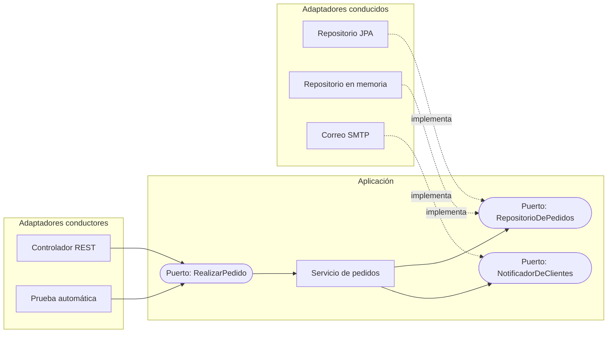

# Arquitectura hexagonal (puertos y adaptadores)

<!-- cspell:words notificador descartable indirección -->

> **Tipo de página:** explicación. Te ayuda a entender la idea y a decidir si te conviene; no es un tutorial paso a paso.

## El problema

En muchas aplicaciones la lógica de negocio termina mezclada con la interfaz y con la base de datos: un controlador que calcula descuentos, una consulta SQL que decide si un pedido es válido. Cuando eso pasa aparecen tres síntomas:

- No puedes probar una regla de negocio sin levantar la base de datos o el servidor web.
- Cambiar una tecnología (de REST a mensajería, de una base de datos a otra) obliga a tocar la lógica.
- La aplicación solo se puede usar de una manera: desde la interfaz para la que fue escrita.

Alistair Cockburn describió el patrón en 2005 con un objetivo explícito: que una aplicación pueda ser usada por igual por personas, por otros programas, por pruebas automáticas o por procesos *batch*, y que se pueda desarrollar y probar aislada de sus dispositivos y bases de datos.

## La idea central

La aplicación queda **adentro** y todo lo demás **afuera**. Lo de afuera solo se comunica con lo de adentro a través de **puertos**, y cada tecnología concreta se conecta a un puerto mediante un **adaptador**.

- Un **puerto** es una conversación con un propósito, definida por la aplicación en sus propios términos: "realizar un pedido", "guardar pedidos", "avisar al cliente". En código suele ser una interfaz.
- Un **adaptador** traduce entre una tecnología y un puerto: convierte una petición HTTP en una llamada a "realizar un pedido", o convierte "guardar pedidos" en sentencias SQL. Un mismo puerto suele tener varios adaptadores, por ejemplo uno real y uno en memoria para las pruebas.

La única división que importa es adentro/afuera, no arriba/abajo. Cockburn la propuso precisamente para alejarse del dibujo unidimensional de capas, en el que la lógica tiende a filtrarse entre niveles.

## Cómo se estructura

Hay dos lados, según quién inicia la conversación:

| Lado | Quién inicia | Ejemplos de adaptadores |
| --- | --- | --- |
| Conductor (*driving*) o primario | El actor externo llama a la aplicación | Controlador REST, línea de comandos, pruebas automáticas |
| Conducido (*driven*) o secundario | La aplicación llama al actor externo | Repositorio JPA, cliente de correo, productor de mensajes |

Cockburn usa "primario" y "secundario", tomados de los actores de los casos de uso, y señala que también se pueden llamar adaptadores *driving* y *driven*.

La regla de dependencias es una sola: **los adaptadores dependen de los puertos; la aplicación no conoce a ningún adaptador**. Algún componente de arranque crea los adaptadores y se los entrega a la aplicación; en Spring Boot ese papel lo cumple el contenedor de inyección de dependencias.



## Cuándo no usarlo

- **CRUD sin reglas de negocio.** Si la aplicación solo lee y escribe tablas, los puertos son una capa de traducción que no protege nada.
- **Prototipos y código descartable.** La inversión se paga a mediano plazo; si el código vive dos semanas, no se recupera.
- **Un único adaptador por puerto, para siempre, y sin pruebas que lo sustituyan.** Parte del valor está en poder enchufar otro adaptador. Si nunca va a existir, queda solo el costo de la indirección.
- **Un equipo que todavía no domina la inyección de dependencias.** El patrón se apoya en ella; sin esa base, se convierte en interfaces vacías que nadie entiende.

## Qué se gana y qué se pierde

| Se gana | Se pierde |
| --- | --- |
| Probar la lógica sin base de datos ni servidor, con adaptadores en memoria | Más tipos e interfaces que leer y mantener |
| Cambiar una tecnología tocando solo su adaptador | Conversiones entre los objetos de la aplicación y los de cada tecnología |
| Varias formas de usar la misma aplicación (REST, mensajería, CLI) | Decisiones extra: qué es un puerto, de qué tamaño, dónde vive |
| La lógica de negocio queda visible en un solo lugar | Más pasos para seguir una petición de punta a punta |

## Confusiones frecuentes

- **"El hexágono tiene que tener seis lados."** No. Cockburn aclara que la forma no es un hexágono porque el número seis importe: solo deja espacio para dibujar varios puertos. En la práctica recomienda pocos, entre dos y cuatro.
- **"Es lo mismo que capas."** En capas la dependencia va de arriba hacia abajo, y la capa de negocio suele depender de la de datos. Aquí la aplicación define el puerto de persistencia y el adaptador de datos depende de ella: la dependencia se invierte.
- **"Todo `interface` es un puerto."** Un puerto nace de un propósito de la aplicación ("guardar pedidos"), no de una tecnología ("`JpaRepository` de pedidos"). Si el nombre del puerto menciona la tecnología, es un adaptador disfrazado.
- **"Exige usar DDD."** El patrón no dice nada sobre cómo organizar el interior de la aplicación. Se combina bien con *Domain-Driven Design*, pero no lo requiere.
- **Hexagonal, onion y clean.** Comparten la idea de proteger la lógica y dirigir las dependencias hacia adentro. Jeffrey Palermo presentó la *Onion Architecture* en 2008 citando la hexagonal como antecedente, y Robert C. Martin la nombra en 2012 entre las arquitecturas que unifica la *Clean Architecture*. La diferencia es de énfasis: hexagonal solo distingue adentro y afuera; onion y clean además proponen anillos con nombre dentro de la aplicación.

## Ejemplo

Dominio de pedidos en Java 21. El núcleo no importa nada de Spring ni de JPA.

Los puertos, definidos por la aplicación:

```java
// Puerto conductor: lo que la aplicación ofrece.
public interface RealizarPedido {
    Pedido realizar(String clienteId, List<Linea> lineas);
}

// Puertos conducidos: lo que la aplicación necesita del exterior.
public interface RepositorioDePedidos {
    void guardar(Pedido pedido);
}

public interface NotificadorDeClientes {
    void pedidoConfirmado(Pedido pedido);
}
```

La aplicación implementa el puerto conductor y usa los conducidos, sin saber qué tecnología hay detrás:

```java
public record Linea(String productoId, int cantidad) {}

public record Pedido(UUID id, String clienteId, List<Linea> lineas) {
    public Pedido {
        if (lineas.isEmpty()) {
            throw new IllegalArgumentException("Un pedido necesita al menos una línea");
        }
        lineas = List.copyOf(lineas);
    }
}

public class ServicioDePedidos implements RealizarPedido {
    private final RepositorioDePedidos repositorio;
    private final NotificadorDeClientes notificador;

    public ServicioDePedidos(RepositorioDePedidos repositorio, NotificadorDeClientes notificador) {
        this.repositorio = repositorio;
        this.notificador = notificador;
    }

    @Override
    public Pedido realizar(String clienteId, List<Linea> lineas) {
        var pedido = new Pedido(UUID.randomUUID(), clienteId, lineas);
        repositorio.guardar(pedido);
        notificador.pedidoConfirmado(pedido);
        return pedido;
    }
}
```

Un adaptador conducido en memoria basta para probar la regla sin base de datos:

```java
public class RepositorioDePedidosEnMemoria implements RepositorioDePedidos {
    private final Map<UUID, Pedido> pedidos = new HashMap<>();

    @Override
    public void guardar(Pedido pedido) {
        pedidos.put(pedido.id(), pedido);
    }

    public int cantidad() {
        return pedidos.size();
    }
}
```

Un adaptador conductor REST traduce HTTP al puerto. Este fragmento es ilustrativo: omite los `import` de Spring y la configuración.

```java
@RestController
@RequestMapping("/pedidos")
class PedidoController {
    private final RealizarPedido realizarPedido;

    PedidoController(RealizarPedido realizarPedido) {
        this.realizarPedido = realizarPedido;
    }

    @PostMapping
    ResponseEntity<UUID> crear(@RequestBody PedidoRequest request) {
        var pedido = realizarPedido.realizar(request.clienteId(), request.lineas());
        return ResponseEntity.status(HttpStatus.CREATED).body(pedido.id());
    }
}
```

En C# con .NET 8 la estructura es la misma: los puertos son `interface`, el servicio los recibe por constructor y el contenedor de `Microsoft.Extensions.DependencyInjection` conecta los adaptadores.

## Referencias

- Cockburn, A. (2005). *Hexagonal Architecture* (HaT Technical Report 2005.02). https://alistair.cockburn.us/hexagonal-architecture/ (consultado el 2026-10-22; [copia archivada](https://web.archive.org/web/20261014214454/https://alistair.cockburn.us/hexagonal-architecture)). Fuente del objetivo del patrón, de la definición de puerto como conversación con propósito, de los nombres de los lados y de la aclaración sobre el número seis.
- Cockburn, A. y Garrido de Paz, J. M. (2024). *Hexagonal Architecture Explained*. Humans and Technology. ISBN 978-1-7375197-8-2. Desarrollo extenso del patrón por su autor, con código y preguntas frecuentes.
- Palermo, J. (2008). *The Onion Architecture: part 1*. https://jeffreypalermo.com/2008/07/the-onion-architecture-part-1/ (consultado el 2026-10-22). Cita la arquitectura hexagonal como antecedente.
- Martin, R. C. (2012). *The Clean Architecture*. https://blog.cleancoder.com/uncle-bob/2012/08/13/the-clean-architecture.html (consultado el 2026-10-22). Nombra la hexagonal entre las arquitecturas que unifica y enuncia la regla de dependencias.

Última revisión: 2026-10-22
