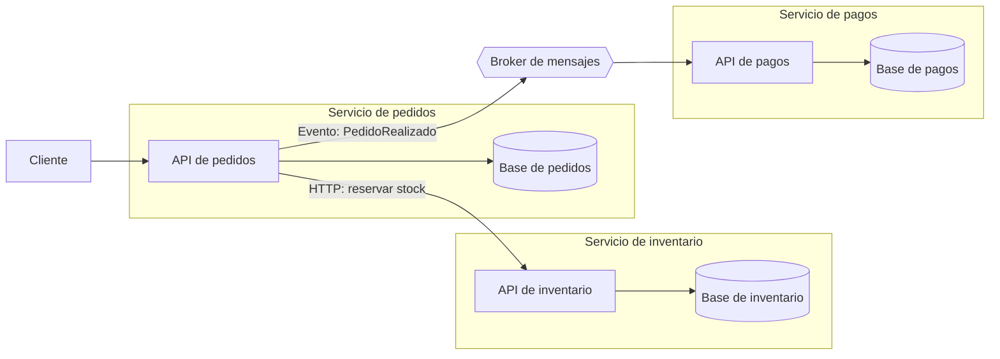

# Microservicios

<!-- cspell:words Newman microservicio Datamation síncrona observabilidad desplegarlos modularidad -->

> **Tipo de página:** explicación. Te ayuda a entender la idea y a decidir si te conviene; no es un tutorial paso a paso.

## El problema

Una aplicación grande que se despliega como una sola pieza obliga a coordinar a todos los equipos para cada versión. Un cambio pequeño en pagos espera a que pedidos e inventario estén listos, y si una parte necesita más capacidad hay que escalar la aplicación entera.

Cuando además las fronteras internas se desdibujan, cualquier cambio toca código de varios equipos. Los microservicios aparecieron como respuesta a ese tipo de sistemas: grandes, con muchos equipos y con partes que cambian a ritmos distintos.

## La idea central

James Lewis y Martin Fowler describieron en 2014 el estilo de **microservicios** como construir una aplicación a partir de un conjunto de **servicios pequeños que se despliegan de forma independiente**, cada uno en su propio proceso, comunicados por mecanismos livianos como HTTP o mensajería.

No dieron una definición formal, sino un conjunto de características comunes. Las que más pesan en el diseño son tres:

- **Organizados alrededor de capacidades de negocio.** Un servicio es "pedidos" o "pagos", no "la capa de base de datos". Lewis y Fowler lo relacionan con la ley de Conway: el diseño de un sistema tiende a copiar la estructura de comunicación de la organización que lo construye.
- **Gestión de datos descentralizada.** Cada servicio administra su propia base de datos. Ningún otro servicio lee ni escribe sus tablas.
- **Diseño para el fallo.** Como cada llamada cruza la red, cualquier servicio puede no responder, y el resto del sistema tiene que tolerarlo.

La palabra clave es **independiente**: si no puedes cambiar y desplegar un servicio sin coordinar con los demás, no obtienes el beneficio principal del estilo.

## Cómo se estructura

Cada servicio es dueño de un área del negocio y de sus datos. Se comunica con los demás solo a través de su API pública (síncrona, como HTTP) o publicando eventos (asíncrona, a través de un *broker* de mensajes).



Al separar los datos se pierde la transacción única. Lewis y Fowler señalan que los microservicios prefieren coordinar sin transacciones distribuidas, aceptan que la consistencia entre servicios sea **eventual** y corrigen los problemas con **operaciones compensatorias**. Esa es la decisión que más cambia la forma de programar.

## Cuándo no usarlo

- **Cuando el sistema todavía no es complejo.** Fowler habla de una *prima* (*Microservice Premium*): los microservicios agregan costos propios, como despliegue automatizado, monitoreo, manejo de fallos y consistencia eventual. Su recomendación es no considerarlos salvo que el sistema sea demasiado complejo para manejarlo como monolito.
- **Cuando todavía no conoces las fronteras del dominio.** Mover una frontera entre módulos es refactorizar paquetes. Moverla entre servicios es cambiar contratos de red y migrar datos. Un [monolito modular](monolito-modular.md) permite descubrir esas fronteras a menor costo.
- **Equipos pequeños.** Si un solo equipo mantiene todo, la independencia de despliegue aporta poco y la carga operativa es la misma.
- **Sin automatización de despliegue ni observabilidad.** Con diez servicios, desplegar a mano o diagnosticar un error sin trazas distribuidas es inmanejable.

## Qué se gana y qué se pierde

| Se gana | Se pierde |
| --- | --- |
| Desplegar un servicio sin coordinar con los demás | Transacciones ACID entre áreas del negocio |
| Escalar solo el servicio que lo necesita | Llamadas en memoria: cada interacción puede fallar o tardar |
| Equipos con autonomía sobre su servicio, sus datos y su tecnología | Simplicidad operativa: más procesos que desplegar, monitorear y versionar |
| Un fallo puede quedar aislado en un servicio, si el resto está diseñado para tolerarlo | Consultas que cruzan áreas: ya no hay un `JOIN` entre pedidos y pagos |

## Confusiones frecuentes

- **"Tener muchos repositorios de Spring Boot que comparten la misma base de datos es tener microservicios."** Si dos servicios leen y escriben las mismas tablas, un cambio de esquema obliga a desplegarlos juntos. Tienes los costos de la red sin la independencia. A ese resultado se le suele llamar *monolito distribuido*.
- **"Micro significa pocas líneas de código."** El tamaño no define el estilo. Fowler cuenta que vio desde un equipo de 60 personas con 20 servicios hasta uno de 4 personas con 200. Lo que importa es que cada servicio se pueda desplegar solo y sea dueño de su parte del negocio.
- **"Los microservicios son la evolución natural de todo monolito."** Fowler sostiene lo contrario: la mayoría de los sistemas deberían construirse como un único monolito con buena modularidad interna.
- **"Microservicios resuelve el código desordenado."** Si el diseño interno está acoplado, separarlo en procesos traslada ese acoplamiento a la red, donde es más caro de cambiar.

## Ejemplo

Dominio de pedidos con Java 21 y Spring Boot 3. El fragmento es ilustrativo: omite los `import`, la configuración y el manejo completo de errores.

El servicio de pedidos guarda en **su** base de datos y le pide stock al servicio de inventario por HTTP. No conoce sus tablas, solo su API:

```java
@Service
class ServicioDePedidos {
    private final PedidoRepository pedidos;   // Tablas propias del servicio de pedidos.
    private final RestClient inventario;      // API pública del servicio de inventario.

    ServicioDePedidos(PedidoRepository pedidos, RestClient.Builder builder) {
        this.pedidos = pedidos;
        this.inventario = builder.baseUrl("http://inventario").build();
    }

    Pedido realizar(String clienteId, List<Linea> lineas) {
        var pedido = pedidos.save(Pedido.pendiente(clienteId, lineas));
        try {
            inventario.post()
                    .uri("/reservas")
                    .body(new SolicitudDeReserva(pedido.id(), lineas))
                    .retrieve()
                    .toBodilessEntity();
            pedido.confirmar();
        } catch (RestClientException e) {
            // No hay transacción compartida: si inventario no responde,
            // este servicio decide qué hacer con su propio estado.
            pedido.rechazar("Inventario no disponible");
        }
        return pedidos.save(pedido);
    }
}
```

Compara con lo que pasa en un monolito: ahí `realizar` podía descontar el stock y guardar el pedido en una sola transacción. Aquí el pedido pasa por un estado intermedio (`PENDIENTE`) y el código tiene que decidir qué hacer si la otra parte falla. El fragmento omite un caso real: inventario puede haber reservado el stock aunque la respuesta no llegue, y entonces hace falta una operación que libere esa reserva.

En C# con .NET 8 la estructura es la misma, con `HttpClient` registrado por `IHttpClientFactory` en lugar de `RestClient`.

## Referencias

- Lewis, J. y Fowler, M. (2014). *Microservices: a definition of this new architectural term*. <https://martinfowler.com/articles/microservices.html> (consultado el 2026-10-27; [copia archivada](https://web.archive.org/web/20261017184146/https://martinfowler.com/articles/microservices.html)). Características del estilo, organización por capacidades de negocio, gestión de datos descentralizada y coordinación sin transacciones con operaciones compensatorias.
- Fowler, M. (2015). *MicroservicePremium*. <https://martinfowler.com/bliki/MicroservicePremium.html> (consultado el 2026-10-27; [copia archivada](https://web.archive.org/web/20261025012135/https://martinfowler.com/bliki/MicroservicePremium.html)). Costos propios del estilo, recomendación de no usarlo salvo en sistemas demasiado complejos para un monolito y variación del tamaño de los servicios.
- Fowler, M. (2015). *MonolithFirst*. <https://martinfowler.com/bliki/MonolithFirst.html> (consultado el 2026-10-27; [copia archivada](https://web.archive.org/web/20261019143622/https://martinfowler.com/bliki/MonolithFirst.html)). Empezar por un monolito para descubrir las fronteras.
- Conway, M. E. (1968). How Do Committees Invent? *Datamation*, 14, 28-31 (abril de 1968). <https://www.melconway.com/Home/Committees_Paper.html> (consultado el 2026-10-27; [copia archivada](https://web.archive.org/web/20261007125004/https://www.melconway.com/Home/Committees_Paper.html)). Tesis de que los sistemas copian la estructura de comunicación de la organización que los diseña.
- Newman, S. (2021). *Building Microservices: Designing Fine-Grained Systems* (2.ª ed.). O'Reilly Media. ISBN 978-1-492-03402-5. Desarrollo extenso del estilo.

Última revisión: 2026-10-27
