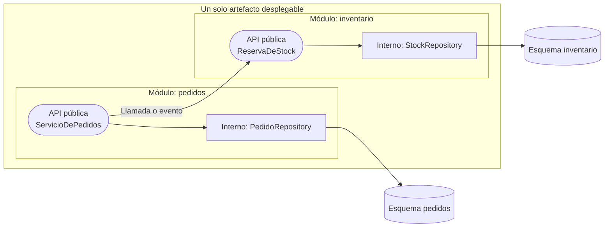

# Monolito modular

<!-- cspell:words ArchUnit Drotbohm Modulith Newman NetArchTest empaquetarlos Manejador microservicio modularizado Modulos refactorizar -->

> **Tipo de página:** explicación. Te ayuda a entender la idea y a decidir si te conviene; no es un tutorial paso a paso.

## El problema

Cuando un sistema crece como una sola aplicación desplegable, las fronteras entre conceptos de negocio suelen desdibujarse: el código de pedidos consulta las tablas de inventario, el de pagos instancia clases internas de clientes y todo termina dependiendo de todo. A ese resultado se le llama *gran bola de lodo* (*Big Ball of Mud*).

Para escapar de ese desorden, muchos equipos saltan a una arquitectura de microservicios antes de tiempo. El resultado frecuente es cambiar un problema de organización de código por los costos de un sistema distribuido: fallos de red, transacciones partidas, despliegues coordinados y mayor carga operativa.

## La idea central

Un **monolito modular** es una aplicación que **se despliega como una sola unidad** (un único proceso o artefacto), pero cuyo código y datos están divididos internamente en **módulos independientes por dominio de negocio**, con límites estrictos que el compilador o las pruebas automáticas hacen cumplir.

Combina la simplicidad operativa de un monolito (una sola aplicación que levantar, llamadas en memoria, transacciones locales) con el aislamiento de responsabilidades que suelen buscarse en los microservicios. Sam Newman lo presenta como una opción razonable para muchas organizaciones y como base desde la cual extraer servicios si algún día hace falta; Martin Fowler recomienda empezar por un monolito y descubrir sus fronteras antes de distribuirlo.

## Cómo se estructura

En lugar de dividir la raíz del proyecto por capas técnicas (`controller/`, `service/`, `repository/`), el primer nivel se divide por **módulos de negocio** (`pedidos/`, `inventario/`, `pagos/`).

Cada módulo sigue tres reglas:

1. **Tiene una interfaz pública explícita (API del módulo) y oculta sus detalles internos.** Las entidades de persistencia, los repositorios y las clases auxiliares son privados del módulo; el resto del sistema no puede importarlos.
2. **Es dueño exclusivo de sus tablas.** El módulo de `pedidos` no hace un `JOIN` en SQL contra las tablas de `inventario`. Si necesita datos de otro módulo, se los pide a través de su interfaz pública o reacciona a eventos publicados en memoria.
3. **Dentro de cada módulo se elige la arquitectura que convenga.** Un módulo complejo puede usar [arquitectura hexagonal](hexagonal.md) y otro módulo sencillo puede usar [arquitectura en capas](capas.md).



## Cuándo no usarlo

- **Cuando distintos módulos necesitan escalar o desplegarse con frecuencias incompatibles.** Si el módulo de catálogo recibe cien veces más tráfico que el resto o requiere hardware especializado (como GPU), empaquetarlos juntos obliga a escalar todo el proceso.
- **Equipos grandes que necesitan autonomía total de tecnología o de ciclo de entrega.** Como hay un único artefacto final, todos los módulos comparten el lenguaje, la versión del runtime y el momento del despliegue.
- **Aplicaciones muy pequeñas de un solo dominio.** Si el sistema solo gestiona pedidos y cabe en un puñado de clases, separar módulos con contratos intermedios y pruebas de arquitectura es ceremonia innecesaria.
- **Si el equipo no automatiza la verificación de los límites.** Sin una herramienta que rompa el *build* cuando alguien importa una clase interna de otro módulo, el monolito modular se degrada con el tiempo hacia un monolito acoplado.

## Qué se gana y qué se pierde

| Se gana | Se pierde |
| --- | --- |
| Un solo artefacto para compilar, probar, desplegar y monitorear | Todos los módulos se despliegan juntos y comparten proceso |
| Refactorizar fronteras entre módulos es cambiar paquetes en el IDE, no contratos de red | Un fallo grave de memoria o CPU en un módulo afecta a todo el proceso |
| Llamadas en memoria y transacciones de base de datos sin latencia de red | No puedes consultar con un `JOIN` directo las tablas que pertenecen a otro módulo |
| Si más adelante hace falta extraer un microservicio, los límites de código y datos ya existen | Exige disciplina y herramientas (como Spring Modulith o ArchUnit) para que los límites no se rompan |

## Confusiones frecuentes

- **"Monolito significa código espagueti o legado."** *Monolito* describe la unidad de despliegue (un solo proceso), no la calidad del diseño interno. Un sistema puede ser un monolito bien modularizado o un conjunto de microservicios acoplados (*monolito distribuido*).
- **"Basta con crear carpetas por módulo para tener un monolito modular."** Si en Java pones `public` en todas las clases y `pedidos` importa el `StockJpaRepository` de `inventario`, tienes carpetas por módulo pero las dependencias siguen cruzadas.
- **"Cada módulo necesita su propio servidor de base de datos."** No hace falta. Basta con un aislamiento lógico (esquemas separados o prefijos de tablas en la misma base de datos) y la regla verificada de que ningún módulo acceda a las tablas de otro.
- **"Es incompatible con hexagonal o Clean Architecture."** Operan a escalas distintas: el monolito modular define cómo se divide el sistema en módulos de negocio; [capas](capas.md), [hexagonal](hexagonal.md) o [Clean Architecture](clean-architecture.md) definen cómo se organiza cada módulo por dentro.

## Ejemplo

Dominio de pedidos e inventario con Java 21, Spring Boot 3 y Spring Modulith. El fragmento es ilustrativo: omite los `import` y la configuración.

En el módulo `pedidos`, solo el servicio y el evento son públicos (`public`). El repositorio y las entidades internas tienen visibilidad de paquete (sin modificador `public`), por lo que Java impide usarlos desde fuera del paquete `com.tienda.pedidos`:

```java
package com.tienda.pedidos;

// Parte de la API pública del módulo: otros módulos pueden escuchar este evento.
public record PedidoRealizado(UUID pedidoId, List<Linea> lineas) {
    public record Linea(String productoId, int cantidad) {}
}

// Interno al módulo (visibilidad de paquete): invisible para inventario o pagos.
interface PedidoRepository extends JpaRepository<PedidoEntity, UUID> {}

@Service
public class ServicioDePedidos {
    private final PedidoRepository repositorio;
    private final ApplicationEventPublisher eventos;

    ServicioDePedidos(PedidoRepository repositorio, ApplicationEventPublisher eventos) {
        this.repositorio = repositorio;
        this.eventos = eventos;
    }

    @Transactional
    public UUID realizar(String clienteId, List<PedidoRealizado.Linea> lineas) {
        if (lineas.isEmpty()) {
            throw new IllegalArgumentException("Un pedido necesita al menos una línea");
        }
        var id = UUID.randomUUID();
        repositorio.save(new PedidoEntity(id, clienteId, lineas.size()));
        eventos.publishEvent(new PedidoRealizado(id, lineas));
        return id;
    }
}
```

El módulo `inventario` reacciona al evento público `PedidoRealizado` sin conocer las clases internas ni las tablas de `pedidos`:

```java
package com.tienda.inventario;

import com.tienda.pedidos.PedidoRealizado;

@Service
class ManejadorDeStock {
    private final StockRepository stockRepository;

    ManejadorDeStock(StockRepository stockRepository) {
        this.stockRepository = stockRepository;
    }

    @ApplicationModuleListener
    void alRealizarPedido(PedidoRealizado evento) {
        evento.lineas().forEach(l -> stockRepository.descontar(l.productoId(), l.cantidad()));
    }
}
```

Para evitar que alguien rompa el aislamiento en el futuro, una prueba automática verifica la estructura de módulos en cada *pull request*:

```java
class ArquitecturaModularTest {
    @Test
    void verificaLimitesDeModulos() {
        ApplicationModules.of(TiendaApplication.class).verify();
    }
}
```

En C# con .NET 8 se aplica el mismo principio: cada módulo puede ser un proyecto separado en la solución (con sus clases internas marcadas como `internal` y solo los contratos como `public`) o verificarse con una biblioteca de pruebas de arquitectura como NetArchTest.

## Referencias

- Newman, S. (2019). *Monolith to Microservices: Evolutionary Patterns to Transform Your Monolith*. O'Reilly Media, cap. 1 ("Just Enough Microservices", sección *The Modular Monolith*). ISBN 978-1-492-04784-1. Definición del monolito modular, aislamiento de datos por módulo y comparación con microservicios.
- Fowler, M. (2015). *MonolithFirst*. <https://martinfowler.com/bliki/MonolithFirst.html> (consultado el 2026-10-24; [copia archivada](https://web.archive.org/web/20261019143622/https://martinfowler.com/bliki/MonolithFirst.html)). Argumento sobre diseñar fronteras de módulos dentro de un monolito antes de considerar microservicios.
- Brown, S. (2017). The Missing Chapter. En R. C. Martin, *Clean Architecture: A Craftsman's Guide to Software Structure and Design*. Prentice Hall, cap. 34. ISBN 978-0-13-449416-6. Organización del código por componentes de negocio con visibilidad restringida (*package by component*) en lugar de carpetas por capa técnica.
- Drotbohm, O. y colaboradores (s. f.). *Spring Modulith Reference Documentation*. <https://docs.spring.io/spring-modulith/reference/fundamentals.html> (consultado el 2026-10-24; [copia archivada](https://web.archive.org/web/20261014132219/https://docs.spring.io/spring-modulith/reference/fundamentals.html)). Verificación automática de módulos e interacción por eventos de aplicación en Spring Boot 3.

Última revisión: 2026-10-24
