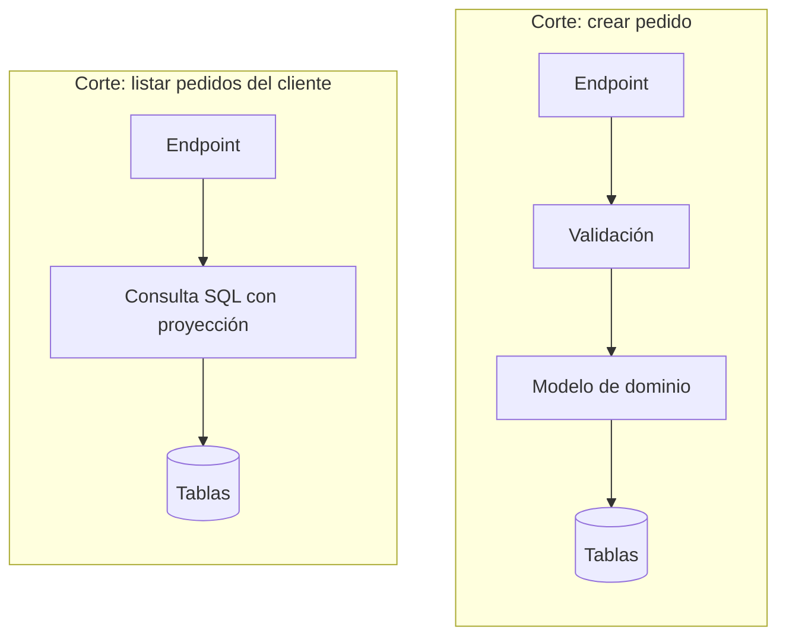

# Arquitectura por cortes verticales (*vertical slice*)

<!-- cspell:words Bogard Parnas listardelcliente maximizarlo reimplementa refactorizarla refactoriza MediatR Jdbc jdbc manejador -->

> **Tipo de página:** explicación. Te ayuda a entender la idea y a decidir si te conviene; no es un tutorial paso a paso.

## El problema

En una arquitectura en [capas](capas.md), [hexagonal](hexagonal.md) o [clean](clean-architecture.md), agregar una función suele obligar a tocar un archivo en cada capa: el controlador, el servicio, el repositorio, el DTO y el *mapper*. El cambio es uno solo, pero queda repartido en carpetas lejanas entre sí.

Además, la regla se aplica igual a todo el sistema. Una consulta que solo lista pedidos pasa por el mismo servicio, el mismo repositorio y las mismas entidades que la operación que valida reglas de negocio complejas, aunque no las necesite.

## La idea central

Jimmy Bogard propuso en 2018 organizar el código alrededor de **cada petición** (*request*) en lugar de alrededor de capas técnicas. Cada **corte vertical** (*slice*) agrupa todo lo que necesita un caso de uso, desde la entrada hasta la base de datos.

Su regla es **minimizar el acoplamiento entre cortes y maximizarlo dentro de cada corte**. Como un cambio en una función suele tocar la interfaz, la validación y los datos a la vez, conviene que esas piezas vivan juntas.

La segunda consecuencia es que **cada corte decide cómo resolver su caso**. Uno puede ser un *Transaction Script* de diez líneas y otro puede usar un modelo de dominio rico. No hace falta que todo el sistema elija un único patrón de lógica de dominio.

La idea de fondo es más antigua. En 1972 David Parnas propuso dividir un sistema en módulos según las decisiones de diseño que cada uno oculta, no según los pasos del procesamiento. Los cortes verticales aplican ese criterio a nivel de caso de uso.

## Cómo se estructura

El primer nivel de carpetas son las funciones del sistema, no las capas:

```text
pedidos/
├── crear/
│   ├── CrearPedidoController.java
│   ├── CrearPedidoCommand.java
│   └── CrearPedidoHandler.java
├── cancelar/
│   └── ...
└── listardelcliente/
    ├── ListarPedidosDelClienteController.java
    └── ListarPedidosDelClienteQuery.java
```



Bogard señala que separar por petición entrega una división entre comandos y consultas desde el inicio, porque cada corte es una cosa o la otra. Por eso el estilo suele aparecer junto a [CQRS](cqrs.md).

## Cuándo no usarlo

- **Equipos que no practican refactorización.** Bogard lo advierte: el estilo supone que el equipo reconoce los *code smells* y sabe cuándo mover lógica repetida al dominio. Sin esa disciplina, cada corte reimplementa las mismas reglas.
- **Dominios con muchas reglas compartidas entre casos de uso.** Si casi todas las operaciones necesitan las mismas invariantes del agregado `Pedido`, ese modelo compartido existe igual y la ventaja se reduce.
- **Cuando el equipo necesita una estructura uniforme para orientarse.** Que cada corte resuelva su caso a su manera es flexible, pero también hace que el código se vea distinto de un corte a otro.

## Qué se gana y qué se pierde

| Se gana | Se pierde |
| --- | --- |
| Un cambio en una función queda en una sola carpeta | Una estructura uniforme que se lee igual en todo el sistema |
| Las funciones nuevas agregan código sin tocar código compartido | Reutilización automática: hay que detectar la duplicación y refactorizarla a mano |
| Cada caso usa el nivel de abstracción que necesita | Reglas claras sobre dónde poner cada cosa, que hay que reemplazar con criterio |
| Menos interfaces y capas que existen solo por la regla | Riesgo de que dos cortes implementen distinto la misma regla de negocio |

## Confusiones frecuentes

- **"Todos los casos de uso tienen que seguir las mismas capas y abstracciones."** Es justo lo que este estilo discute. Una consulta de solo lectura no necesita pasar por el agregado `Pedido` ni por un repositorio genérico si una consulta SQL con proyección resuelve el caso.
- **"Vertical slice prohíbe el código compartido."** No lo prohíbe: pide mantenerlo al mínimo y que aparezca por refactorización, cuando la duplicación muestra una regla real. El modelo de dominio puede seguir existiendo y ser usado por los cortes que lo necesitan.
- **"Exige MediatR."** Bogard creó la biblioteca MediatR y muchos ejemplos del estilo la usan, pero el estilo es una forma de organizar el código, no una dependencia. En Java alcanza con un controlador y una clase por caso de uso.
- **"Es lo opuesto a hexagonal o clean."** Bogard lo presenta como alternativa a esas estructuras aplicadas de forma uniforme. Dentro de un corte complejo puedes seguir aislando el dominio de la infraestructura.

## Ejemplo

Dominio de pedidos con Java 21 y Spring Boot 3. El fragmento es ilustrativo: omite los `import` y la configuración.

El corte **crear pedido** valida y usa el modelo de dominio, porque ahí están las reglas de negocio:

```java
package com.tienda.pedidos.crear;

record CrearPedidoCommand(String clienteId, List<Linea> lineas) {}

@RestController
class CrearPedidoController {
    private final PedidoRepository pedidos;

    CrearPedidoController(PedidoRepository pedidos) {
        this.pedidos = pedidos;
    }

    @PostMapping("/pedidos")
    @Transactional
    ResponseEntity<UUID> crear(@RequestBody CrearPedidoCommand comando) {
        var pedido = Pedido.nuevo(comando.clienteId(), comando.lineas()); // Invariantes del dominio.
        pedidos.save(pedido);
        return ResponseEntity.status(HttpStatus.CREATED).body(pedido.id());
    }
}
```

El corte **listar pedidos del cliente** no pasa por el agregado. Lee directamente lo que la pantalla necesita:

```java
package com.tienda.pedidos.listardelcliente;

record ResumenDePedido(UUID id, LocalDate fecha, int cantidadDeLineas, BigDecimal total) {}

@RestController
class ListarPedidosDelClienteController {
    private final JdbcClient jdbc;

    ListarPedidosDelClienteController(JdbcClient jdbc) {
        this.jdbc = jdbc;
    }

    @GetMapping("/clientes/{clienteId}/pedidos")
    List<ResumenDePedido> listar(@PathVariable String clienteId) {
        return jdbc.sql("""
                SELECT p.id, p.fecha, COUNT(l.id) AS cantidad_de_lineas, SUM(l.subtotal) AS total
                FROM pedidos p JOIN lineas_de_pedido l ON l.pedido_id = p.id
                WHERE p.cliente_id = :clienteId
                GROUP BY p.id, p.fecha
                ORDER BY p.fecha DESC
                """)
                .param("clienteId", clienteId)
                .query(ResumenDePedido.class)
                .list();
    }
}
```

Si mañana cambia el listado, solo se toca la carpeta `listardelcliente`. Si la regla para crear pedidos crece, se refactoriza dentro de `Pedido` sin afectar al listado.

En C# con .NET 8 es habitual una carpeta por función, con un *endpoint* de Minimal APIs y su manejador en el mismo archivo o en archivos vecinos.

## Referencias

- Bogard, J. (2018). *Vertical Slice Architecture*. <https://www.jimmybogard.com/vertical-slice-architecture/> (consultado el 2026-10-27; [copia archivada](https://web.archive.org/web/20260926081427/https://www.jimmybogard.com/vertical-slice-architecture/)). Definición del estilo, regla de acoplamiento entre cortes y dentro de ellos, relación con CQRS y advertencia sobre equipos sin práctica de refactorización.
- Parnas, D. L. (1972). On the Criteria To Be Used in Decomposing Systems into Modules. *Communications of the ACM*, 15(12), 1053-1058. <https://doi.org/10.1145/361598.361623>. Descomposición en módulos según las decisiones que ocultan y no según los pasos del procesamiento.
- Fowler, M. (2002). *Patterns of Enterprise Application Architecture*. Addison-Wesley. ISBN 978-0-321-12742-6. Patrones de lógica de dominio (*Transaction Script*, *Domain Model*) entre los que cada corte puede elegir.

Última revisión: 2026-10-27
