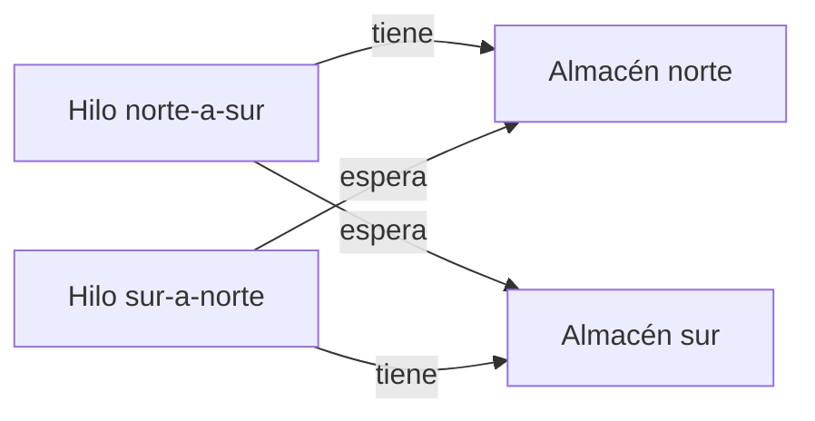

# Bloqueos y deadlocks

<!-- cspell:words Coffman Elphick Shoshani deadlock deadlocks ReentrantLock tryLock Almacen almacen javac Ingenuo Ordenado Limite findDeadlockedThreads sincronizadores serializa Goetz -->

> **Tipo de página:** explicación. Te ayuda a entender por qué dos operaciones correctas por separado pueden quedarse esperándose para siempre y qué opciones hay para evitarlo; no es una guía de una biblioteca concreta.

## El problema

Dos transferencias de stock entre almacenes se ejecutan a la vez. Una mueve unidades del almacén norte al sur y otra del sur al norte. Cada una bloquea primero el almacén de origen y después el de destino, para que nadie más lo toque mientras mueve las unidades. La primera bloquea el norte y pide el sur. La segunda bloquea el sur y pide el norte. Ninguna puede avanzar, porque cada una espera algo que la otra no soltará hasta terminar. Eso es un **deadlock** (bloqueo mutuo): el programa no falla, no lanza ninguna excepción, simplemente se queda parado.

Es el costo de la solución de la [página anterior](condiciones-de-carrera-y-memoria-compartida.md): proteger datos con candados evita las carreras, pero varios candados a la vez abren este otro problema.

## La idea central

Coffman, Elphick y Shoshani (1971) describen cuatro condiciones que tienen que cumplirse a la vez para que exista un bloqueo mutuo:

1. **Exclusión mutua.** Las tareas reclaman control exclusivo de los recursos que necesitan.
2. **Retener y esperar.** Las tareas conservan los recursos que ya tienen mientras esperan otros adicionales.
3. **Sin expropiación.** Los recursos no se pueden quitar a la fuerza a quien los tiene hasta que este termina de usarlos.
4. **Espera circular.** Existe una cadena cerrada de tareas en la que cada una tiene recursos que pide la siguiente.

El artículo las presenta como condiciones necesarias, y plantea la prevención como romper al menos una de ellas en todo momento. Dice que la primera no se puede negar para todos los recursos (un archivo no puede compartirse mientras alguien lo actualiza) y describe tres formas de negar las otras tres:

- **Pedir todo de una vez** y no avanzar hasta tenerlo todo, lo que niega retener y esperar.
- **Soltar lo que se tiene** si una petición adicional es denegada y volver a pedir todo junto, lo que niega la falta de expropiación.
- **Imponer un orden lineal a los tipos de recurso** para que todos los pidan en ese orden, lo que impide el ciclo y por tanto la espera circular.

En Java, la tercera es la más usada: se decide un orden global para los candados (por ejemplo, por nombre o por identificador) y todo el código los toma siempre en ese orden. La segunda tiene su forma en los candados con **tiempo límite**: `ReentrantLock.tryLock(tiempo, unidad)` devuelve `false` si no consigue el candado dentro del tiempo dado, y el hilo puede soltar lo que tenía en lugar de esperar para siempre.

## Cómo se estructura



El ciclo del diagrama es la espera circular. Para romperlo hay tres decisiones de diseño:

- **Orden global de adquisición.** No hay ciclo posible si todos los hilos piden los candados en el mismo orden. Es barato en ejecución, pero exige disciplina en todo el código, y el orden tiene que poder calcularse siempre (nombre, identificador).
- **Tiempo límite y reintento.** Evita quedarse parado, pero el hilo debe decidir qué hacer al fallar: reintentar, informar o abandonar. Y reintentar sin más puede causar que dos hilos se cedan el paso una y otra vez.
- **Reducir los candados.** Si una operación solo necesita uno, no puede haber espera circular. Por eso conviene reducir la zona que se protege, y apoyarse en las [fronteras de un agregado](../modelado-de-dominio/agregados.md) para que una operación toque un solo agregado.

Cuando el bloqueo ya ocurrió, la JVM puede detectarlo. `ThreadMXBean.findDeadlockedThreads()` encuentra ciclos de hilos de plataforma que esperan monitores o sincronizadores propios (como los de `java.util.concurrent`), y devuelve los hilos implicados. La documentación advierte de que no encuentra ciclos que incluyan hilos virtuales.

## Cuándo no usarlo

- **No añadas tiempos límite como remedio general.** Un tiempo límite esconde el diseño que produce el ciclo, y deja la pregunta de qué hacer cuando vence. Úsalo donde un fallo y un reintento tengan sentido para el negocio.
- **No impongas un orden global si el conjunto de candados no se conoce de antemano.** Si los candados se descubren durante la ejecución (por ejemplo, por navegar objetos), puede ser difícil mantener el orden; ahí conviene reducir el alcance de lo que se bloquea.
- **No lo resuelvas con un candado único gigante** sin medir el costo: elimina el ciclo, pero serializa todo el trabajo.

## Qué se gana y qué se pierde

| Se gana | Se pierde |
| --- | --- |
| El programa deja de quedarse parado sin avisar | Hay que mantener una disciplina de orden en todo el código |
| Los fallos por espera se pueden manejar y registrar | Un tiempo límite introduce reintentos y casos de error nuevos |
| El ciclo desaparece de forma verificable | Menos paralelismo si se reduce a pocos candados |

## Confusiones frecuentes

- **"Un deadlock es lo mismo que un programa lento."** En un deadlock los hilos no avanzan nunca; en uno lento sí. El síntoma es que la carga baja a cero y las solicitudes se acumulan.
- **"Basta con que se cumpla una de las cuatro condiciones."** Hacen falta las cuatro a la vez. Por eso se previene rompiendo una cualquiera.
- **"Solo ocurre con candados explícitos."** Cualquier mecanismo de espera mutua sirve: monitores `synchronized`, candados de una biblioteca, transacciones de base de datos que se esperan entre sí, o incluso un hilo que espera el resultado de una tarea que corre en el mismo grupo de hilos.
- **"Es un caso raro que no aparecerá en producción."** Con un orden de adquisición distinto basta; aparece justo bajo carga, cuando varias operaciones coinciden.

## Ejemplo

Dominio de pedidos con Java 21. Comprobado: compilado con `javac` de OpenJDK 21 y ejecutado tres veces, con el mismo resultado.

Las dos transferencias del problema, con un `CountDownLatch` que obliga a que cada hilo tenga su primer candado antes de pedir el segundo (así el ejemplo es repetible; sin él el bloqueo aparecería solo a veces):

```java
static void transferirIngenuo(Almacen de, Almacen a, int n, CountDownLatch ambosTienenElPrimero) throws InterruptedException {
    de.cerrojo.lock();
    try {
        ambosTienenElPrimero.countDown();
        ambosTienenElPrimero.await();          // fuerza el entrelazado malo en el ejemplo
        a.cerrojo.lock();
        try { de.stock -= n; a.stock += n; } finally { a.cerrojo.unlock(); }
    } finally { de.cerrojo.unlock(); }
}
```

Con un orden global (siempre se bloquea primero el almacén de menor nombre) y con un tiempo límite:

```java
static void transferirOrdenado(Almacen de, Almacen a, int n) {
    Almacen primero = de.nombre.compareTo(a.nombre) < 0 ? de : a;
    Almacen segundo = primero == de ? a : de;
    primero.cerrojo.lock();
    try {
        segundo.cerrojo.lock();
        try { de.stock -= n; a.stock += n; } finally { segundo.cerrojo.unlock(); }
    } finally { primero.cerrojo.unlock(); }
}

static boolean transferirConLimite(Almacen de, Almacen a, int n, long ms) throws InterruptedException {
    if (!de.cerrojo.tryLock(ms, TimeUnit.MILLISECONDS)) return false;
    try {
        if (!a.cerrojo.tryLock(ms, TimeUnit.MILLISECONDS)) return false;
        try { de.stock -= n; a.stock += n; return true; } finally { a.cerrojo.unlock(); }
    } finally { de.cerrojo.unlock(); }
}
```

Salida de la ejecución:

```text
1) sin orden: terminaron? false
   hilos en deadlock detectados por la JVM: 2
2) con orden global: terminaron? true, stock total=20
3) con tiempo límite: transferencia hecha? false, norte libre? true
```

En la prueba 1 los hilos son demonios para que el programa pueda terminar; la JVM detecta los dos hilos bloqueados. En la 2, 200 000 transferencias cruzadas terminan y el stock total se conserva. En la 3, un tercero retiene el almacén sur; la transferencia falla tras 200 ms, devuelve `false` y deja libre el candado del norte. En .NET 8 el equivalente es `Monitor.TryEnter` con tiempo de espera; no lo ejecuté.

## Referencias

- Coffman, E. G., Elphick, M. J. y Shoshani, A. (1971). System Deadlocks. *ACM Computing Surveys*, 3(2), 67-78. <https://doi.org/10.1145/356586.356588> (consultado el 2026-11-10; [copia archivada](https://web.archive.org/web/20250130163920/https://dl.acm.org/doi/10.1145/356586.356588)). Texto leído en una copia escaneada de terceros. Secciones 2 y 3: las cuatro condiciones y las formas de prevención.
- Oracle. *ReentrantLock*, Java SE 21. <https://docs.oracle.com/en/java/javase/21/docs/api/java.base/java/util/concurrent/locks/ReentrantLock.html> (consultado el 2026-11-10; [copia archivada](https://web.archive.org/web/20260917200401/https://docs.oracle.com/en/java/javase/21/docs/api/java.base/java/util/concurrent/locks/ReentrantLock.html)). Comportamiento de `tryLock` con tiempo de espera.
- Oracle. *ThreadMXBean*, Java SE 21. <https://docs.oracle.com/en/java/javase/21/docs/api/java.management/java/lang/management/ThreadMXBean.html> (consultado el 2026-11-10; [copia archivada](https://web.archive.org/web/20260511134952/https://docs.oracle.com/en/java/javase/21/docs/api/java.management/java/lang/management/ThreadMXBean.html)). `findDeadlockedThreads` y su límite con los hilos virtuales.
- Goetz, B. et al. (2006). *Java Concurrency in Practice*. Addison-Wesley. Libro de referencia sobre el tema; no se consultó su texto y la página no se apoya en él.

Última revisión: 2026-11-10
