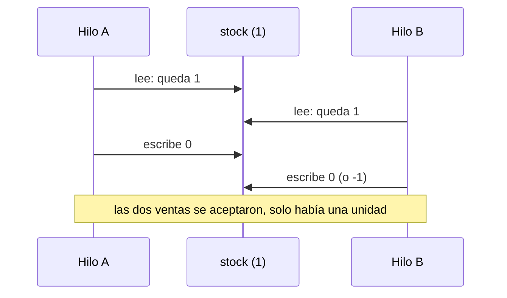

# Condiciones de carrera y memoria compartida

<!-- cspell:words Goetz Oracle JLS volatile synchronized javac check-then-act atomicidad Proteccion Inventario sincronizado -->

> **Tipo de página:** explicación. Te ayuda a entender por qué dos hilos que tocan el mismo dato pueden dar resultados incorrectos aunque cada línea parezca correcta; no es una guía de una biblioteca concreta.

## El problema

Dos clientes compran la última unidad de un producto al mismo tiempo. Cada solicitud corre en su propio hilo, comprueba que queda stock, y luego lo descuenta. Si los dos hilos hacen la comprobación antes de que cualquiera descuente, los dos ven "queda 1" y los dos venden. El stock termina en -1 y no hay ninguna línea de código que parezca equivocada.

Es el patrón *check-then-act* (comprobar y luego actuar): la decisión se toma con un dato que otro hilo puede cambiar antes de que se actúe. Un contador que dos hilos incrementan a la vez sufre una variante: ambos leen el mismo valor, ambos suman uno y uno de los incrementos se pierde.

## La idea central

Hay dos problemas distintos que suelen aparecer juntos:

1. **Atomicidad.** Una operación como `stock--` o "si hay stock, descuenta" parece una sola instrucción, pero son varios pasos (leer, calcular, escribir). Si otro hilo se interpone entre ellos, el resultado depende del orden de llegada.
2. **Visibilidad y orden.** Aunque una operación fuera atómica, un hilo puede no ver lo que otro escribió, porque el compilador y el procesador pueden reordenar y guardar en caché. La especificación del lenguaje Java lo define con el **modelo de memoria** (JLS §17.4): una escritura solo es visible para otro hilo si hay una relación *happens-before* entre ambas.

La especificación llama **carrera de datos** (*data race*) a la situación en que "un programa contiene dos accesos conflictivos que no están ordenados por una relación *happens-before*" (§17.4.5); dos accesos son conflictivos si son sobre la misma variable y al menos uno es una escritura. Y da la garantía que importa en la práctica: si un programa no tiene carreras de datos, todas sus ejecuciones parecen secuencialmente consistentes (§17.4.5), es decir, como si los hilos se intercalaran sin reordenar.

Las herramientas que crean relaciones *happens-before* son pocas y están en la propia especificación: liberar un monitor (salir de un bloque `synchronized`) ocurre antes de cualquier adquisición posterior de ese monitor; una escritura a un campo `volatile` ocurre antes de cualquier lectura posterior de ese campo; `Thread.start()` ocurre antes de las acciones del hilo iniciado, y las acciones de un hilo ocurren antes de que otro hilo vuelva de un `join()` sobre él.

La especificación advierte también del límite: que un programa esté correctamente sincronizado no garantiza que su comportamiento global sea correcto. Evita las carreras de datos, pero la lógica de negocio sigue siendo asunto tuyo.

## Cómo se estructura



Para corregirlo hay tres caminos, de menor a mayor costo de diseño:

- **No compartir.** Si un dato lo toca un solo hilo, no hay carrera. Los objetos inmutables (como los [objetos de valor](../modelado-de-dominio/entidades-y-objetos-de-valor.md)) se pueden compartir sin riesgo porque nadie los modifica.
- **Hacer atómica la operación.** Un bloque `synchronized`, un candado o una variable atómica convierten "comprobar y descontar" en un solo paso indivisible, y además crean la relación *happens-before* que da la visibilidad.
- **Delegar en un sistema que ya sepa hacerlo.** Una base de datos con una restricción o un `UPDATE ... WHERE stock > 0` resuelve el mismo problema fuera de la memoria del proceso, y funciona aunque haya varias instancias de la aplicación. Cuando el agregado es la frontera de consistencia (ver [agregados](../modelado-de-dominio/agregados.md)), la transacción o el bloqueo se aplican a ese agregado.

## Cuándo no usarlo

- **No sincronices por reflejo.** Un bloqueo sobre un dato que solo toca un hilo, o sobre un objeto inmutable, solo añade costo y abre la puerta a [bloqueos mutuos](bloqueos-y-deadlocks.md).
- **Un candado en memoria no protege entre procesos.** Si la aplicación corre en varias instancias, `synchronized` no impide que dos instancias vendan la misma unidad; ahí hace falta la base de datos o un mecanismo distribuido.
- **No uses `volatile` como sustituto de un candado** cuando la operación tiene varios pasos: garantiza visibilidad, pero `stock--` sobre un campo `volatile` sigue siendo leer, restar y escribir.

## Qué se gana y qué se pierde

| Se gana | Se pierde |
| --- | --- |
| Resultados correctos con varios hilos | Los hilos esperan unos a otros y se pierde paralelismo |
| Garantía de visibilidad entre hilos | Riesgo de bloqueos mutuos si se usan varios candados |
| Menos errores intermitentes en producción | Pruebas más difíciles: la carrera no siempre se presenta |

## Confusiones frecuentes

- **"Si no falla en mis pruebas, es correcto."** Una carrera depende del orden en que se intercalan los hilos. Puede pasar una vez de cada mil ejecuciones, o solo bajo carga.
- **"`volatile` hace atómicas las operaciones."** Solo garantiza que una escritura sea visible para las lecturas posteriores. Incrementar un campo `volatile` sigue perdiendo actualizaciones.
- **"Basta con que cada operación sea atómica."** Dos operaciones atómicas seguidas (comprobar, luego descontar) no forman una operación atómica. El *check-then-act* hay que proteger entero.
- **"Los hilos solo ven datos obsoletos por un instante."** Sin relación *happens-before* la especificación no promete que el otro hilo llegue a ver la escritura; un bucle `while (!listo)` sobre un campo no `volatile` puede no terminar nunca.

## Ejemplo

Dominio de pedidos con Java 21. Comprobado: compilado con `javac` de OpenJDK 21 y ejecutado tres veces.

Cuatro hilos incrementan un contador 100 000 veces cada uno, sin protección y con un bloque `synchronized`. Después, ocho hilos intentan reservar stock de un inventario de 100 unidades, con la comprobación y el descuento separados y con el método sincronizado:

```java
boolean reservarSinProteccion() {
    if (stock > 0) {          // comprueba
        Thread.yield();       // da pie a que otro hilo se cuele
        stock--;              // actúa
        return true;
    }
    return false;
}

synchronized boolean reservarSincronizado() {
    if (stock > 0) { stock--; return true; }
    return false;
}
```

Salida de una de las ejecuciones:

```text
esperado:        400000
sin proteger:    121982 (se perdieron 278018)
sincronizado:    400000
stock inicial 100, sin proteger:  reservas aceptadas=102, stock final=-2
stock inicial 100, sincronizado:  reservas aceptadas=100, stock final=0
```

Los números sin proteger cambian en cada ejecución (en las tres que hice, el contador terminó entre unos 111 000 y 122 000 y las reservas aceptadas fueron 101, 102 y 103), y esa variación es parte de la lección. Las versiones sincronizadas dieron siempre 400 000 y 100. El `Thread.yield()` está solo para hacer más probable la carrera en un ejemplo corto; sin él la carrera existe igual, pero cuesta más verla. En .NET 8 el equivalente es `lock` o `Interlocked`, y el modelo de memoria de C# tiene sus propias garantías.

## Referencias

- Gosling, J. et al. *The Java Language Specification, Java SE 21 Edition*, cap. 17, *Threads and Locks*. Oracle. <https://docs.oracle.com/javase/specs/jls/se21/html/jls-17.html> (consultado el 2026-11-10; [copia archivada](https://web.archive.org/web/20261031074120/https://docs.oracle.com/javase/specs/jls/se21/html/jls-17.html)). Secciones 17.4.3 a 17.4.5: consistencia secuencial, *happens-before*, sincronización y carreras de datos.
- Goetz, B. et al. (2006). *Java Concurrency in Practice*. Addison-Wesley. Libro de referencia sobre el tema; no se consultó su texto y la página no se apoya en él.

Última revisión: 2026-11-10
