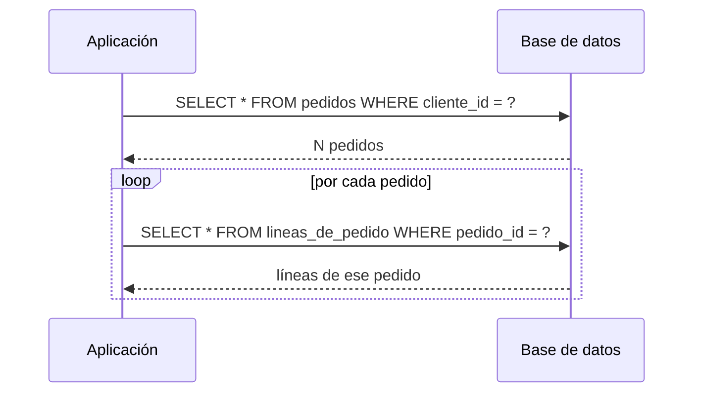

# ORM y el problema N+1

<!-- cspell:words ORM ORMs Hibernate Jakarta EntityGraph roundtrip LINQ lineas JPQL milisegundo resumenes -->

> **Tipo de página:** explicación. Te ayuda a entender por qué aparece el problema N+1 y cómo evitarlo; no es una guía de optimización de Hibernate ni de EF Core.

## El problema

Un endpoint lista los pedidos de un cliente con el total de cada uno. En desarrollo, con cinco pedidos de prueba, responde al instante. En producción, un cliente con 300 pedidos espera varios segundos.

Al activar el registro de SQL aparece la causa: una consulta para traer los pedidos y después **una consulta más por cada pedido** para traer sus líneas. Para 300 pedidos son 301 consultas, cada una con su ida y vuelta a la base de datos. Nadie las escribió: las generó el ORM.

## La idea central

Un **ORM** (*Object-Relational Mapping*), como Hibernate (la implementación de JPA más usada en Java) o Entity Framework Core en .NET, traduce entre objetos y tablas. Permite recorrer `pedido.getLineas()` como si fuera una lista en memoria, aunque los datos estén en otra tabla.

Para no cargar toda la base al traer un objeto, el ORM usa **carga diferida** (*lazy loading*): en lugar de las líneas reales deja un marcador y las busca recién cuando el código las usa. Fowler la describe como el patrón *Lazy Load*: un objeto que no tiene todos los datos que necesita, pero sabe cómo conseguirlos.

El **problema N+1** aparece cuando se combinan una consulta que trae N objetos y un recorrido que toca una relación diferida en cada uno: 1 consulta inicial más N consultas adicionales. La guía de Hibernate lo llama "el temido problema de los *n+1 selects*", y la documentación de EF Core lo describe con el mismo nombre.

## Cómo se estructura



Hay tres formas de evitarlo, de la más específica a la más general:

1. **Proyección a DTO:** si la pantalla solo necesita el total y la cantidad de líneas, una consulta con `JOIN` y `GROUP BY` devuelve exactamente eso, sin cargar entidades.
2. **Carga anticipada en esa consulta:** `JOIN FETCH` en JPQL, `@EntityGraph` en Spring Data JPA o `Include` en EF Core traen las líneas en la misma consulta que los pedidos.
3. **Carga por lotes:** algunos ORM pueden traer las líneas de varios pedidos en una sola consulta con `IN (...)`. Reduce N+1 a pocas consultas sin cambiar cada llamada.

## Cuándo no usarlo

La carga diferida no es mala por sí misma, ni la anticipada es siempre la solución:

- **No adelantes la carga si casi nunca usas la relación.** Traer las líneas de 300 pedidos para mostrar solo sus fechas es trabajo inútil.
- **No uses entidades para pantallas de solo lectura con muchos datos.** Una proyección a DTO es más rápida y deja claro qué datos usa la pantalla. Es la idea del lado de lectura de [CQRS](../arquitectura/cqrs.md).
- **Cuidado con `JOIN FETCH` de varias colecciones a la vez.** Unir dos colecciones de un mismo objeto multiplica filas (producto cartesiano). Con más de una colección conviene la carga por lotes o consultas separadas.

## Qué se gana y qué se pierde

| Estrategia | Se gana | Se pierde |
| --- | --- | --- |
| Carga diferida | Solo se trae lo que se usa | Riesgo de N+1 al recorrer colecciones |
| `JOIN FETCH` / `@EntityGraph` / `Include` | Una consulta para los objetos y sus relaciones | Más datos por fila; cuidado con varias colecciones |
| Proyección a DTO | La consulta exacta que necesita la pantalla | No hay entidades: no sirve para modificar datos |
| Carga por lotes | Pocas consultas sin tocar cada llamada | Configuración específica del ORM |

## Confusiones frecuentes

- **"La solución al N+1 es cambiar las relaciones a `FetchType.EAGER`."** Eso traslada el problema a todas las consultas que cargan la entidad, incluso las que no necesitan las líneas. Además, una relación `EAGER` no garantiza un `JOIN`: el ORM puede resolverla con consultas adicionales. La guía de Hibernate recomienda declarar todas las asociaciones como diferidas y decidir la carga anticipada en cada consulta.
- **"Mis relaciones son diferidas porque no puse nada."** En JPA, las relaciones `@ManyToOne` y `@OneToOne` son `EAGER` por defecto. La guía de Hibernate señala que esto contradice su propia recomendación.
- **"El N+1 es un error de Hibernate."** Es una consecuencia de usar carga diferida dentro de un recorrido. Aparece igual en EF Core y en cualquier ORM con carga diferida.
- **"Si la base responde rápido, el N+1 no importa."** Cada consulta tiene un costo fijo de ida y vuelta por la red. Con cientos de consultas, ese costo domina aunque cada una tarde un milisegundo.

## Ejemplo

Dominio de pedidos con Java 21 y Spring Data JPA. Los fragmentos son ilustrativos: omiten los `import`, la configuración y el resto de las entidades.

**Con N+1.** Las líneas son diferidas (lo correcto) y el código las recorre por cada pedido:

```java
@Entity
class PedidoEntity {
    @Id
    private UUID id;

    private String clienteId;

    @OneToMany(mappedBy = "pedido", fetch = FetchType.LAZY)
    private List<LineaEntity> lineas;
}

List<PedidoEntity> pedidos = repositorio.findByClienteId(clienteId);  // 1 consulta
for (var pedido : pedidos) {
    total(pedido.getLineas());                                         // 1 consulta por pedido
}
```

**Carga anticipada en esta consulta.** `@EntityGraph` indica que, solo aquí, las líneas vienen con los pedidos:

```java
interface PedidoRepository extends JpaRepository<PedidoEntity, UUID> {
    @EntityGraph(attributePaths = "lineas")
    List<PedidoEntity> findByClienteId(String clienteId);
}
```

**Proyección a DTO.** Si la pantalla solo muestra el resumen, no hace falta cargar entidades:

```java
record ResumenDePedido(UUID id, Long cantidadDeLineas, BigDecimal total) {}

interface PedidoRepository extends JpaRepository<PedidoEntity, UUID> {
    @Query("""
            SELECT new com.tienda.pedidos.ResumenDePedido(p.id, COUNT(l), SUM(l.subtotal))
            FROM PedidoEntity p JOIN p.lineas l
            WHERE p.clienteId = :clienteId
            GROUP BY p.id
            """)
    List<ResumenDePedido> resumenesDelCliente(String clienteId);
}
```

Las tres versiones devuelven los mismos datos a la pantalla. La primera hace 301 consultas para 300 pedidos; las otras dos, una.

En C# con .NET 8 y EF Core, la carga anticipada es `.Include(p => p.Lineas)` y la proyección es un `.Select(p => new ResumenDePedido(...))` en LINQ.

## Referencias

- Fowler, M. (2002). *Patterns of Enterprise Application Architecture*. Addison-Wesley. ISBN 978-0-321-12742-6. Patrón *Lazy Load*. Resumen del autor: <https://martinfowler.com/eaaCatalog/lazyLoad.html> (consultado el 2026-10-28; [copia archivada](https://web.archive.org/web/20261022121825/https://martinfowler.com/eaaCatalog/lazyLoad.html)).
- Hibernate (s. f.). *Hibernate ORM 6.6 User Guide*. <https://docs.jboss.org/hibernate/orm/6.6/userguide/html_single/Hibernate_User_Guide.html> (consultado el 2026-10-28; [copia archivada](https://web.archive.org/web/20251002084132/https://docs.jboss.org/hibernate/orm/6.6/userguide/html_single/Hibernate_User_Guide.html)). Cap. 12 (*Fetching*): recomendación de declarar las asociaciones como diferidas y conflicto con los valores por defecto de JPA; sección de HQL sobre `join fetch` y el problema de los *n+1 selects*.
- Eclipse Foundation (2022). *Jakarta Persistence 3.1 Specification*. <https://jakarta.ee/specifications/persistence/3.1/jakarta-persistence-spec-3.1.html> (consultado el 2026-10-28; [copia archivada](https://web.archive.org/web/20261008214808/https://jakarta.ee/specifications/persistence/3.1/jakarta-persistence-spec-3.1.html)). Valores por defecto de `fetch` en cada tipo de relación.
- Spring (s. f.). *JPA Query Methods* (sección *Configuring Fetch- and LoadGraphs*). <https://docs.spring.io/spring-data/jpa/reference/jpa/query-methods.html> (consultado el 2026-10-28; [copia archivada](https://web.archive.org/web/20261005125830/https://docs.spring.io/spring-data/jpa/reference/jpa/query-methods.html)). Uso de `@EntityGraph`.
- Microsoft (s. f.). *Efficient Querying (EF Core)*. <https://learn.microsoft.com/en-us/ef/core/performance/efficient-querying> (consultado el 2026-10-28; [copia archivada](https://web.archive.org/web/20260926083532/https://learn.microsoft.com/en-us/ef/core/performance/efficient-querying)). El problema N+1 con carga diferida y su solución con `Include` o proyecciones.

Última revisión: 2026-10-28
