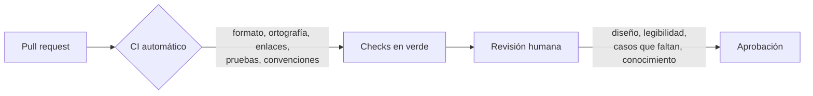

# Revisión de código

<!-- cspell:words Fagan Bacchelli Winters Manshreck commitlint Bloqueante bloqueante ICSE -->

> **Tipo de página:** explicación. Te ayuda a entender para qué sirve la revisión de código y cómo hacerla útil; no es una lista de verificación para copiar.

## El problema

En muchos equipos la revisión de código se convierte en una de dos cosas. O es un trámite: alguien aprueba un *pull request* de 2000 líneas a los cinco minutos sin entenderlo. O es una discusión sobre comas, sangrías y nombres de variables que no deja tiempo para mirar si el diseño tiene sentido.

En los dos casos se pierde lo que la revisión puede dar: que otra persona entienda el cambio, detecte un problema de diseño antes de que llegue a producción y aprenda algo del código que no escribió.

## La idea central

La **revisión de código** (*code review*) es que otra persona lea un cambio antes de integrarlo, para comprobar que funciona, que se entiende y que encaja en el sistema.

La práctica tiene historia. En 1976 Michael Fagan describió en IBM las **inspecciones** de diseño y de código: reuniones formales con roles definidos, preparación previa y seguimiento de los defectos encontrados.

La revisión moderna es más liviana: se hace sobre una herramienta, de forma asíncrona, cambio por cambio. Alberto Bacchelli y Christian Bird estudiaron en 2013 cómo se usaba en Microsoft. Encontraron que encontrar defectos era la motivación principal que declaraban los desarrolladores, pero que en la práctica la revisión producía menos defectos de lo esperado y aportaba otras cosas: transferencia de conocimiento, conocimiento compartido del equipo sobre los cambios y soluciones alternativas. También encontraron que la mayor dificultad era entender el cambio.

El libro *Software Engineering at Google* lista beneficios parecidos: comprobar que el código es correcto, que otra persona lo entiende, que es consistente con el resto del código, que el equipo se sienta dueño del código, compartir conocimiento y dejar un registro histórico de las decisiones.

## Cómo se estructura

Una revisión útil reparte el trabajo entre las máquinas y las personas:



Para que la parte humana funcione, hay tres prácticas que aparecen en las fuentes:

- **Cambios pequeños.** Google la considera probablemente la práctica más importante para que la revisión sea ágil: un cambio chico se entiende rápido, se revisa en el día y, si introduce un error, encontrarlo cuesta poco.
- **Automatizar lo mecánico.** Lo que una herramienta puede comprobar no debería consumir la atención de quien revisa. Así puede concentrarse en lo que importa en lugar del formato.
- **Etiquetar la severidad de los comentarios.** La guía de revisión de Google propone prefijos como `Nit:` (detalle menor), `Optional:` (sugerencia) y `FYI:` (información para el futuro). Sin etiquetas, quien recibe la revisión suele tomar todos los comentarios como obligatorios.

## Cuándo no usarlo

La revisión antes de integrar es la regla en la mayoría de los equipos, pero hay casos en que no es la mejor herramienta:

- **Programación en pareja o en grupo.** Si dos personas escribieron el cambio juntas, ya hubo una revisión continua. Una segunda revisión puede seguir siendo útil, pero exigir el mismo proceso que para un cambio individual duplica el trabajo.
- **Como sustituto de pruebas automáticas.** Una persona no puede ejecutar mentalmente todos los casos. Si la revisión es la única red de seguridad, los errores van a pasar.
- **Cambios urgentes en un incidente.** Esperar una revisión completa mientras producción está caída puede costar más que revisar después. Si el equipo lo permite, que sea una excepción explícita y con revisión posterior.

## Qué se gana y qué se pierde

| Se gana | Se pierde |
| --- | --- |
| Al menos dos personas entienden cada cambio | Tiempo de espera entre abrir el *pull request* e integrarlo |
| Problemas de diseño detectados antes de llegar a producción | Tiempo de quien revisa, que deja de hacer su propio trabajo |
| Conocimiento compartido del código y de sus decisiones | Fricción si los comentarios se sienten como ataques personales |
| Un registro escrito de por qué se hizo cada cambio | Incentivo a abrir *pull requests* grandes para "revisar una sola vez" |

## Confusiones frecuentes

- **"El propósito de la revisión humana es encontrar errores de estilo."** El estilo, la ortografía y el formato los comprueba mejor una herramienta. Si quien revisa gasta su tiempo en eso, no lo gasta en el diseño, en los casos que faltan ni en si el cambio se entiende.
- **"La revisión sirve sobre todo para encontrar errores."** Es lo que la mayoría espera, pero el estudio de Bacchelli y Bird muestra que una parte importante de su valor está en otras cosas, como compartir conocimiento y encontrar soluciones alternativas.
- **"Quien revisa debe imponer su forma de escribir el código."** Google recomienda dar prioridad al enfoque del autor y proponer alternativas solo si mejoran la comprensión o el funcionamiento, no por preferencia personal.
- **"Si nadie comenta, la revisión no sirvió."** Una aprobación sin comentarios sobre un cambio pequeño y claro es una buena señal, no una revisión fallida.

## Ejemplo

En este repositorio el CI comprueba el formato del Markdown (markdownlint), la terminología y las palabras de relleno (Vale), la ortografía (cspell), los enlaces (lychee), la sección de referencias y el formato del título del *pull request*. Nada de eso necesita un comentario humano.

Supón un *pull request* que modifica `ServicioDePedidos` para aplicar descuentos. Con el CI en verde, una revisión útil podría dejar estos comentarios:

```text
ServicioDePedidos.java, línea 42
  Bloqueante: si el pedido no tiene líneas, total() devuelve cero y se guarda
  igual. ¿No debería rechazarse antes, como hace el constructor de Pedido?

DescuentoPorVolumen.java, línea 12
  Optional: el umbral de 10 unidades aparece también en la prueba. Si lo
  sacas a una constante, el próximo cambio de umbral toca un solo lugar.

ServicioDePedidosTest.java, línea 30
  Falta un caso: ¿qué pasa con exactamente 10 unidades? La regla dice
  "a partir de 10" y la condición usa >.

ServicioDePedidos.java, línea 18
  Nit: "calc" podría llamarse "calcularTotal", como el resto de los métodos.

ServicioDePedidos.java, línea 50
  FYI: la página de arquitectura hexagonal muestra cómo probar este servicio
  con un repositorio en memoria, por si quieres evitar el mock.
```

Quien recibe la revisión sabe qué tiene que resolver antes de integrar (el comentario bloqueante y el caso que falta), qué puede decidir (la sugerencia y el *nit*) y qué es solo información.

## Referencias

- Fagan, M. E. (1976). Design and code inspections to reduce errors in program development. *IBM Systems Journal*, 15(3), 182-211. DOI: 10.1147/sj.153.0182. Inspecciones formales de diseño y de código.
- Bacchelli, A. y Bird, C. (2013). Expectations, Outcomes, and Challenges of Modern Code Review. En *Proceedings of the 35th International Conference on Software Engineering (ICSE)*, 712-721. DOI: 10.1109/ICSE.2013.6606617. Motivaciones, resultados reales y dificultades de la revisión moderna en Microsoft.
- Winters, T., Manshreck, T. y Wright, H. (2020). *Software Engineering at Google*. O'Reilly Media. Cap. 9 (*Code Review*). <https://abseil.io/resources/swe-book/html/ch09.html> (consultado el 2026-10-27; [copia archivada](https://web.archive.org/web/20261006183910/https://abseil.io/resources/swe-book/html/ch09.html)). Beneficios de la revisión, cambios pequeños, automatización y deferencia al enfoque del autor.
- Google (s. f.). *How to write code review comments*. Google Engineering Practices Documentation. <https://google.github.io/eng-practices/review/reviewer/comments.html> (consultado el 2026-10-27; [copia archivada](https://web.archive.org/web/20260922091005/https://google.github.io/eng-practices/review/reviewer/comments.html)). Etiquetas de severidad para los comentarios.

Última revisión: 2026-10-27
