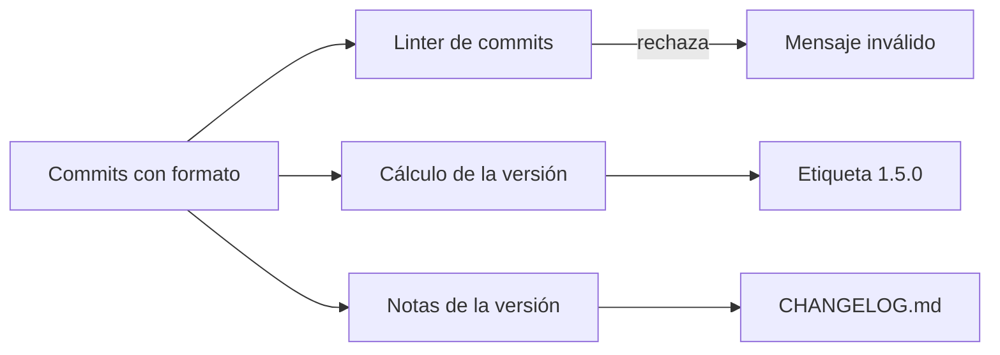

# Conventional Commits

<!-- cspell:words semver changelog commitlint -->

> **Tipo de página:** explicación. Te ayuda a entender la convención y a decidir si te conviene; no es una referencia completa de la especificación.

## El problema

En un repositorio sin reglas, el historial termina lleno de mensajes como `cambios`, `arreglo`, `wip` o `ahora sí`. Eso trae tres problemas:

- Para saber qué hace un commit tienes que abrir el diff. El historial no sirve para responder "¿cuándo se rompió esto?" o "¿qué cambió desde la última versión?".
- Escribir las notas de una versión es trabajo manual: alguien revisa commit por commit y decide qué fue una corrección, qué fue una función nueva y qué rompe a quien usa el código.
- Ninguna herramienta puede leer el historial, porque cada persona escribe con su propio formato.

## La idea central

*Conventional Commits* es una convención para escribir el mensaje de commit de forma que lo pueda leer una persona y también un programa. La primera línea dice **qué tipo de cambio es**, opcionalmente **en qué parte del proyecto**, y después una descripción corta:

```text
tipo(alcance): descripción
```

La especificación solo hace obligatorios dos tipos, `feat` (una función nueva) y `fix` (una corrección), y una forma de marcar los **cambios incompatibles** (*breaking changes*). Con eso alcanza para relacionar el historial con el [versionado semántico](https://semver.org/lang/es/) (SemVer):

| En el commit | En SemVer |
| --- | --- |
| `fix` | Sube el número de parche (`1.4.2` → `1.4.3`) |
| `feat` | Sube el número menor (`1.4.2` → `1.5.0`) |
| `!` o pie `BREAKING CHANGE` | Sube el número mayor (`1.4.2` → `2.0.0`) |

Cualquier otro tipo está permitido, pero no tiene efecto en la versión salvo que marque un cambio incompatible.

## Cómo se estructura

Un mensaje tiene hasta tres partes, separadas por una línea en blanco:

```text
<tipo>[alcance opcional][! opcional]: <descripción>

[cuerpo opcional]

[pie(s) opcional(es)]
```

- **Encabezado.** El tipo es obligatorio, va seguido de dos puntos y un espacio, y después la descripción. El alcance va entre paréntesis y nombra una sección del proyecto: `fix(pedidos):`.
- **Cuerpo.** Texto libre, en uno o varios párrafos. Es el lugar para explicar el porqué del cambio, que el diff no muestra.
- **Pies** (*footers*). Líneas con la forma `Clave: valor` o `Clave #valor`, al estilo de los *trailers* de Git. La clave usa guiones en lugar de espacios (`Reviewed-by`, `Co-authored-by`, `Refs`). La única excepción es `BREAKING CHANGE`, que se escribe con espacio y siempre en mayúsculas.

Un cambio incompatible se marca de una de dos formas, o con ambas: un `!` justo antes de los dos puntos (`feat(api)!:`) o un pie `BREAKING CHANGE: descripción`. Puede aparecer en commits de cualquier tipo.

Los tipos además de `feat` y `fix` no los define la especificación. Los más usados vienen de las guías de commits del proyecto Angular y los recoge la configuración `@commitlint/config-conventional`:

| Tipo | Para qué se usa |
| --- | --- |
| `build` | Sistema de compilación o dependencias externas |
| `ci` | Configuración de la integración continua |
| `docs` | Solo documentación |
| `perf` | Mejora de rendimiento |
| `refactor` | Cambio de código que no corrige errores ni agrega funciones |
| `style` | Formato, sin cambio de significado |
| `test` | Pruebas nuevas o corregidas |
| `chore` | Mantenimiento que no entra en las categorías anteriores |
| `revert` | Revierte un commit anterior |

Cada equipo puede elegir su propia lista. Este repositorio, por ejemplo, usa solo seis tipos y cinco alcances (ver [CONTRIBUTING.md](../CONTRIBUTING.md#mensajes-de-commit)).



## Cuándo no usarlo

- **Repositorios personales o de un solo uso.** Si nadie más lee el historial y no publicas versiones, la convención agrega pasos sin un lector que los aproveche.
- **Equipos que fusionan con *squash* y no revisan el mensaje final.** Si el commit que llega a `main` lo escribe la herramienta a partir de los títulos de cada commit, el formato de los commits intermedios se pierde. En ese caso conviene validar el título del *pull request*, que es lo que queda, en lugar de cada commit.
- **Proyectos que no se versionan.** Gran parte del valor está en automatizar SemVer y las notas de versión. Sin versiones, queda solo el beneficio de un historial ordenado, que se puede lograr con reglas más livianas.
- **Como sustituto de commits pequeños.** Un prefijo correcto no arregla un commit que mezcla tres cambios. La especificación misma recomienda separar el trabajo en varios commits cuando un cambio encaja en más de un tipo.

## Qué se gana y qué se pierde

| Se gana | Se pierde |
| --- | --- |
| Un historial que se puede filtrar por tipo (`git log --grep '^fix'`) | Tiempo para decidir el tipo y el alcance de cada commit |
| Notas de versión y número de versión generados por herramientas | Configurar y mantener esas herramientas |
| Cambios incompatibles visibles desde el encabezado | Discusiones sobre casos ambiguos (¿esto es `fix` o `refactor`?) |
| Revisiones más rápidas: el título anticipa el tamaño del cambio | Un linter que rechaza mensajes puede frenar a quien recién llega |

## Confusiones frecuentes

- **"La especificación define `chore`, `docs`, `refactor` y los demás."** No. Solo define `feat`, `fix` y la marca de cambio incompatible. El resto de los tipos viene de la convención de Angular y de `@commitlint/config-conventional`, y cada equipo puede cambiarlos.
- **"La descripción tiene que ir en minúscula y en imperativo."** Esas reglas vienen de la guía de Angular, no de la especificación. La especificación dice que los elementos no distinguen mayúsculas de minúsculas, excepto `BREAKING CHANGE`, y en su sección de preguntas frecuentes recomienda ser consistente. Que un equipo elija minúscula e imperativo es una decisión válida, pero es una regla local.
- **"`BREAKING CHANGE` solo va en commits `feat`."** Puede ir en cualquier tipo. Un `fix` que cambia la firma de un método público también rompe a quien lo usa.
- **"Un `feat` es cualquier cambio grande."** El tipo describe la naturaleza del cambio, no su tamaño. Un cambio de una línea que habilita algo nuevo para quien usa el sistema es `feat`; reescribir un módulo entero sin cambiar su comportamiento es `refactor`.
- **"El alcance es el nombre del archivo."** El alcance nombra una sección del proyecto, entendida por quien lee el historial: `pedidos`, `api`, `inventario`. Si lo cambias por el nombre del archivo, el historial se llena de alcances distintos que no se pueden agrupar.
- **"Si me equivoco de tipo, ya no sirve."** Antes de fusionar puedes corregir el mensaje. Después, un commit fuera de formato solo queda fuera de lo que las herramientas detectan; no rompe el resto del historial.

## Ejemplo

Siguiendo el sistema de pedidos de las páginas de arquitectura. Una corrección acotada a un módulo:

```text
fix(pedidos): rechaza pedidos sin líneas al confirmar

La validación existía al crear el pedido, pero no al confirmarlo
después de editarlo. Un pedido podía quedar confirmado y vacío.

Refs: #42
```

Una función nueva, sin cuerpo porque el encabezado alcanza:

```text
feat(notificaciones): avisa al cliente por correo cuando se envía el pedido
```

Un cambio incompatible en la API REST, marcado con `!` y explicado en el pie:

```text
feat(api)!: devuelve el pedido completo en lugar de solo su id

BREAKING CHANGE: POST /pedidos responde con el objeto Pedido en vez
de un UUID. Los clientes que leían el cuerpo como texto deben leerlo
como JSON.
```

Un mantenimiento escrito entre dos personas, con el *trailer* de coautoría que GitHub reconoce:

```text
chore(deps): actualiza Spring Boot a 3.3.5

Co-authored-by: Joako601 <242209193+Joako601@users.noreply.github.com>
```

Con este historial, una herramienta calcula que la próxima versión es mayor (por el `!`), agrupa el `feat` y el `fix` en las notas, y deja fuera el `chore`.

Para validar los mensajes antes de que lleguen al repositorio puedes usar commitlint, que es lo que hace este proyecto en `commitlint.config.mjs`:

```js
export default {
  extends: ['@commitlint/config-conventional'],
  rules: {
    'scope-enum': [2, 'always', ['pedidos', 'notificaciones', 'api', 'deps']],
  },
};
```

## Referencias

- Conventional Commits (s. f.). *Conventional Commits 1.0.0*. <https://www.conventionalcommits.org/es/v1.0.0/> (consultado el 2026-10-23; [copia archivada de la versión en inglés](https://web.archive.org/web/20261022065541/https://www.conventionalcommits.org/en/v1.0.0/)). Fuente de la estructura del mensaje, de los tipos obligatorios, de las reglas sobre pies y cambios incompatibles, de la relación con SemVer y de las preguntas frecuentes sobre mayúsculas, commits mixtos y errores de tipo.
- Angular (2018). *Commit Message Guidelines*, en `CONTRIBUTING.md`, commit `22b96b9`. <https://github.com/angular/angular/blob/22b96b9/CONTRIBUTING.md> (consultado el 2026-10-23; [copia archivada](https://web.archive.org/web/20261016070822/https://github.com/angular/angular/blob/22b96b9/CONTRIBUTING.md)). Antecedente que la especificación enlaza; origen de la lista de tipos y de las reglas de imperativo, minúscula y sin punto final.
- Preston-Werner, T. (s. f.). *Versionado Semántico 2.0.0*. <https://semver.org/lang/es/> (consultado el 2026-10-23; [copia archivada de la versión en inglés](https://web.archive.org/web/20261012051309/https://semver.org/spec/v2.0.0.html)). Definición de las versiones mayor, menor y de parche.
- Git (s. f.). *git-interpret-trailers*. <https://git-scm.com/docs/git-interpret-trailers> (consultado el 2026-10-23; [copia archivada](https://web.archive.org/web/20260925170148/https://git-scm.com/docs/git-interpret-trailers)). Formato de los *trailers* en el que se inspiran los pies.
- commitlint (s. f.). *@commitlint/config-conventional*. <https://github.com/conventional-changelog/commitlint/tree/master/%40commitlint/config-conventional> (consultado el 2026-10-23). Lista de tipos por defecto y reglas de validación.

Última revisión: 2026-10-23
