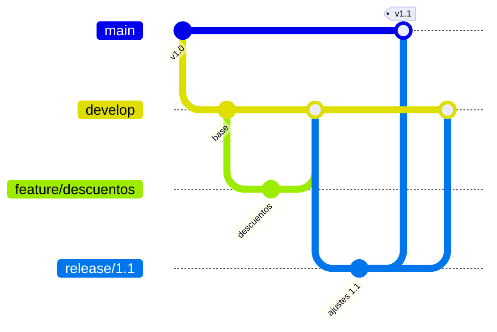
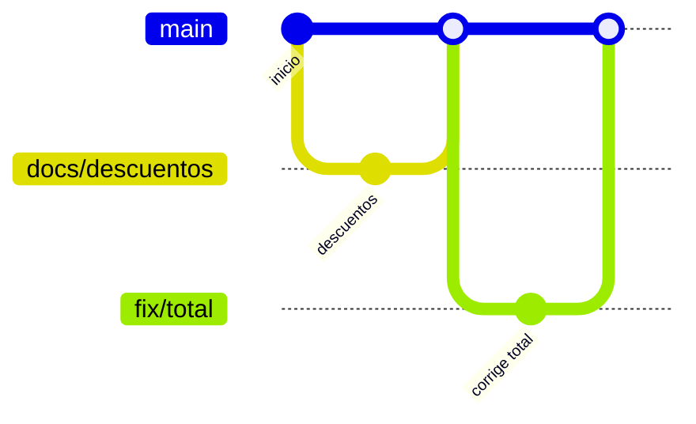

# Estrategias de ramas

<!-- cspell:words Driessen Chacon Hammant Forsgren hotfix gitGraph checkout instalable -->

> **Tipo de página:** explicación. Te ayuda a comparar las estrategias más comunes y a elegir una; no es una guía de comandos.

## El problema

Sin acuerdo sobre cómo usar las ramas, cada persona inventa su propio flujo. Aparecen ramas que viven semanas, integraciones dolorosas con decenas de conflictos y la pregunta de siempre antes de cada entrega: "¿qué rama tiene la versión buena?".

El problema opuesto también existe: adoptar un modelo pensado para otro tipo de software. Un equipo que despliega una aplicación web varias veces por día no necesita la misma estructura que uno que mantiene tres versiones de una biblioteca en paralelo.

## La idea central

Una **estrategia de ramas** es un acuerdo del equipo sobre qué ramas existen, cuánto viven, de dónde salen y adónde se integran. Las tres más citadas responden a necesidades distintas.

**Git Flow.** Vincent Driessen lo publicó en 2010. Usa dos ramas permanentes: `master` (hoy `main`), que solo contiene versiones publicadas, y `develop`, donde se integra el trabajo. Alrededor hay ramas de apoyo con vida limitada: `feature/*` para funciones, `release/*` para preparar una versión y `hotfix/*` para correcciones urgentes en producción.

**GitHub Flow.** Scott Chacon lo describió en 2011 como el flujo que usaba GitHub. Tiene una sola regla fuerte: todo lo que está en `main` se puede desplegar. Cada cambio sale de `main` en una rama con nombre descriptivo, se revisa en un *pull request*, vuelve a `main` y se despliega enseguida.

***Trunk-Based Development*.** Paul Hammant documenta un modelo en el que todo el equipo integra en una sola rama (*trunk*, hoy `main`) y evita las ramas de desarrollo de larga duración. Si se usan ramas, son cortas: horas o pocos días. Es la base de la integración continua, que exige que cada persona integre al menos una vez por día.

## Cómo se estructura

Git Flow, con una función y una versión:



GitHub Flow y *Trunk-Based Development* con ramas cortas se ven casi igual: ramas pequeñas que salen de `main` y vuelven pronto.



La diferencia entre estos dos últimos es de énfasis. GitHub Flow pone el centro en el *pull request* y en desplegar después de cada integración. *Trunk-Based Development* pone el centro en la frecuencia: integrar tan seguido que ninguna rama alcanza a separarse de `main`.

## Cuándo no usarlo

Cada estrategia tiene un caso en el que no conviene:

- **Git Flow en software con entrega continua.** El propio Driessen agregó en 2020 una nota al artículo original: el modelo se pensó para software con versiones explícitas, y para equipos que hacen entrega continua (como la mayoría de las aplicaciones web) recomienda un flujo más simple, como GitHub Flow.
- **GitHub Flow o *Trunk-Based Development* si mantienes varias versiones en paralelo.** Si tus clientes usan la 2.x y la 3.x y ambas reciben correcciones, necesitas ramas de versión que vivan tanto como cada versión tenga soporte. Driessen señala que en ese caso Git Flow puede seguir siendo una buena opción.
- ***Trunk-Based Development* sin pruebas automáticas ni *feature flags*.** Integrar varias veces por día solo es seguro si un CI rápido detecta los errores enseguida y el trabajo incompleto puede quedar apagado en `main`.

## Qué se gana y qué se pierde

| Estrategia | Se gana | Se pierde |
| --- | --- | --- |
| Git Flow | Separación clara entre lo publicado, lo integrado y lo que está en preparación | Ramas largas, integraciones grandes y más pasos para cada entrega |
| GitHub Flow | Un solo lugar de verdad (`main`) y entregas pequeñas | Exige que `main` esté siempre lista para desplegar |
| *Trunk-Based Development* | Integración continua real y conflictos pequeños | Exige CI rápido, disciplina y técnicas para ocultar trabajo incompleto |

## Confusiones frecuentes

- **"Git Flow es el estándar moderno para cualquier proyecto."** El autor del modelo dice lo contrario en su nota de 2020: se volvió popular al punto de tratarse como un dogma, y no lo pensó para el software que se entrega de forma continua.
- **"*Trunk-Based Development* significa no usar ramas."** Permite ramas, siempre que sean cortas. Lo que evita son las ramas de desarrollo de larga duración.
- **"Usar *pull requests* es incompatible con integrar seguido."** Un *pull request* pequeño que se revisa en el día es compatible con *Trunk-Based Development*. El problema es el *pull request* de dos semanas.
- **"La estrategia se elige por moda."** Se elige por cómo entregas el software: una versión desplegada continuamente o varias versiones publicadas con soporte en paralelo.

## Ejemplo

Este repositorio usa GitHub Flow. `main` está protegida, cada cambio sale de `main` en una rama con nombre `tipo/tema` y vuelve por un *pull request* aprobado:

```sh
git switch main
git pull --ff-only
git switch -c docs/estrategias-de-ramas
# ... commits pequeños ...
git push -u origin docs/estrategias-de-ramas
# Se abre el pull request, se revisa y se fusiona con squash.
```

Para un sistema de pedidos que se despliega varias veces por día, el mismo flujo alcanza. Si una función nueva de descuentos tarda una semana, se integra en partes pequeñas detrás de un *feature flag* apagado, en lugar de vivir una semana en una rama.

Si en cambio el sistema de pedidos se vendiera como producto instalable, con clientes en la versión 2.x y otros en la 3.x, haría falta una rama `release/2.x` para seguir publicando correcciones de esa versión. Ese es el caso que Git Flow resuelve bien.

## Referencias

- Driessen, V. (2010, nota agregada en 2020). *A successful Git branching model*. <https://nvie.com/posts/a-successful-git-branching-model/> (consultado el 2026-10-27; [copia archivada](https://web.archive.org/web/20261013125116/https://nvie.com/posts/a-successful-git-branching-model/)). Definición de Git Flow y nota de 2020 sobre cuándo no usarlo.
- Chacon, S. (2011). *GitHub Flow*. <https://scottchacon.com/2011/08/31/github-flow/> (consultado el 2026-10-27; [copia archivada](https://web.archive.org/web/20261002082939/https://scottchacon.com/2011/08/31/github-flow/)). Reglas del flujo y la regla de que `main` siempre se puede desplegar.
- Hammant, P. y colaboradores (s. f.). *Trunk Based Development: Introduction*. <https://trunkbaseddevelopment.com/> (consultado el 2026-10-27; [copia archivada](https://web.archive.org/web/20261011200311/https://trunkbaseddevelopment.com/)). Definición del modelo, ramas cortas y relación con la integración continua.
- GitHub (s. f.). *GitHub flow*. <https://docs.github.com/en/get-started/using-github/github-flow> (consultado el 2026-10-27; [copia archivada](https://web.archive.org/web/20261022040257/https://docs.github.com/en/get-started/using-github/github-flow)). Descripción actual del flujo en la documentación oficial.
- Forsgren, N., Humble, J. y Kim, G. (2018). *Accelerate: The Science of Lean Software and DevOps*. IT Revolution. ISBN 978-1-942788-33-1. *Trunk-based development* entre las capacidades de entrega continua asociadas al buen desempeño.
- IT Revolution (2020). *24 Key Capabilities to Drive Improvement in Software Delivery* (extracto adaptado de *Accelerate*). <https://itrevolution.com/articles/24-key-capabilities-to-drive-improvement-in-software-delivery/> (consultado el 2026-10-28; [copia archivada](https://web.archive.org/web/20260118042054/https://itrevolution.com/articles/24-key-capabilities-to-drive-improvement-in-software-delivery/)). Capacidad 4: menos de tres ramas activas, ramas de menos de un día y sin congelamientos de código.

Última revisión: 2026-10-27
