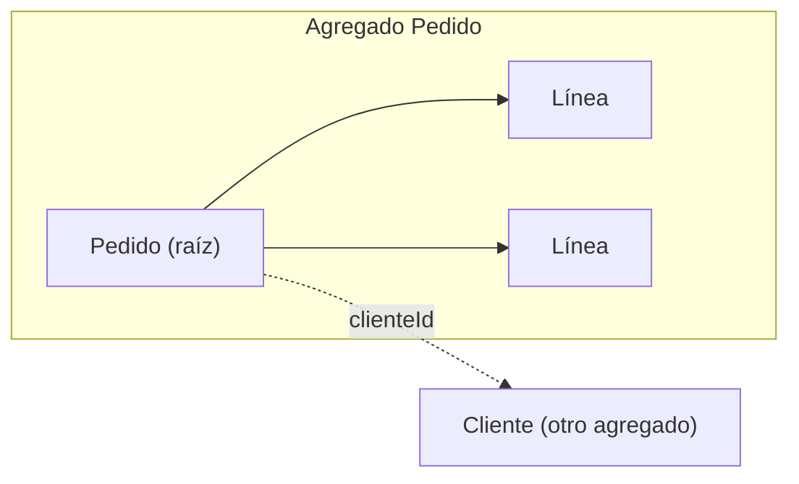

# Agregados

<!-- cspell:words Evans Vernon Fowler javac agregado agregados invariante invariantes ProjectOvation consistencia transaccional síncrona -->

> **Tipo de página:** explicación. Te ayuda a decidir qué objetos del dominio se guardan y se modifican juntos y cuáles no; no es una guía de un *framework* concreto.

## El problema

Un `Pedido` tiene líneas, un cliente, una dirección de entrega y un historial de pagos. Si todos esos objetos se pueden modificar desde cualquier parte del código, es muy fácil romper una regla del negocio sin darse cuenta: alguien agrega una línea a un pedido ya confirmado, o dos operaciones modifican a la vez objetos relacionados y dejan el pedido en un estado imposible.

Evans lo describe así: es difícil garantizar la consistencia de los cambios en un modelo con asociaciones complejas. Los objetos deberían mantener su propio estado consistente, pero pueden ser "sorprendidos" por cambios en otros objetos que son parte constitutiva suya. Y los esquemas de bloqueo cautelosos hacen que muchos usuarios se estorben sin motivo y pueden volver el sistema inutilizable.

## La idea central

Un **agregado** es un grupo de objetos del dominio que se trata como una sola unidad para los cambios de datos. Fowler lo define como un conjunto de objetos del dominio tratables como una unidad, con el pedido y sus líneas como ejemplo.

Según el resumen de Evans, la solución tiene estas partes:

- **Agrupar** las entidades y los objetos de valor en agregados y definir fronteras alrededor de cada uno.
- **Elegir una entidad como raíz** de cada agregado. Los objetos externos solo pueden mantener referencias a la raíz; las referencias a miembros internos se entregan solo para usarlas dentro de una operación.
- **Definir propiedades e invariantes** para el agregado como un todo, y dar la responsabilidad de hacerlas cumplir a la raíz.
- **Usar las mismas fronteras para las transacciones**: dentro de la frontera las reglas de consistencia se aplican de forma síncrona; entre agregados, las actualizaciones se manejan de forma asíncrona.

Fowler coincide en lo esencial: el agregado es la unidad de carga y de guardado, las transacciones deben quedarse dentro de un solo agregado y el código externo debe referenciar solo la raíz. Advierte además de que no hay que confundir un agregado del dominio con una colección genérica, como una lista o un mapa.

Para decidir **qué entra** en un agregado, Vernon propone cuatro reglas de diseño en sus ensayos *Effective Aggregate Design*:

1. **Modelar invariantes verdaderas dentro de fronteras de consistencia.** Una invariante es una regla del negocio que siempre debe ser consistente; en este contexto se refiere a la consistencia transaccional, inmediata y atómica. Solo conociendo las invariantes se sabe qué objetos agrupar.
2. **Diseñar agregados pequeños.** Vernon argumenta que un agregado grande limita el rendimiento y la escalabilidad: añadir un elemento a un producto con miles de elementos obligaría a cargar miles en memoria. Recomienda limitarlo a la raíz y a un número mínimo de atributos o de propiedades de tipo valor.
3. **Referenciar otros agregados por identidad**, no mediante una referencia directa al objeto.
4. **Usar consistencia eventual fuera de la frontera.** Si ejecutar un comando en un agregado exige que se cumplan reglas en otros, debe usarse consistencia eventual. Vernon cita la propia definición de Evans: una regla que abarca varios agregados no tiene por qué estar al día en todo momento.

## Cómo se estructura



- La **raíz** (`Pedido`) es el único punto de entrada. Quien quiere agregar una línea se lo pide al pedido, y el pedido decide si puede.
- Las **líneas** no se modifican por otro camino. Si se expone la lista, se entrega como vista de solo lectura.
- El **cliente** es otro agregado. El pedido guarda su identificador, no el objeto, de modo que cargar un pedido no carga a su cliente ni sus otros pedidos.
- Una **transacción** modifica un agregado. Si una operación necesita cambiar dos, el segundo cambio se realiza después, a partir de un evento, y se acepta un breve desfase. Cómo se publica ese evento sin perderlo se explica en [el patrón *outbox*](../sistemas-distribuidos/outbox-y-eventos.md); cómo se deshace si falla, en las [sagas](../sistemas-distribuidos/sagas.md).

## Cuándo no usarlo

- **Cuando no hay invariantes que proteger.** Si los objetos se modifican de forma independiente sin reglas que los relacionen, agruparlos solo añade acoplamiento.
- **Para reflejar la composición del mundo real.** Que una caja contenga productos no significa que deban formar un agregado: la frontera sale de las reglas de consistencia, no de lo que contiene qué. Vernon lo llama diseñar por comodidad de composición y lo cuenta como el error que lleva a agregados demasiado grandes.
- **Para guardar datos que consultas a menudo juntos.** Eso se resuelve con una consulta o un modelo de lectura, no con una frontera de transacción.

## Qué se gana y qué se pierde

| Se gana | Se pierde |
| --- | --- |
| Las reglas del negocio tienen un único guardián, la raíz | Las reglas entre agregados no son inmediatas |
| Transacciones pequeñas y menos bloqueos entre usuarios | Hay que diseñar con consistencia eventual y eventos |
| Cargar un agregado es barato y previsible | Para mostrar datos de varios agregados hace falta una consulta aparte |

## Confusiones frecuentes

- **"Un agregado por tabla."** El agregado agrupa lo que debe ser consistente a la vez, no lo que se guarda junto en la base de datos. Un pedido y sus líneas pueden estar en dos tablas y formar un solo agregado.
- **"Cuanto más grande el agregado, más seguro."** Vernon sostiene lo contrario: los agregados grandes no escalan ni rinden bien, y recomienda diseñar agregados pequeños.
- **"Un agregado es una colección."** Fowler lo advierte de forma expresa: es un concepto del dominio, como un pedido, no una lista ni un mapa.
- **"Puedo modificar una línea directamente desde un servicio si tengo su identificador."** Rompe la regla de acceso solo por la raíz: la raíz no puede hacer cumplir sus invariantes si otros modifican sus partes por otro camino.
- **"Una transacción puede abarcar varios agregados si es cómodo."** Fowler y Evans coinciden en que las transacciones se quedan dentro de un agregado; si no es posible, el modelo está pidiendo otra frontera.

## Ejemplo

Dominio de pedidos con Java 21. Comprobado: compilado con `javac` de OpenJDK 21 y ejecutado.

`Pedido` es la raíz. Protege dos invariantes (un máximo de líneas y que un pedido confirmado no cambie), guarda el cliente por identidad y entrega las líneas como vista de solo lectura:

```java
static class Pedido {
    static final int MAX_LINEAS = 3;
    private final UUID id = UUID.randomUUID();
    private final String clienteId;          // otro agregado, por identidad
    private final List<Linea> lineas = new ArrayList<>();
    private boolean confirmado;

    void agregarLinea(String producto, int cantidad) {
        if (confirmado) throw new IllegalStateException("Un pedido confirmado no admite cambios");
        if (lineas.size() >= MAX_LINEAS) throw new IllegalStateException("Un pedido admite como máximo " + MAX_LINEAS + " líneas");
        lineas.add(new Linea(producto, cantidad));
    }

    void confirmar() {
        if (lineas.isEmpty()) throw new IllegalStateException("Un pedido necesita al menos una línea");
        confirmado = true;
    }

    List<Linea> lineas() { return Collections.unmodifiableList(lineas); }
}
```

Salida de la ejecución:

```text
rechazado: confirmar sin líneas -> Un pedido necesita al menos una línea
rechazado: agregar línea con cantidad 0 -> La cantidad debe ser positiva
ok:        agregar 3 líneas
rechazado: agregar una cuarta línea -> Un pedido admite como máximo 3 líneas
rechazado: modificar la lista desde fuera -> UnsupportedOperationException
ok:        confirmar
rechazado: agregar línea tras confirmar -> Un pedido confirmado no admite cambios
cliente guardado por identidad: c-1
```

El máximo de tres líneas es solo para que el ejemplo muestre el rechazo: en un negocio real el límite, si existe, sale de una regla del negocio. Que la regla viva en la raíz hace que ningún código externo pueda saltársela, porque la única forma de llegar a las líneas es a través del pedido. El repositorio carga y guarda el agregado completo con una sola transacción; esa parte no está en el ejemplo. En .NET 8 la estructura es la misma, con `IReadOnlyList` para exponer las líneas.

## Referencias

- Evans, E. (2015). *Domain-Driven Design Reference: Definitions and Pattern Summaries*. Domain Language, Inc. <https://www.domainlanguage.com/wp-content/uploads/2016/05/DDD_Reference_2015-03.pdf> (consultado el 2026-11-09; [copia archivada](https://web.archive.org/web/20261011023500/https://www.domainlanguage.com/wp-content/uploads/2016/05/DDD_Reference_2015-03.pdf)). Sección *Aggregates*: problema de consistencia, raíz, invariantes, fronteras de transacción y consistencia síncrona dentro y asíncrona entre agregados.
- Evans, E. (2003). *Domain-Driven Design: Tackling Complexity in the Heart of Software*. Addison-Wesley. Libro donde se formula el patrón; no se consultó su texto, y la página se apoya en el resumen del propio Evans de 2015.
- Fowler, M. (2013). *DDD_Aggregate*. <https://martinfowler.com/bliki/DDD_Aggregate.html> (consultado el 2026-11-09; [copia archivada](https://web.archive.org/web/20261025013342/https://martinfowler.com/bliki/DDD_Aggregate.html)). Definición, raíz, transacciones dentro de un agregado y la advertencia sobre las colecciones.
- Vernon, V. (2011). *Effective Aggregate Design*, partes I y II. DDD Community. <https://www.dddcommunity.org/library/vernon_2011/> (consultado el 2026-11-09; [copia archivada](https://web.archive.org/web/20261007040154/https://www.dddcommunity.org/library/vernon_2011/)). Textos: <https://www.dddcommunity.org/wp-content/uploads/files/pdf_articles/Vernon_2011_1.pdf> ([copia archivada](https://web.archive.org/web/20260907003416/https://www.dddcommunity.org/wp-content/uploads/files/pdf_articles/Vernon_2011_1.pdf)) y <https://www.dddcommunity.org/wp-content/uploads/files/pdf_articles/Vernon_2011_2.pdf> ([copia archivada](https://web.archive.org/web/20260712035234/https://www.dddcommunity.org/wp-content/uploads/files/pdf_articles/Vernon_2011_2.pdf)). Reglas de diseño: invariantes verdaderas, agregados pequeños, referencia por identidad y consistencia eventual. La parte III (proceso de descubrimiento) no se consultó.

Última revisión: 2026-11-09
