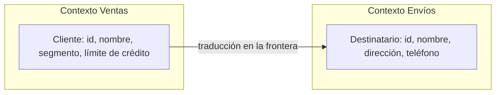

# Lenguaje ubicuo y contextos delimitados

<!-- cspell:words Evans ubicuo ubicuos DDD Bounded Context Ubiquitous Language Fowler anticorrupción Anticorruption microservicio javac Credito Envio direccion telefono -->

> **Tipo de página:** explicación. Te ayuda a entender por qué una misma palabra del negocio puede necesitar modelos distintos en distintas partes de un sistema; no es una guía de un *framework* concreto.

## El problema

En una tienda en línea todos hablan de "el cliente". Para el equipo de ventas es alguien con un segmento y un límite de crédito. Para el de envíos es una dirección y un teléfono donde entregar. Para el de facturación es un identificador fiscal. Si el código intenta tener **una sola clase `Cliente`** que sirva a las tres áreas, esa clase acumula los campos de todas, cada cambio de un equipo afecta a los otros y nadie sabe qué significa realmente cada campo.

La alternativa tampoco es cómoda: si cada equipo usa la palabra a su manera sin decirlo, las reuniones se llenan de malentendidos y el código acaba con nombres que ni los desarrolladores ni los expertos del negocio reconocen.

## La idea central

Dos ideas de *Domain-Driven Design* (DDD), ambas de Eric Evans, atacan este problema.

**Lenguaje ubicuo** (*ubiquitous language*). Martin Fowler lo describe como un lenguaje común y riguroso que comparten los desarrolladores y los expertos del negocio, apoyado en el modelo del dominio que usa el software. Evans lo trata como una forma de poner a prueba ese modelo en las conversaciones. Fowler recuerda un motivo práctico: el software no maneja bien la ambigüedad, así que los términos tienen que ser lo bastante exactos como para trasladarse al diseño.

**Contexto delimitado** (*bounded context*). Evans, en su resumen de los patrones, parte de que en cualquier proyecto grande hay varios modelos a la vez, por razones como que dos subsistemas atienden a comunidades de usuarios distintas, o que equipos independientes resuelven el mismo problema de forma diferente. Combinar código basado en modelos distintos hace el software confuso y poco fiable. Su respuesta es definir de forma **explícita** el contexto dentro del cual un modelo se aplica, y fijar sus fronteras en términos de la organización de los equipos, del uso en partes concretas de la aplicación y de manifestaciones físicas como el código y los esquemas de base de datos.

Fowler añade el argumento contra la alternativa: la unificación total del modelo de dominio de un sistema grande "no será viable ni rentable", y por eso el consejo de construir un único modelo de todo el negocio dio paso a dividir los sistemas en contextos, cada uno con su propio modelo unificado.

La idea se resume así: **dentro de un contexto, cada término significa una sola cosa; entre contextos, la misma palabra puede significar cosas distintas y eso se acepta de forma explícita**. Para Evans, las expresiones de un modelo, como cualquier frase, solo tienen sentido en un contexto.

## Cómo se estructura



Para trabajar con contextos hacen falta tres decisiones:

1. **Dónde está la frontera.** Evans la liga a equipos, partes de la aplicación, código y esquemas. Fowler observa que las fronteras suelen seguir la cultura humana: un vocabulario distinto pide un modelo distinto.
2. **Cómo se llama cada cosa dentro de cada contexto.** El lenguaje ubicuo vale **dentro** del contexto. En Envíos se habla de destinatario, no de cliente.
3. **Cómo se traducen los modelos en la frontera.** Cuando un contexto necesita datos del otro, una pieza de traducción convierte el modelo de uno en el del otro, para que Envíos no dependa de cómo Ventas representa al cliente. Fowler habla de relaciones entre contextos que se hacen explícitas, normalmente en un mapa de contextos, y el resumen de Evans cataloga varias formas de relación, entre ellas la capa anticorrupción (*Anticorruption Layer*).

## Cuándo no usarlo

- **En un sistema pequeño con un solo equipo y un vocabulario compartido.** Si no hay palabras que signifiquen cosas distintas, dividir en contextos añade traducciones sin beneficio.
- **Para dividir por razones técnicas.** Un contexto no es "el módulo de base de datos" ni "la capa de servicios": se delimita por el significado del negocio, no por la tecnología.
- **Sin acceso a los expertos del negocio.** El lenguaje ubicuo se construye conversando con ellos; sin esa conversación se convierte en un glosario inventado por los desarrolladores.

## Qué se gana y qué se pierde

| Se gana | Se pierde |
| --- | --- |
| Cada modelo es más pequeño y coherente | Hay que escribir y mantener la traducción entre contextos |
| Un equipo puede cambiar su modelo sin romper a otros | La misma persona puede aparecer con dos nombres y dos formas |
| Las conversaciones del negocio y el código usan las mismas palabras | Mantener el lenguaje exige que el equipo lo cuide y lo corrija |

## Confusiones frecuentes

- **"Un contexto delimitado es un microservicio."** Evans define las fronteras en términos de equipos, partes de la aplicación, código y esquemas, y no menciona la unidad de despliegue. Nuestra lectura es que un contexto es una decisión de modelado que puede vivir dentro de un [monolito modular](../arquitectura/monolito-modular.md) o repartirse en [microservicios](../arquitectura/microservicios.md); son decisiones distintas, aunque a menudo se alineen.
- **"Un modelo único y completo evita traducciones."** Fowler sostiene lo contrario para sistemas grandes: unificarlo todo no es viable ni rentable.
- **"El lenguaje ubicuo es un glosario."** Es un lenguaje vivo que aparece en las conversaciones y en el código, y que cambia a medida que el equipo entiende mejor el dominio. Si el código usa `getCustomerEntityData()` y el negocio dice "destinatario", no hay lenguaje compartido.
- **"Un término ambiguo se resuelve con un comentario."** La ambigüedad se resuelve en el modelo: dos significados, dos nombres, y cada uno en su contexto.

## Ejemplo

Dominio de pedidos con Java 21. Comprobado: compilado con `javac` de OpenJDK 21 y ejecutado.

En Ventas, el cliente importa por cuánto puede comprar. En Envíos, como destinatario. Son dos tipos distintos, y una función los traduce en la frontera:

```java
// Contexto Ventas
record ClienteDeVentas(String id, String nombre, String segmento, int limiteDeCredito) {}

// Contexto Envíos
record DestinatarioDeEnvio(String id, String nombre, String direccion, String telefono) {}

// Traducción en la frontera: Envíos no conoce el modelo de Ventas
static DestinatarioDeEnvio comoDestinatario(ClienteDeVentas c, String direccion, String telefono) {
    return new DestinatarioDeEnvio(c.id(), c.nombre(), direccion, telefono);
}
```

La salida muestra la misma persona con dos formas:

```text
Ventas: ClienteDeVentas[id=c-1, nombre=Ana, segmento=mayorista, limiteDeCredito=5000]
Envíos: DestinatarioDeEnvio[id=c-1, nombre=Ana, direccion=Calle 5 #10, telefono=555-0100]
```

El identificador `c-1` es lo único que comparten; Envíos no recibe el segmento ni el crédito, y Ventas no necesita saber la dirección de entrega. En una aplicación real cada contexto tendría su propio paquete (o módulo, o servicio) y la función de traducción viviría en la frontera. En .NET 8 la estructura es la misma, con un `record` por contexto.

## Referencias

- Evans, E. (2015). *Domain-Driven Design Reference: Definitions and Pattern Summaries*. Domain Language, Inc. <https://www.domainlanguage.com/wp-content/uploads/2016/05/DDD_Reference_2015-03.pdf> (consultado el 2026-11-09; [copia archivada](https://web.archive.org/web/20261011023500/https://www.domainlanguage.com/wp-content/uploads/2016/05/DDD_Reference_2015-03.pdf)). Secciones *Bounded Context* y *Ubiquitous Language*.
- Evans, E. (2003). *Domain-Driven Design: Tackling Complexity in the Heart of Software*. Addison-Wesley. Libro donde se formulan los dos patrones; no se consultó su texto, y lo que la página dice de ellos sale del resumen del propio Evans de 2015.
- Fowler, M. (2014). *BoundedContext*. <https://martinfowler.com/bliki/BoundedContext.html> (consultado el 2026-11-09; [copia archivada](https://web.archive.org/web/20261029173852/https://martinfowler.com/bliki/BoundedContext.html)). Contextos con modelos propios y su relación con la cultura de los equipos; la unificación total del modelo no es viable.
- Fowler, M. (2006). *UbiquitousLanguage*. <https://martinfowler.com/bliki/UbiquitousLanguage.html> (consultado el 2026-11-09; [copia archivada](https://web.archive.org/web/20261029203909/https://martinfowler.com/bliki/UbiquitousLanguage.html)). Definición del lenguaje ubicuo y la ambigüedad en el software.

Última revisión: 2026-11-09
