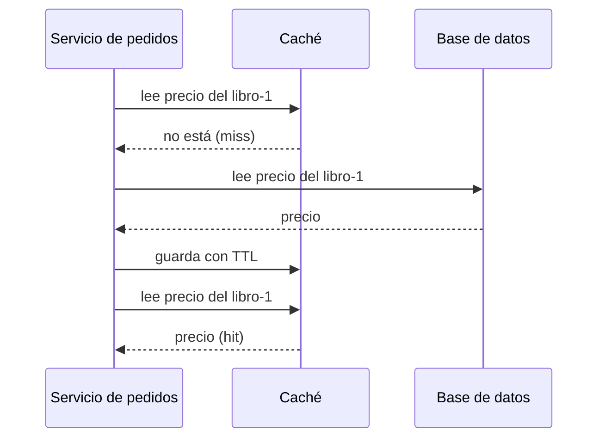

# Estrategias de caché: *cache-aside*, TTL e invalidación

<!-- cspell:words Nishtala memcache memcached Chhabra Redis stampede thundering herd cache-aside write-through TTL invalidación invalidar invalidada caché cachear cacheado cacheados coalescing javac lease leases look-aside demand-filled cachés desactualización desactualizados idempotente idempotentes NSDI -->

> **Tipo de página:** explicación. Te ayuda a decidir qué conviene guardar en una caché, por cuánto tiempo y cómo evitar que su caída o su vaciado tumbe el sistema; no es una guía de un producto concreto.

## El problema

Al armar un `Pedido` el servicio consulta precios del catálogo y tarifas de envío, datos que cambian pocas veces al día. Si cada petición los lee de la base de datos, la base de datos hace trabajo repetido y se satura cuando crece el tráfico.

Una **caché** guarda temporalmente el resultado en un almacenamiento rápido, en la memoria del proceso o en un servicio compartido como Redis. A cambio se acepta una condición: el dato guardado puede estar desactualizado durante un tiempo, o hay que decidir cómo invalidarlo.

## La idea central

El patrón más usado es ***cache-aside*** (también llamado carga bajo demanda). Es la aplicación la que maneja la caché, no la caché la que sabe de la base de datos. Según la descripción de Microsoft:

1. La aplicación intenta leer de la caché.
2. Si el dato no está (un *cache miss*), lo lee de la base de datos.
3. Lo guarda en la caché y lo devuelve.

Al escribir, la aplicación **actualiza primero la base de datos y después invalida** la entrada de la caché. La siguiente lectura la volverá a cargar con el valor nuevo. El orden importa: si se borra la entrada antes de actualizar la base, una lectura intermedia puede recargar el valor viejo y dejarlo guardado.

El artículo de Nishtala y colegas sobre la memcache de Facebook describe el mismo esquema, al que llama caché de consulta "bajo demanda y a un lado" (*demand-filled look-aside*). En las escrituras prefieren **borrar** el dato de la caché en lugar de actualizarlo, y dan una razón: los borrados son [idempotentes](../apis/idempotencia-y-reintentos.md). Añaden que la caché no es la fuente autoritativa del dato, por lo que puede descartar entradas.

Dos mecanismos controlan cuánto dura un dato guardado:

- **TTL (*time to live*):** un tiempo de vida fijado al cargar el dato; pasado ese tiempo, la entrada se considera caducada. El artículo de la AWS Builders' Library explica que se elige según cuánta desactualización tolera el cliente y cuánto cambia el dato: lo casi estático puede guardarse más tiempo.
- **Invalidación:** borrar la entrada cuando el dato cambia.

## Cómo se estructura



Decisiones que hay que tomar:

- **TTL.** Microsoft advierte que no debe ser demasiado corto, porque caducar antes de tiempo obliga a recargar de la base de datos una y otra vez, ni tan largo que el dato quede viejo.
- **Expulsión.** Las cachés tienen tamaño limitado y, al llenarse, descartan entradas; la política más común es descartar la menos usada recientemente (LRU).
- **Caché local o compartida.** Una caché en memoria del proceso es privada: dos instancias del servicio pueden tener copias distintas del mismo dato. Si eso importa, una caché compartida evita la divergencia.
- **Qué hacer cuando la caché falla.** El artículo de AWS recomienda que el cliente pueda seguir funcionando sin ella, con medidas como limitar la tasa de peticiones a la base de datos o servir datos desactualizados, y probar la carga con la caché desactivada.

## Cuándo no usarlo

- **Datos que exigen exactitud.** El stock disponible al confirmar un pedido no debería salir de una caché con TTL: un valor viejo permite vender lo que ya no hay. Microsoft señala también que pueden no ser aptos los datos sensibles o relacionados con seguridad, que conviene leer siempre de la fuente primaria.
- **Cuando casi ninguna petición acierta.** Si la mayoría de lecturas son *misses*, comprobar la caché y cargarla cuesta más de lo que ahorra.
- **Datos estáticos que caben enteros en la caché.** Es preferible cargarlos al arrancar y no hacerlos caducar.
- **Para esconder una consulta lenta.** Ver la primera confusión de abajo.

## Qué se gana y qué se pierde

| Se gana | Se pierde |
| --- | --- |
| Menos carga y menos latencia en las lecturas repetidas | El dato puede estar desactualizado durante el TTL |
| La base de datos soporta más tráfico con el mismo hardware | Invalidar bien es difícil y no hay garantía de consistencia |
| Un colchón ante una base de datos lenta | El sistema puede volverse dependiente de la caché |

## Confusiones frecuentes

- **"Poner Redis delante de una consulta lenta soluciona el problema de raíz."** Si la consulta es lenta porque le falta un índice, la caché solo aplaza el problema: cuando una entrada caduca o la caché se vacía bajo mucho tráfico, muchas peticiones llegan a la vez a la base de datos. El artículo de AWS lo describe: muchos clientes que piden a la vez el mismo recurso sin guardar, o un servidor nuevo que arranca con la caché vacía, pueden saturar la dependencia. Advierte además de que un servicio puede volverse "adicto a su caché", de modo que una caché fría o caída provoca un aumento de tráfico que causa una caída.
- **"Si la caché falla, el sistema simplemente es más lento."** Puede ser peor que más lento: el aumento de carga sobre la base de datos puede tumbar también a la base y a lo que dependa de ella.
- **"*Thundering herd* es solo cuando caduca una clave popular."** En el artículo de Facebook el término describe otra situación: una clave con mucha actividad de lectura y escritura, en la que las escrituras invalidan una y otra vez el valor recién guardado y muchas lecturas acaban yendo a la vía más costosa. En la literatura de AWS se usa también para el caso de muchas peticiones simultáneas sobre un recurso sin guardar. Conviene precisar cuál de los dos casos se discute.
- **"Actualizar la caché al escribir es más limpio que borrarla."** Facebook eligió borrar en lugar de actualizar porque el borrado es idempotente; actualizar exige que las escrituras concurrentes lleguen en el orden correcto.

## Ejemplo

Dominio de pedidos con Java 21, sin biblioteca, para mostrar solo la mecánica. Comprobado: compilado con `javac` de OpenJDK 21 y ejecutado.

La caché guarda cada valor con su hora de vencimiento. `obtener` es el *cache-aside* simple; `obtenerUnaVez` hace además que, para una misma clave, solo una petición cargue el dato mientras las demás esperan:

```java
String obtener(String clave, Function<String, String> cargar) {
    var e = datos.get(clave);
    if (e != null && Instant.now().isBefore(e.venceEn())) return e.valor();
    var valor = cargar.apply(clave);
    datos.put(clave, new Entrada(valor, Instant.now().plus(ttl)));
    return valor;
}

String obtenerUnaVez(String clave, Function<String, String> cargar) {
    var e = datos.get(clave);
    if (e != null && Instant.now().isBefore(e.venceEn())) return e.valor();
    return datos.compute(clave, (k, actual) -> {
        if (actual != null && Instant.now().isBefore(actual.venceEn())) return actual;
        return new Entrada(cargar.apply(k), Instant.now().plus(ttl));
    }).valor();
}

void invalidar(String clave) { datos.remove(clave); }
```

Con la caché vacía y 100 hilos que piden el mismo precio a la vez, cada carga tarda 50 ms:

```text
100 peticiones con la caché vacía, cache-aside simple:   100 lecturas a la base
100 peticiones con la caché vacía, una sola carga por clave: 1 lectura a la base
v1 v1 lecturas=1
v2 lecturas=2
```

Sin protección, las 100 peticiones llegan a la base de datos. Con una sola carga por clave llega una. Esa técnica se llama **agrupar peticiones** (*request coalescing*) y es la mitigación principal que propone el artículo de AWS. Las dos últimas líneas muestran que una segunda lectura no vuelve a la base y que, tras `invalidar`, la siguiente sí.

En el servicio real, el catálogo de precios sí es candidato a caché con un TTL de minutos; el stock disponible no lo es, o solo con un TTL muy corto, según cuánta exactitud exija el negocio. Esa decisión no sale de ninguna fuente: depende de cuánto cuesta vender de más. En .NET 8, la misma estructura se logra con `IMemoryCache` o `IDistributedCache`.

## Referencias

- Microsoft (2025). *Cache-Aside pattern*. Azure Architecture Center. <https://learn.microsoft.com/en-us/azure/architecture/patterns/cache-aside> (consultado el 2026-11-04; [copia archivada](https://web.archive.org/web/20260928002121/https://learn.microsoft.com/en-us/azure/architecture/patterns/cache-aside)). Flujo de lectura y escritura, orden entre actualizar e invalidar, TTL, expulsión, caché local y cuándo no usar el patrón.
- Chhabra, J. (2019). *Caching challenges and strategies*. AWS Builders' Library. <https://builder.aws.com/content/3K9TeXp6strMiJ4vhakpRD7BQWO/caching-challenges-and-strategies> (consultado el 2026-11-04; [copia archivada](https://web.archive.org/web/20261019214236/https://builder.aws.com/content/3K9TeXp6strMiJ4vhakpRD7BQWO/caching-challenges-and-strategies)). TTL, datos desactualizados, agrupación de peticiones y dependencia de la caché. La URL original en `aws.amazon.com/builders-library` redirige a esta.
- Nishtala, R. et al. (2013). Scaling Memcache at Facebook. En *10th USENIX Symposium on Networked Systems Design and Implementation (NSDI '13)* (pp. 385-398). <https://www.usenix.org/conference/nsdi13/technical-sessions/presentation/nishtala>. Texto: <https://www.usenix.org/system/files/conference/nsdi13/nsdi13-final170_update.pdf> (consultado el 2026-11-04; [copia archivada](https://web.archive.org/web/20261023030040/https://www.usenix.org/system/files/conference/nsdi13/nsdi13-final170_update.pdf)). Caché de consulta bajo demanda, borrar en lugar de actualizar, y *leases* contra valores desactualizados y *thundering herds* (sección 3.2.1).

Última revisión: 2026-11-04
