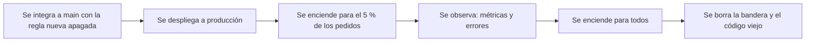

# Entrega continua y *feature flags*: desplegar no es lanzar

<!-- cspell:words Hodgson Humble Farley Knight Capital SMARS Power Peg toggle toggles feature flags kill switch router javac despliegue desplegar desplegado desplegada lanzar lanzamiento cubos cubo hash -->

> **Tipo de página:** explicación. Te ayuda a entender por qué separar el despliegue de una función de su lanzamiento reduce el riesgo, y qué costo tienen los interruptores que lo hacen posible; no es una guía de una herramienta de despliegue concreta.

## El problema

Un equipo acumula tres semanas de cambios en una rama para "subir todo junto el viernes por la noche". El despliegue es enorme: toca muchas partes a la vez, cuando algo falla cuesta saber cuál de los cambios fue, y deshacerlo es difícil porque lleva mezclado trabajo que sí funciona.

## La idea central

La **entrega continua** (*continuous delivery*) es una disciplina en la que el software está listo para salir en todo momento. Martin Fowler propone esta prueba: la versión actual en desarrollo se puede desplegar a producción "de un momento a otro". Distingue la entrega continua del **despliegue continuo**: este último envía automáticamente cada cambio a producción; la entrega continua solo exige que puedas hacerlo con frecuencia, y puedes elegir no hacerlo. Fowler llama al libro de Humble y Farley, *Continuous Delivery*, "el libro fundacional" del tema.

Para que `main` esté siempre desplegable aunque una función esté a medias, hay que separar dos actos que suelen confundirse:

- **Desplegar** es un acto técnico: el código llega a producción.
- **Lanzar** es un acto de producto: la función queda disponible para los usuarios.

La herramienta que los separa es el ***feature flag*** (o *feature toggle*, interruptor de funcionalidad). Pete Hodgson, en su artículo en el sitio de Fowler, describe los **interruptores de lanzamiento** (*release toggles*) como una forma de enviar a producción código sin terminar, latente, que quizá nunca se encienda; permiten además integrar a `main` con frecuencia y que el equipo de producto decida cuándo lanzar.

Hodgson distingue cuatro categorías, con vidas muy distintas:

| Categoría | Para qué sirve | Vida típica |
| --- | --- | --- |
| Lanzamiento | Enviar código sin terminar y encenderlo después | Corta: una o dos semanas |
| Experimento | Pruebas A/B: cada grupo recibe siempre el mismo camino | Lo que tarde en haber resultados significativos |
| Operaciones | Apagar o degradar una función rápido en producción | Corta, salvo interruptores de emergencia de larga duración |
| Permisos | Mostrar una función solo a ciertos usuarios, como clientes de pago | Años |

## Cómo se estructura



Dos recomendaciones de Hodgson sostienen el diseño:

- **No acoplar el punto de decisión a la lógica que decide.** Si el código de negocio lleva `if (config.esActiva("X"))` por todas partes, sabe demasiado. Propone que reciba la decisión ya tomada, por ejemplo mediante una interfaz inyectada, de modo que el módulo no sepa que existe un *feature flag* y se pueda probar con la decisión fijada en cada sentido.
- **Eliminar los interruptores de lanzamiento.** Son "transitorios por naturaleza" y deberían quitarse normalmente en una o dos semanas. Sugiere crear la tarea de retirarlos en el momento en que se crea el interruptor.

Hodgson advierte del costo: cada interruptor añade lógica condicional, abstracciones y pruebas. Propone controlarlo con fechas de caducidad, con pruebas que fallan pasada una fecha, o con un tope de interruptores simultáneos, de modo que añadir uno obligue a quitar otro.

## Cuándo no usarlo

- **Para cambios pequeños y seguros.** Un cambio que se integra y se despliega en una hora no necesita interruptor; añadirlo duplica el camino que hay que probar.
- **Como configuración permanente disfrazada.** Una opción que va a quedarse para siempre es configuración, no un interruptor de lanzamiento; trátala como tal.
- **Para esconder trabajo que no vas a terminar.** Un interruptor apagado indefinidamente es código muerto que sigue costando mantenimiento.
- **Para cambios que no se pueden encender y apagar,** como una migración de esquema que ya borró datos. El interruptor controla qué código corre, no deshace efectos en los datos.

## Qué se gana y qué se pierde

| Se gana | Se pierde |
| --- | --- |
| Lotes pequeños y frecuentes en lugar de un despliegue enorme | Lógica condicional extra y más caminos que probar |
| Poder apagar una función sin volver a desplegar | Disciplina para retirar los interruptores a tiempo |
| Lanzar de forma gradual y observar antes de abrir para todos | Hay que decidir y mantener quién ve qué |

## Confusiones frecuentes

- **"Un *feature flag* es una variable de la base de datos que se queda en el código para siempre."** Un interruptor de lanzamiento debe ser temporal. Si no se elimina cuando la función ya es estable para todos, el código acumula combinaciones de `if/else` que nadie prueba. Hodgson sugiere que, como no se puede probar cada combinación, se pruebe la configuración esperada en producción y el caso en que los interruptores nuevos están apagados.
- **"Entrega continua significa desplegar a producción en cada commit."** Eso es despliegue continuo. La entrega continua pide poder desplegar en cualquier momento, no hacerlo en cada cambio.
- **"El interruptor apagado no puede hacer daño."** El caso de Knight Capital, abajo, muestra lo contrario.
- **"Todos los interruptores son iguales."** Un interruptor de permisos puede durar años y un interruptor de lanzamiento, una semana; mezclarlos en una misma lista dificulta saber cuáles retirar.

## Un caso: Knight Capital, 2012

El 1 de agosto de 2012, la firma Knight Capital perdió más de 460 millones de dólares en unos 45 minutos. La orden de la SEC de 2013 explica lo que ocurrió:

- Knight desplegaba un código nuevo para un programa de liquidez en su sistema de envío de órdenes (SMARS). El código nuevo **reutilizaba una bandera** que antes activaba una funcionalidad llamada Power Peg, abandonada desde 2003 pero **todavía presente y ejecutable** en el sistema.
- Al desplegar, un técnico **no copió el código nuevo a uno de los ocho servidores**. No hubo una segunda persona que revisara el despliegue, y Knight no tenía procedimientos escritos que lo exigieran.
- En ese servidor, las órdenes con la bandera reutilizada activaron el código viejo, que se comportó de forma incorrecta y envió órdenes al mercado de manera descontrolada.

Es un caso útil por dos razones, y conviene no resumirlo como "una bandera que nunca se borró". El código muerto seguía ejecutable, la bandera cambió de significado y el despliegue fue parcial y sin revisión. Son tres fallos distintos, y el primero es precisamente el que la práctica de retirar interruptores y código viejo pretende evitar.

## Ejemplo

Dominio de pedidos con Java 21. Una nueva regla de envío entra en `ServicioDePedidos` apagada, detrás de una interfaz `EvaluadorDeFunciones`, y se enciende para un porcentaje de clientes. Comprobado: compilado con `javac` de OpenJDK 21 y ejecutado.

El servicio solo conoce la interfaz, no de dónde sale la decisión:

```java
interface EvaluadorDeFunciones {
    boolean activa(String funcion, String clienteId);
}

static String calcularEnvio(EvaluadorDeFunciones banderas, String clienteId, double total) {
    if (banderas.activa("envio-gratis-desde-50", clienteId)) {
        return total >= 50 ? "0.00" : "5.00";
    }
    return "5.00";
}
```

La implementación reparte a los clientes en 100 cubos según un cálculo estable sobre la función y el cliente, de modo que **el mismo cliente recibe siempre el mismo camino**:

```java
public boolean activa(String funcion, String clienteId) {
    int porcentaje = porcentajes.getOrDefault(funcion, 0);
    int cubo = Math.floorMod((funcion + ":" + clienteId).hashCode(), 100);
    return cubo < porcentaje;
}
```

Con 10 000 clientes la salida fue:

```text
porcentaje=0% -> 0.0% de 10000 clientes con la regla nueva
porcentaje=5% -> 5.0% de 10000 clientes con la regla nueva
porcentaje=100% -> 100.0% de 10000 clientes con la regla nueva
mismo cliente, dos peticiones: false false
envio con regla apagada, total 60: 5.00
envio con regla encendida, total 60: 0.00
```

Los dos caminos de `calcularEnvio` se pueden probar fijando la decisión sin tocar ninguna configuración, que es lo que pide Hodgson. Cuando la regla se valida con todos los clientes, se borran la bandera, la rama `else` y el código viejo; esa tarea se crea el mismo día que la bandera. En un sistema real el porcentaje se lee de una configuración que se puede cambiar sin desplegar; Hodgson señala que la configuración estática en el control de versiones suele ser preferible.

## Referencias

- Fowler, M. (2013, actualizado en 2014). *ContinuousDelivery*. <https://martinfowler.com/bliki/ContinuousDelivery.html> (consultado el 2026-11-04; [copia archivada](https://web.archive.org/web/20261025010252/https://martinfowler.com/bliki/ContinuousDelivery.html)). Definición de entrega continua, diferencia con el despliegue continuo y mención del libro de Humble y Farley.
- Hodgson, P. (2017). *Feature Toggles (aka Feature Flags)*. <https://martinfowler.com/articles/feature-toggles.html> (consultado el 2026-11-04; [copia archivada](https://web.archive.org/web/20261027044222/https://martinfowler.com/articles/feature-toggles.html)). Categorías de interruptores, retirada de los interruptores de lanzamiento, control del costo y desacople de la decisión.
- Humble, J. y Farley, D. (2010). *Continuous Delivery: Reliable Software Releases through Build, Test, and Deployment Automation*. Addison-Wesley. Citado a través de Fowler, que lo llama el libro fundacional del tema; no se consultó el texto.
- U.S. Securities and Exchange Commission (2013). *In the Matter of Knight Capital Americas LLC* (Securities Exchange Act Release No. 34-70694, 16 de octubre de 2013). <https://www.sec.gov/files/litigation/admin/2013/34-70694.pdf> (consultado el 2026-11-04; [copia archivada](https://web.archive.org/web/20261021042643/https://www.sec.gov/files/litigation/admin/2013/34-70694.pdf)). Párrafos 12 a 15: despliegue del código nuevo, bandera reutilizada, código Power Peg aún presente y servidor sin actualizar.

Última revisión: 2026-11-04
