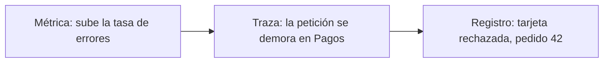

# Observabilidad: registros, métricas y trazas

<!-- cspell:words Micrometer OpenTelemetry traceparent traceId pedidoId clienteId trace-id span span-id observabilidad Saturación saturación trazas traza registros métricas JSON Beyer Petoff Murphy Fong-Jones Majors cardinalidad cardinalidades estructurado estructurados -->

> **Tipo de página:** explicación. Te ayuda a entender qué pregunta responde cada señal y cómo se conectan entre sí; no es una guía de una herramienta de monitoreo concreta.

## El problema

Un cliente avisa de que su pedido falló, o de que tardó 10 segundos. En producción hay miles de peticiones a la vez, repartidas entre varios servicios. Buscar a ojo líneas sueltas como `Entró al método` entre todas ellas no lleva a ninguna parte: no dicen de qué pedido son, ni en qué orden ocurrieron, ni si el problema afecta a un cliente o a todos.

## La idea central

Un solo tipo de dato no basta para entender un sistema en funcionamiento. OpenTelemetry, un estándar abierto para producir estos datos, llama **señales** a lo que el sistema emite sobre sí mismo, y entre ellas define tres principales:

- **Métricas:** mediciones tomadas en tiempo de ejecución, como el número de pedidos por segundo o el uso de memoria. Responden a **"¿hay un problema general?"**
- **Trazas:** el camino de una petición a través de la aplicación, que sigue una petición mientras pasa de un servicio a otro. Responden a **"¿en qué parte del recorrido se demoró?"**
- **Registros (*logs*):** el relato de eventos que ocurrieron en el sistema. Responden a **"¿qué detalle exacto pasó en ese paso?"**

Cada una es útil donde las otras no llegan. Una métrica avisa de que la tasa de errores subió, pero no dice qué pedido falló; un registro tiene el detalle, pero entre millones de líneas no se ve el patrón; una traza muestra dónde se fue el tiempo en una petición concreta, no cuántas se comportan así.

El libro de SRE de Google, en el capítulo sobre monitoreo de sistemas distribuidos, propone empezar por cuatro señales de un servicio de cara al usuario, las **cuatro señales doradas**:

- **Latencia:** el tiempo que tarda en atenderse una petición. Conviene medir por separado las exitosas y las fallidas, porque "un error lento es peor que un error rápido".
- **Tráfico:** cuánta demanda recibe el sistema, por ejemplo peticiones por segundo.
- **Errores:** la tasa de peticiones que fallan, ya sea de forma explícita (un 500), implícita (un 200 con el contenido equivocado) o por política (una respuesta que supera el objetivo de latencia).
- **Saturación:** qué tan "lleno" está el servicio, según su recurso más limitado.

El mismo capítulo separa **síntomas** de **causas**: servir errores 500 es un síntoma; que la base de datos rechace conexiones es una posible causa. Recomienda dedicar más esfuerzo a detectar síntomas, que es lo que siente el usuario, que causas.

## Cómo se estructura

Las tres señales se conectan mediante un identificador compartido: el de la traza. Cuando una petición entra, se le asigna un identificador de traza (*trace id*) que viaja con ella por todos los servicios. El estándar de W3C para propagar el contexto de traza lo transporta en la cabecera `traceparent`, que lleva una versión, un `trace-id` de 16 bytes que identifica la traza completa, un `parent-id` de 8 bytes que identifica el tramo actual y unas banderas.

Si cada línea de registro incluye ese `trace-id`, desde una traza lenta se llega a los registros exactos de esa petición, y desde un registro de error se llega a la traza que muestra el recorrido.



El flujo habitual de una investigación sigue ese camino: la métrica indica que algo va mal, la traza localiza dónde, el registro explica por qué.

## Cuándo no usarlo

- **Trazar todas las peticiones de un sistema pequeño.** Con un solo servicio y poco tráfico, métricas y registros estructurados suelen bastar; las trazas rinden más cuando una petición cruza varios servicios.
- **Métricas con etiquetas de valores ilimitados.** Cada combinación de etiquetas crea una serie distinta. La documentación de Micrometer pide mantener las etiquetas en conjuntos pequeños y acotados, como una región, y evitar valores como el identificador de usuario o de petición.
- **Registrar datos sensibles.** Números de tarjeta o contraseñas no deben acabar en un registro, aunque ayude a depurar.

## Qué se gana y qué se pierde

| Se gana | Se pierde |
| --- | --- |
| Responder preguntas que no previste al escribir el código | Costo de almacenamiento y de transporte de las señales |
| Pasar del síntoma a la causa en pocos pasos | Código de instrumentación que mantener |
| Detectar problemas antes de que los reporte un cliente | Etiquetas y volumen que hay que controlar |

## Confusiones frecuentes

- **"Registrar todo en nivel `INFO` en cada línea mejora la observabilidad."** Más líneas no son más información. El ruido encarece el almacenamiento, ralentiza la salida de datos, puede filtrar datos sensibles y oculta los errores reales si las líneas no comparten un `traceId` o un `pedidoId` con el que reconstruir una petición.
- **"Observabilidad es lo mismo que monitoreo."** El monitoreo vigila lo que ya sabes que puede fallar. La observabilidad es poder hacer preguntas nuevas sobre un comportamiento que no habías previsto.
- **"Las métricas, los registros y las trazas son tres herramientas distintas."** Son tres vistas del mismo sistema; lo que las une es el contexto compartido, como el identificador de traza.
- **"Una métrica por cliente da más detalle."** Con identificadores de cliente como etiqueta, el número de series crece sin límite. Ese detalle pertenece a los registros y a las trazas.

## Ejemplo

Dominio de pedidos con Java 21 y Spring Boot. Los fragmentos son ilustrativos y no están compilados. El nombre de la API de Micrometer se contrastó con su documentación.

Un registro estructurado en JSON incluye el contexto con el que se puede buscar y correlacionar:

```json
{
  "marca": "2026-11-04T16:30:12.481Z",
  "nivel": "INFO",
  "mensaje": "Pedido confirmado",
  "traceId": "4bf92f3577b34da6a3ce929d0e0e4736",
  "pedidoId": "9f1c2a40-5b0e-4c1a-9d7e-3b1f6d2a8c11",
  "clienteId": "ana"
}
```

Una métrica de negocio al confirmar el pedido. `Counter` cuenta eventos y la etiqueta tiene pocos valores posibles; el identificador del pedido va en el registro, no en la etiqueta:

```java
@Service
class ConfirmarPedido {
    private final MeterRegistry metricas;

    ConfirmarPedido(MeterRegistry metricas) {
        this.metricas = metricas;
    }

    void confirmar(Pedido pedido) {
        pedido.confirmar();
        metricas.counter("pedidos.confirmados", "canal", pedido.canal()).increment();
    }
}
```

Para no ensuciar las reglas de negocio, `Pedido` no conoce ni el registro ni las métricas: el caso de uso que lo orquesta, o un decorador a su alrededor, es quien registra. El identificador de traza lo añade la instrumentación al contexto del registro; el código de negocio no lo gestiona.

En .NET 8 la estructura es la misma: `ILogger` con registros estructurados y `System.Diagnostics.Metrics` para las métricas, ambos compatibles con OpenTelemetry.

## Referencias

- OpenTelemetry (s. f.). *Signals*. <https://opentelemetry.io/docs/concepts/signals/> (consultado el 2026-11-04; [copia archivada](https://web.archive.org/web/20261103090628/https://opentelemetry.io/docs/concepts/signals/)). Definición de trazas, métricas y registros como señales. Esa página no explica la correlación entre registros y trazas.
- W3C (2021). *Trace Context* (Recomendación W3C, 23 de noviembre de 2021). <https://www.w3.org/TR/trace-context/> (consultado el 2026-11-04; [copia archivada](https://web.archive.org/web/20261022055111/https://www.w3.org/TR/trace-context/)). Cabecera `traceparent` y sus campos: versión, `trace-id`, `parent-id` y banderas.
- Beyer, B., Jones, C., Petoff, J. y Murphy, N. R. (eds.) (2016). *Site Reliability Engineering*. O'Reilly. Capítulo 6, *Monitoring Distributed Systems*. <https://sre.google/sre-book/monitoring-distributed-systems/> (consultado el 2026-11-04; [copia archivada](https://web.archive.org/web/20261023045124/https://sre.google/sre-book/monitoring-distributed-systems/)). Las cuatro señales doradas y la distinción entre síntomas y causas.
- Micrometer (s. f.). *Counters*. <https://docs.micrometer.io/micrometer/reference/concepts/counters.html> (consultado el 2026-11-04; [copia archivada](https://web.archive.org/web/20260422052239/https://docs.micrometer.io/micrometer/reference/concepts/counters.html)). `registry.counter(nombre, etiquetas)` y la advertencia sobre etiquetas de baja cardinalidad.

Última revisión: 2026-11-04
