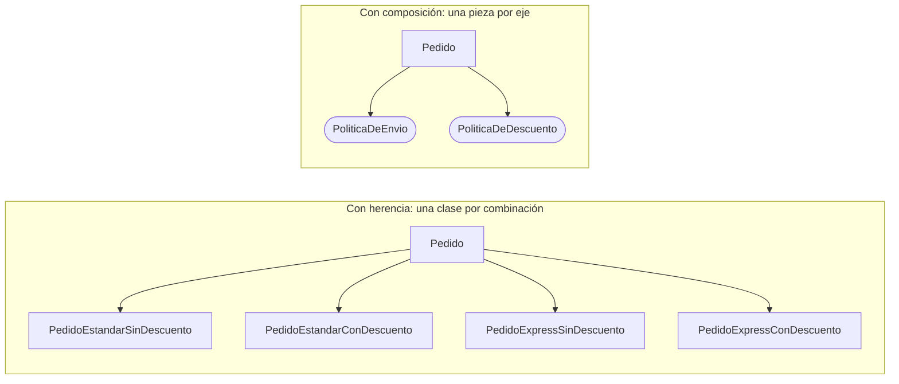

# Composición sobre herencia

<!-- cspell:words Bloch Vlissides Envio envio Estandar Politica encapsulamiento composicion -->

> **Tipo de página:** explicación. Te ayuda a entender la idea y a decidir cuándo aplicarla; no es un tutorial paso a paso.

## El problema

La herencia parece la forma natural de reutilizar código: si un pedido con envío *express* se parece a un pedido normal, se crea `PedidoConEnvioExpress extends Pedido`. El problema aparece cuando hay más de un eje de variación.

Supón que un pedido puede tener envío estándar o *express*, y descuento o no. Con herencia necesitas una subclase por combinación: `PedidoEstandarSinDescuento`, `PedidoEstandarConDescuento`, `PedidoExpressSinDescuento`, `PedidoExpressConDescuento`. Si aparece el envío internacional, las combinaciones pasan de cuatro a seis. Cada eje nuevo multiplica las clases.

Hay un segundo problema, menos visible: la subclase depende de cómo está implementada la clase padre, no solo de lo que promete. Un cambio interno en `Pedido` puede romper a `PedidoConEnvioExpress` sin que nadie toque la subclase.

## La idea central

En 1994, el libro de patrones de diseño de Gamma, Helm, Johnson y Vlissides formuló el principio como **preferir la composición de objetos a la herencia de clases**.

- **Herencia:** la clase hija reutiliza la implementación de la padre. Los autores la llaman reutilización de **caja blanca**, porque la hija ve los detalles internos de la padre. Por esa exposición, recuerdan, se suele decir que la herencia rompe el encapsulamiento.
- **Composición:** un objeto obtiene comportamiento delegando en otros objetos a través de sus interfaces. Es reutilización de **caja negra**: solo importa lo que el otro objeto promete, no cómo lo hace.

Joshua Bloch retoma la idea en *Effective Java* con un ejemplo concreto. Una subclase que cuenta los elementos agregados a un `HashSet` sobrescribe `add` y `addAll`. Como `addAll` de la clase padre llama internamente a `add`, cada elemento se cuenta dos veces. La subclase falló por un detalle de implementación que no estaba en ningún contrato.

## Cómo se estructura

En lugar de una jerarquía, cada eje de variación se convierte en una interfaz, y el objeto principal recibe una implementación de cada una:



Con composición, agregar el envío internacional es una clase nueva que implementa `PoliticaDeEnvio`. Las combinaciones se arman al crear el objeto, no al escribir la jerarquía, y pueden cambiar en tiempo de ejecución.

## Cuándo no usarlo

El principio dice *preferir*, no *prohibir*. La herencia sigue siendo adecuada en algunos casos:

- **Cuando la relación "es un" se cumple de verdad y es estable.** Bloch lo plantea como pregunta: ¿todo objeto de la subclase es realmente un objeto de la clase padre? Si la respuesta es sí y la jerarquía no va a crecer en varios ejes, la herencia es más directa.
- **Cuando la clase padre fue diseñada para heredarse.** Bloch recomienda diseñar y documentar las clases para la herencia o, si no, prohibirla. Muchas clases abstractas de *frameworks* existen para eso y documentan qué métodos sobrescribir.
- **Tipos cerrados y conocidos.** En Java 21, una `sealed interface` con varios `record` modela bien un conjunto fijo de variantes, como los estados de un pedido.
- **Un solo eje de variación que no va a crecer.** Si solo existe un tipo de envío distinto y no hay otro eje, una subclase o una condición pueden ser suficientes.

## Qué se gana y qué se pierde

| Se gana | Se pierde |
| --- | --- |
| Agregar una variante es una clase nueva, no una combinación por cada variante existente | Más objetos que crear y conectar al construir el pedido |
| Las piezas se prueban por separado | Seguir el comportamiento exige saber qué implementación se inyectó |
| Las dependencias pasan por interfaces, no por detalles internos de otra clase | Algo de código de delegación que la herencia daba gratis |
| El comportamiento puede cambiar en tiempo de ejecución | La jerarquía ya no documenta por sí sola qué variantes existen |

## Confusiones frecuentes

- **"La herencia es la herramienta principal para reutilizar código entre clases parecidas."** Parecerse no alcanza. Si la única razón para heredar es no repetir unos métodos, la composición reutiliza ese código sin atar una clase a la implementación de otra.
- **"Composición sobre herencia significa no usar nunca `extends`."** El principio pide preferir la composición, no eliminar la herencia. Implementar interfaces tampoco es el problema: el riesgo está en heredar implementación.
- **"Composición es lo mismo que inyección de dependencias."** La inyección es una forma de entregarle a un objeto sus colaboradores. La composición es la decisión de diseño de delegar en ellos. Puedes componer creando los colaboradores a mano.
- **"Es un principio de SOLID."** No forma parte de SOLID, aunque se relaciona con abierto/cerrado: el `Pedido` de abajo admite políticas nuevas sin modificarse (ver [SOLID](solid.md)).

## Ejemplo

Dominio de pedidos con Java 21. El código compila y no depende de ningún *framework*.

Cada eje de variación es una interfaz. El `Pedido` delega el envío y el descuento en las políticas que recibe:

```java
public record Linea(String productoId, int cantidad, BigDecimal precioUnitario) {
    BigDecimal subtotal() {
        return precioUnitario.multiply(BigDecimal.valueOf(cantidad));
    }
}

public interface PoliticaDeEnvio {
    BigDecimal costo(List<Linea> lineas);
}

public interface PoliticaDeDescuento {
    BigDecimal descuento(BigDecimal subtotal);
}

public record Pedido(List<Linea> lineas, PoliticaDeEnvio envio, PoliticaDeDescuento descuento) {
    public Pedido {
        if (lineas.isEmpty()) {
            throw new IllegalArgumentException("Un pedido necesita al menos una línea");
        }
        lineas = List.copyOf(lineas);
    }

    public BigDecimal total() {
        var subtotal = lineas.stream().map(Linea::subtotal).reduce(BigDecimal.ZERO, BigDecimal::add);
        return subtotal.subtract(descuento.descuento(subtotal)).add(envio.costo(lineas));
    }
}
```

Las variantes son pequeñas y se combinan libremente. Como las interfaces tienen un solo método, en Java pueden ser lambdas:

```java
PoliticaDeEnvio express = lineas -> new BigDecimal("15.00");
PoliticaDeDescuento diezPorCiento = subtotal -> subtotal.multiply(new BigDecimal("0.10"));

var pedido = new Pedido(lineas, express, diezPorCiento);
```

Dos tipos de envío y dos de descuento son cuatro piezas en lugar de cuatro subclases. Con tres de cada uno, la herencia necesitaría nueve subclases; la composición, seis piezas.

En C# con .NET 8 la estructura es la misma: interfaces para cada política, o delegados `Func<IReadOnlyList<Linea>, decimal>` cuando la política es una sola operación.

## Referencias

- Gamma, E., Helm, R., Johnson, R. y Vlissides, J. (1994). *Design Patterns: Elements of Reusable Object-Oriented Software*. Addison-Wesley. ISBN 978-0-201-63361-0. Cap. 1: comparación entre herencia y composición, reutilización de caja blanca y de caja negra, y el principio de preferir la composición.
- Bloch, J. (2018). *Effective Java* (3.ª ed.). Addison-Wesley. ISBN 978-0-13-468599-1. Ítem 18 (*Favor composition over inheritance*): fragilidad de la herencia de implementación y el ejemplo del `HashSet` instrumentado. Ítem 19 (*Design and document for inheritance or else prohibit it*).

Última revisión: 2026-10-27
