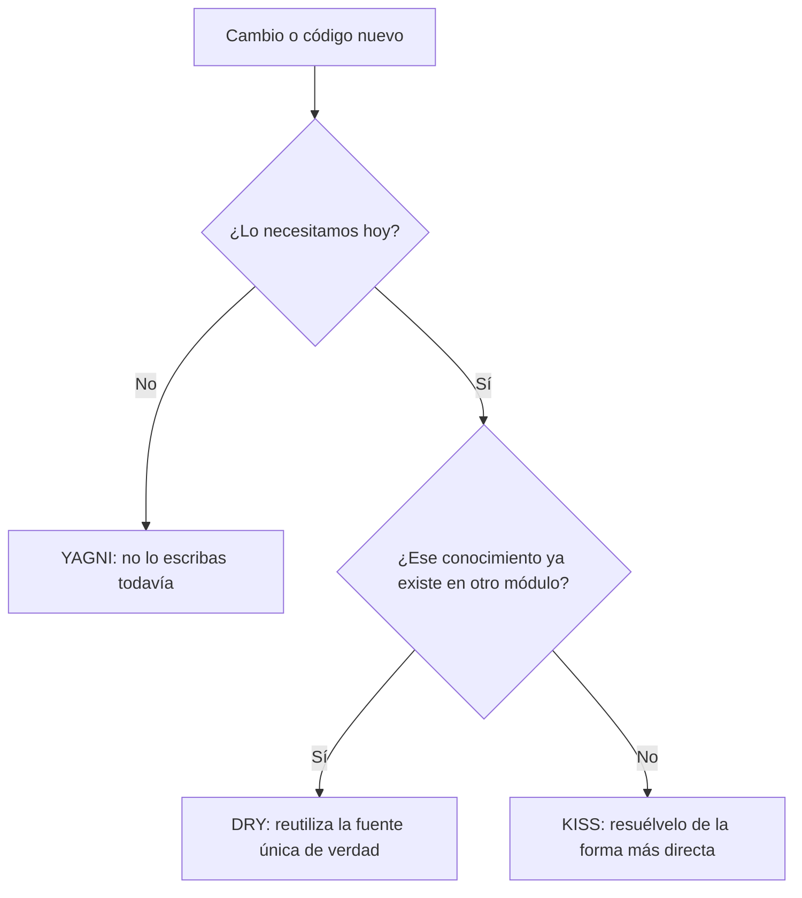

# DRY, KISS y YAGNI

<!-- cspell:words Beck Chet Hendrickson Hickey Hunt Kent Sandi Thomas configurables crípticas heurística heurísticas multimoneda recalculan refactorización resuélvelo Yagni -->

> **Tipo de página:** explicación. Te ayuda a entender la idea y a decidir si te conviene; no es un tutorial paso a paso.

## El problema

Al escribir software es común caer en dos extremos opuestos:

1. **Dispersar la misma regla de negocio en varios lugares.** Cuando el negocio cambia la regla, alguien actualiza dos lugares, olvida el tercero y el sistema queda inconsistente.
2. **Construir abstracciones complejas para problemas hipotéticos.** El equipo diseña motores genéricos, parámetros configurables y jerarquías de clases "por si mañana hacen falta", y termina manteniendo código para requisitos que nunca llegan.

Hacen falta criterios prácticos para decidir cuándo unificar, cuándo mantener las cosas directas y cuándo postergar trabajo.

## La idea central

**DRY**, **KISS** y **YAGNI** son tres heurísticas complementarias que ayudan a contener la complejidad accidental:

- **DRY (*Don't Repeat Yourself*):** cada pieza de conocimiento de un sistema debe tener una representación única, inequívoca y autorizada. La formularon Andy Hunt y Dave Thomas en *The Pragmatic Programmer* (1999).
- **KISS (*Keep It Simple, Stupid* / *Keep It Short and Simple*):** entre dos soluciones que resuelven el mismo problema, prefiere la más directa de entender y mantener. El acrónimo se atribuye a Kelly Johnson, ingeniero aeronáutico de Lockheed en los años sesenta, y se adoptó en el desarrollo de software. No existe un texto fuente de Johnson que lo formule: la atribución es tradición oral.
- **YAGNI (*You Aren't Gonna Need It*):** no implementes una funcionalidad hasta que sea realmente necesaria, no cuando solo supones que lo será. Proviene de *Extreme Programming* (XP) a fines de los años noventa: según Martin Fowler, surgió en una conversación entre Kent Beck y Chet Hendrickson en el proyecto C3, como forma de referirse a la práctica de diseño simple.

## Cómo se estructura

Las tres ideas actúan como frenos entre sí. Si aplicas DRY sin mirar KISS, creas abstracciones enredadas para ahorrar tres líneas. Si aplicas KISS sin DRY, repites reglas de negocio por todo el sistema.

| Heurística | Qué combate | Pregunta guía | En el dominio de pedidos |
| --- | --- | --- | --- |
| **DRY** | Duplicación de conocimiento | ¿Si cambia esta regla de negocio, tengo que tocar más de un lugar? | La regla "un pedido requiere al menos una línea" vive en `Pedido`, no copiada en el controlador y en el servicio |
| **KISS** | Complejidad innecesaria en el cómo | ¿Hay una forma más directa de expresar esto sin perder claridad? | Calcular el total sumando las líneas con un bucle o `Stream`, sin un motor de reglas dinámico |
| **YAGNI** | Funcionalidad especulativa en el qué | ¿Este requisito lo necesitamos hoy o lo estamos adivinando? | No programar soporte multimoneda si la tienda hoy solo cobra en una moneda |



## Cuándo no usarlo

- **DRY cuando dos bloques de código se parecen por casualidad pero representan conocimientos distintos.** Si dos validaciones tienen la misma forma hoy pero pertenecen a conceptos que evolucionan por separado, unirlas acopla ambos módulos. En la edición del 20.º aniversario de *The Pragmatic Programmer*, Hunt y Thomas recalcan que DRY trata sobre conocimiento, no sobre texto idéntico.
- **DRY entre límites de servicios o capas.** Compartir la misma clase entre la entidad de base de datos (`PedidoEntity`) y el modelo de la API REST (`PedidoResponse`) para "no repetir campos" ata el contrato público de tu API al esquema de tablas.
- **KISS confundido con escribir menos caracteres o ignorar el dominio.** Un método de una línea con expresiones regulares crípticas es corto pero no es simple. Y cuando el negocio es complejo, un modelo demasiado plano empuja esa complejidad hacia condicionales sueltos.
- **YAGNI como excusa para escribir código desordenado.** Martin Fowler aclara que YAGNI solo funciona si cambiar el código es barato y que no justifica descuidar la salud del código: necesita pruebas automáticas y refactorización constante. Tampoco aplica cuando el costo de cambiar después es altísimo, como en contratos públicos de una API ya publicada o migraciones destructivas de datos.

## Qué se gana y qué se pierde

| Se gana | Se pierde |
| --- | --- |
| Cambiar una regla de negocio requiere editar un único lugar (DRY) | Unificar antes de tiempo puede acoplar casos que luego divergen (abstracción equivocada) |
| Menos código muerto y menos tiempo invertido en funciones que nadie pide (YAGNI) | Si el requisito descartado llega más adelante, habrá que refactorizar para incorporarlo |
| Código que otra persona del equipo entiende en minutos (KISS) | Menos flexibilidad inmediata ante escenarios que no estaban previstos |

## Confusiones frecuentes

- **"DRY prohíbe tener dos clases con los mismos campos."** No. Tener `Pedido` en el dominio y `PedidoRequest` en el controlador REST duplica tres nombres de campos, pero no duplica conocimiento: uno representa las invariantes del negocio y el otro el formato JSON de entrada.
- **"Si dos métodos tienen tres líneas iguales, hay que extraer una clase base."** Sandi Metz popularizó la observación de que *"la duplicación es mucho más barata que la abstracción equivocada"*. Cuando dos fragmentos coinciden por accidente, forzarlos en un único método lleno de parámetros booleanos (`if (esCasoEspecial)`) rompe KISS sin cumplir el verdadero espíritu de DRY.
- **"YAGNI dice que no hay que pensar en la arquitectura."** YAGNI rechaza construir funcionalidades especulativas o puntos de extensión sin uso actual, pero se apoya en mantener el código limpio y probado para que cambiarlo mañana sea barato.
- **"Simple (KISS) es lo mismo que fácil."** Rich Hickey popularizó esta distinción en la charla *Simple Made Easy* (2011). Algo *fácil* es lo que te resulta familiar o rápido de escribir hoy; algo *simple* es lo que tiene pocas piezas entrelazadas cuando toca leerlo y mantenerlo seis meses después.

## Ejemplo

Dominio de pedidos en Java 21. Primero, un ejemplo de **falso DRY** y violación de **YAGNI**: unificar la validación del pedido con la del registro de clientes en un validador genérico configurable, y agregar multimoneda "por si el año que viene vendemos afuera":

```java
// Viola KISS y YAGNI: motor genérico y conversión de moneda que nadie pidió hoy.
public class ProcesadorUniversalDePedidos {
    public BigDecimal calcularTotal(
            List<Linea> lineas,
            String monedaDestino,
            Map<String, BigDecimal> tasasDeCambio,
            boolean aplicarImpuestoFronterizo) {
        // Decenas de líneas para casos hipotéticos...
        return BigDecimal.ZERO;
    }
}
```

Aplicando **DRY**, **KISS** y **YAGNI**, el conocimiento de negocio sobre qué hace válido a un `Pedido` y cómo se calcula su total vive en un solo lugar (`Pedido`), sin parámetros para requisitos futuros que hoy no existen:

```java
public record Linea(String productoId, int cantidad, BigDecimal precioUnitario) {
    public Linea {
        if (cantidad <= 0) {
            throw new IllegalArgumentException("La cantidad debe ser positiva");
        }
    }

    public BigDecimal subtotal() {
        return precioUnitario.multiply(BigDecimal.valueOf(cantidad));
    }
}

public record Pedido(UUID id, String clienteId, List<Linea> lineas) {
    public Pedido {
        if (lineas.isEmpty()) {
            throw new IllegalArgumentException("Un pedido necesita al menos una línea");
        }
        lineas = List.copyOf(lineas);
    }

    // DRY + KISS: el cálculo del total está en un solo lugar y es directo.
    public BigDecimal total() {
        return lineas.stream()
            .map(Linea::subtotal)
            .reduce(BigDecimal.ZERO, BigDecimal::add);
    }
}
```

Ni el controlador ni el repositorio recalculan el total ni vuelven a comprobar si la lista de líneas está vacía: confían en `Pedido` como única fuente de esa regla.

En C# con .NET 8 se expresa igual: un `record` o clase `Pedido` que valida sus invariantes en el constructor y expone una propiedad calculada `Total => Lineas.Sum(l => l.Subtotal)`.

## Referencias

- Hunt, A. y Thomas, D. (2019). *The Pragmatic Programmer: Your Journey to Mastery* (20th Anniversary Edition). Addison-Wesley, tópico 9 ("DRY—The Evils of Duplication"). ISBN 978-0-13-595705-9. Definición de DRY como duplicación de conocimiento y aclaración de las falsas duplicaciones entre código parecido y entre estructuras de datos.
- Beck, K. (1999). *Extreme Programming Explained: Embrace Change*. Addison-Wesley. ISBN 0-201-61641-6. Origen de la práctica de diseño simple en XP y de no implementar hoy lo que se cree necesitar mañana.
- Fowler, M. (2015). *Yagni*. <https://martinfowler.com/bliki/Yagni.html> (consultado el 2026-10-24; [copia archivada](https://web.archive.org/web/20261005122308/https://www.martinfowler.com/bliki/Yagni.html)). Explicación del origen de YAGNI en XP, sus costos (de construcción, de demora, de acarreo y de reparación) y por qué requiere código fácil de refactorizar.
- Metz, S. (2016). *The Wrong Abstraction*. <https://sandimetz.com/blog/2016/1/20/the-wrong-abstraction> (consultado el 2026-10-24; [copia archivada](https://web.archive.org/web/20261004225443/https://sandimetz.com/blog/2016/1/20/the-wrong-abstraction)). Explicación del costo de unificar código parecido bajo una abstracción prematura.
- Hickey, R. (2011). *Simple Made Easy*. Charla en Strange Loop. <https://www.infoq.com/presentations/Simple-Made-Easy/> (consultado el 2026-10-24). Distinción entre simple y fácil.

Última revisión: 2026-10-24
