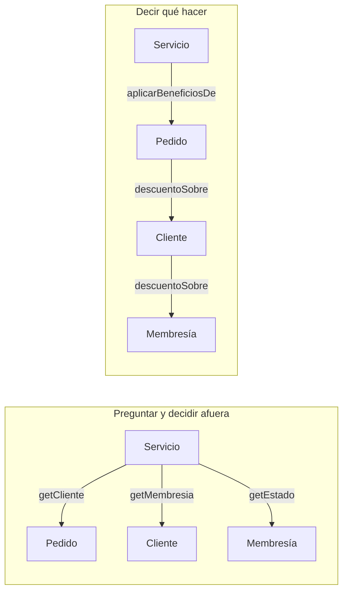

# Ley de Demeter y *Tell, Don't Ask*

<!-- cspell:words Sharp Smalltalk Demeter Lieberherr Northeastern Enbugging Membresia membresia despues parseado direccion autoimplementadas Dont antipatrón -->

> **Tipo de página:** explicación. Te ayuda a entender las dos ideas y a decidir cuándo aplicarlas; no es un tutorial paso a paso.

## El problema

Mira esta línea:

```java
if (pedido.getCliente().getMembresia().getEstado().equals("ACTIVA")) {
    pedido.setDescuento(pedido.getSubtotal().multiply(new BigDecimal("0.05")));
}
```

Para aplicar un descuento, este código conoce la estructura completa de tres clases: que un pedido tiene un cliente, que el cliente tiene una membresía y que la membresía guarda su estado como texto. Si mañana la membresía pasa a tener fecha de vencimiento, hay que buscar y cambiar cada lugar del sistema que recorre esa cadena.

Además, la regla de negocio ("los socios activos tienen un 5 % de descuento") no vive en ninguno de los objetos involucrados. Vive en el código que los recorre, y probablemente está repetida en varios lugares.

## La idea central

Son dos principios distintos que apuntan al mismo problema: el código que conoce demasiado de la estructura interna de otros objetos.

**La ley de Demeter** (*Law of Demeter*, LoD) surgió en la Universidad Northeastern en 1987, durante el proyecto Demeter, y Karl Lieberherr e Ian Holland la publicaron en 1989. Su lema es "habla solo con tus amigos inmediatos". En la versión para métodos que resumen Hunt y Thomas, un método solo debería llamar a métodos de:

- su propio objeto;
- los objetos que recibe como parámetros;
- los objetos que crea;
- los objetos que su objeto tiene como atributos.

Llamar a un método sobre el resultado de otra llamada (`a.getB().getC().hacer()`) es hablar con desconocidos. Los autores la presentan como una versión concreta del principio de bajo acoplamiento: hace visible el acoplamiento innecesario.

***Tell, Don't Ask*** (dile, no le preguntes) se asocia con Andy Hunt y Dave Thomas, que a su vez toman la idea de Alec Sharp: el código procedural obtiene información y toma decisiones; el orientado a objetos les dice a los objetos qué hacer. En lugar de pedirle datos a un objeto y decidir afuera qué hacer con ellos, le dices al objeto qué hacer y él decide con sus propios datos. Fowler lo resume como un recordatorio de que la orientación a objetos consiste en juntar los datos con las funciones que operan sobre ellos.

## Cómo se estructura

Las dos ideas llevan al mismo cambio: mover el comportamiento hacia el objeto que tiene los datos. Cada objeto expone una operación con significado de negocio y oculta cómo la resuelve.



En la segunda versión cada objeto habla solo con el siguiente, y la regla del descuento queda en `Membresia`, que es quien sabe si está activa.

## Cuándo no usarlo

- **Estructuras de datos.** Un `record` de respuesta, un DTO o un JSON parseado existen para exponer datos. Navegar `respuesta.cliente().direccion().ciudad()` en un DTO no oculta ninguna regla, y envolver cada campo en un método solo agrega código. La ley de Demeter piensa en objetos con comportamiento, no en datos planos.
- **APIs fluidas.** `pedidos.stream().filter(...).map(...).toList()` encadena llamadas, pero cada una devuelve un objeto del mismo tipo de API. No expone la estructura interna de tu dominio.
- **Cuando lleva a interfaces enormes.** La página del proyecto Demeter reconoce que, a nivel de clase, la ley tiende a producir interfaces anchas: muchos métodos auxiliares que solo reenvían llamadas. Si `Pedido` termina con un método por cada dato de cada objeto relacionado, el remedio salió peor.
- **Para eliminar todos los *getters*.** Fowler advierte que *Tell, Don't Ask* puede empujar a eliminar cualquier método de consulta, y que a veces la colaboración más clara es que un objeto entregue información. Él prefiere pensar en ubicar juntos los datos y el comportamiento.

## Qué se gana y qué se pierde

| Se gana | Se pierde |
| --- | --- |
| Cambiar la estructura interna de un objeto afecta solo a sus vecinos directos | Métodos de reenvío en clases intermedias |
| La regla de negocio vive en un solo lugar, junto a sus datos | Para entender una operación hay que seguir varias delegaciones |
| Pruebas más simples: cada objeto se prueba con sus colaboradores directos | Riesgo de inflar las clases con métodos que solo usa un llamador |

## Confusiones frecuentes

- **"Encapsular es poner los campos `private` y generar *getters* y *setters* para todo."** Si cada campo tiene su *getter* y su *setter*, cualquiera puede leer y cambiar el estado desde afuera: el campo es privado solo de nombre. Fowler llama *modelo de dominio anémico* (*Anemic Domain Model*) a las clases de dominio que son poco más que bolsas de *getters* y *setters*, con toda la lógica en servicios.
- **"La ley de Demeter consiste en contar puntos."** Contar puntos por línea es un atajo. Lo que importa es con qué objetos habla el método. Partir la cadena en tres variables locales no cambia nada: el método sigue conociendo la estructura completa.
- **"*Tell, Don't Ask* prohíbe los métodos que devuelven datos."** Lo que critica es pedir datos para tomar afuera una decisión que le corresponde al objeto. Un método `total()` que devuelve un valor calculado es una consulta legítima.
- **"Las dos son lo mismo."** Se refuerzan, pero no son iguales. Demeter limita **con quién** habla un método. *Tell, Don't Ask* indica **dónde** poner la decisión.

## Ejemplo

Dominio de pedidos con Java 21. El código compila y no depende de ningún *framework*. `Linea` es el `record` con `subtotal()` de la página de [composición sobre herencia](composicion-sobre-herencia.md).

Cada clase responde con sus propios datos y solo habla con sus amigos inmediatos. La decisión de si corresponde el descuento queda en `Membresia`:

```java
public class Membresia {
    private final boolean activa;
    private final BigDecimal porcentajeDeDescuento;

    public Membresia(boolean activa, BigDecimal porcentajeDeDescuento) {
        this.activa = activa;
        this.porcentajeDeDescuento = porcentajeDeDescuento;
    }

    BigDecimal descuentoSobre(BigDecimal monto) {
        return activa ? monto.multiply(porcentajeDeDescuento) : BigDecimal.ZERO;
    }
}

public class Cliente {
    private final Membresia membresia;

    public Cliente(Membresia membresia) {
        this.membresia = membresia;
    }

    public BigDecimal descuentoSobre(BigDecimal monto) {
        return membresia.descuentoSobre(monto);
    }
}

public class Pedido {
    private final List<Linea> lineas;
    private BigDecimal descuento = BigDecimal.ZERO;

    public Pedido(List<Linea> lineas) {
        this.lineas = List.copyOf(lineas);
    }

    public void aplicarBeneficiosDe(Cliente cliente) {
        descuento = cliente.descuentoSobre(subtotal());
    }

    public BigDecimal total() {
        return subtotal().subtract(descuento);
    }

    private BigDecimal subtotal() {
        return lineas.stream().map(Linea::subtotal).reduce(BigDecimal.ZERO, BigDecimal::add);
    }
}
```

El código que antes recorría la cadena ahora es una sola línea:

```java
pedido.aplicarBeneficiosDe(cliente);
```

Si la membresía pasa a tener fecha de vencimiento, solo cambia `Membresia`. `Pedido` y `Cliente` no se enteran. `Pedido` ya no tiene `setDescuento`: nadie de afuera puede poner un descuento que no surja de las reglas.

En C# con .NET 8 la estructura es la misma. Las propiedades autoimplementadas con `get; set;` públicos tienen el mismo riesgo que los *setters* de Java.

## Referencias

- Lieberherr, K. J. y Holland, I. M. (1989). Assuring Good Style for Object-Oriented Programs. *IEEE Software*, 6(5), 38-48. DOI: 10.1109/52.35588. Publicación de la ley de Demeter.
- Lieberherr, K. J. (s. f.). *Law of Demeter (General Formulation)*. Northeastern University. <https://www2.ccs.neu.edu/research/demeter/demeter-method/LawOfDemeter/general-formulation.html> (consultado el 2026-10-27; [copia archivada](https://web.archive.org/web/20260703093149/https://www2.ccs.neu.edu/research/demeter/demeter-method/LawOfDemeter/general-formulation.html)). Origen en 1987, lema, relación con el bajo acoplamiento e interfaces anchas a nivel de clase.
- Hunt, A. y Thomas, D. (2003). The Art of Enbugging. *IEEE Software*, 20(1), 10-11. DOI: 10.1109/MS.2003.1159022. Columna en la que, según Fowler, los autores presentan *Tell, Don't Ask*.
- The Pragmatic Programmers (s. f.). *Tell, Don't Ask*. The Pragmatic Bookshelf. [Copia archivada](https://web.archive.org/web/20200513213948/https://pragprog.com/articles/tell-dont-ask) (consultada el 2026-10-28; la página original ya no está disponible). El principio, su origen en Alec Sharp y las cuatro reglas de la ley de Demeter para métodos.
- Fowler, M. (2013). *TellDontAsk*. <https://martinfowler.com/bliki/TellDontAsk.html> (consultado el 2026-10-27; [copia archivada](https://web.archive.org/web/20261001064424/https://martinfowler.com/bliki/TellDontAsk.html)). Resumen del principio y su advertencia sobre eliminar todos los métodos de consulta.
- Fowler, M. (2003). *AnemicDomainModel*. <https://martinfowler.com/bliki/AnemicDomainModel.html> (consultado el 2026-10-27; [copia archivada](https://web.archive.org/web/20261006084744/https://martinfowler.com/bliki/AnemicDomainModel.html)). Modelo de dominio anémico como antipatrón.

Última revisión: 2026-10-27
