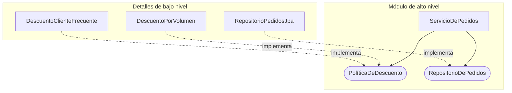

# Principios SOLID

<!-- cspell:words Feathers Liskov Meyer Parnas subtipado conductual indirección pasarle politica Politica postcondiciones refactorizar Rigido Subtyping -->

> **Tipo de página:** explicación. Te ayuda a entender la idea y a decidir si te conviene; no es un tutorial paso a paso.

## El problema

Con el paso de los meses, un sistema que empezó limpio suele volverse difícil de cambiar. En su artículo de 2000 *Design Principles and Design Patterns*, Robert C. Martin agrupa los síntomas de esa degradación en cuatro problemas:

- **Rigidez:** un cambio pequeño obliga a tocar muchas clases en cascada.
- **Fragilidad:** al cambiar una parte se rompen otras que no tienen relación aparente.
- **Inmovilidad:** cuesta reutilizar una pieza en otro contexto porque arrastra demasiadas dependencias.
- **Viscosidad:** hacer las cosas bien cuesta más trabajo que agregar un parche rápido.

La causa común es el acoplamiento no controlado entre módulos: clases que asumen detalles concretos de otras o que mezclan responsabilidades de distintos actores del negocio.

## La idea central

**SOLID** reúne cinco principios de diseño orientado a objetos recopilados por Robert C. Martin a principios de los años 2000 (el acrónimo lo propuso Michael Feathers alrededor de 2004). Su objetivo común es que los módulos de código sean fáciles de cambiar, probar y extender sin romper lo que ya funciona.

No son leyes absolutas ni una lista de verificación obligatoria para cada clase. Son heurísticas para decidir dónde poner los límites entre componentes cuando el código empieza a resistirse al cambio.

## Cómo se estructura

Cada letra del acrónimo responde a una pregunta distinta sobre la estructura del código:

| Letra | Principio | Idea original | En el dominio de pedidos |
| --- | --- | --- | --- |
| **S** | *Single Responsibility Principle* (SRP) | Un módulo debe tener una sola razón para cambiar, es decir, responder a un único actor o área del negocio (Martin, 2017) | El cálculo de impuestos de un `Pedido` (finanzas) no vive en la misma clase que arma el PDF del recibo (operaciones) |
| **O** | *Open-Closed Principle* (OCP) | Un módulo debe estar abierto para su extensión y cerrado para su modificación (Meyer, 1988) | Agregar un nuevo tipo de descuento no obliga a editar un `switch` dentro de `ServicioDePedidos` |
| **L** | *Liskov Substitution Principle* (LSP) | Un subtipo debe poder sustituir a su tipo base sin alterar las propiedades esperadas del programa (Liskov y Wing, 1994) | Si una interfaz promete aplicar un descuento válido, ninguna implementación lanza una excepción inesperada para pedidos pequeños |
| **I** | *Interface Segregation Principle* (ISP) | Ningún cliente debe depender de métodos que no usa (Martin, 2002) | Quien solo consulta un pedido no depende de una interfaz que también obliga a implementar `cancelar()` y `reembolsar()` |
| **D** | *Dependency Inversion Principle* (DIP) | Los módulos de alto nivel no dependen de los de bajo nivel; ambos dependen de abstracciones (Martin, 2002) | `ServicioDePedidos` define la interfaz `RepositorioDePedidos` y el adaptador JPA la implementa |

El siguiente diagrama muestra cómo se combinan **OCP**, **ISP** y **DIP** alrededor del servicio de pedidos: el servicio depende solo de abstracciones estrechas que él mismo necesita, y las implementaciones concretas apuntan hacia esas abstracciones.



## Cuándo no usarlo

- **Aplicar OCP de forma preventiva antes de que exista una segunda variante.** Crear interfaces y estrategias para cada cálculo cuando solo hay una regla en producción agrega indirección sin beneficio. Conviene esperar a que aparezca el segundo caso real.
- **Fragmentar clases hasta que ninguna haga nada por sí sola (falso SRP).** Si divides una operación coherente en cinco clases minúsculas que siempre cambian juntas por pedido del mismo usuario, no redujiste las razones de cambio: dispersaste la cohesión.
- **Crear una interfaz por cada clase concreta "por cumplir con DIP".** Un par `IServicioDePedidos` / `ServicioDePedidosImpl` con una sola implementación que copia firma por firma no invierte ninguna dependencia si los tipos que cruzan el límite siguen atados a detalles externos.
- **Scripts, prototipos o consultas de lectura directa.** Cuando el código no modela reglas de negocio cambiantes, el costo de las abstracciones supera lo que protegen.

## Qué se gana y qué se pierde

| Se gana | Se pierde |
| --- | --- |
| Los cambios de un área de negocio quedan contenidos en sus propios módulos | Más interfaces y tipos que navegar para seguir el flujo de ejecución |
| Agregar variantes nuevas (como otra regla de descuento) sin tocar código probado | Riesgo de diseñar puntos de extensión para cambios que nunca ocurren |
| Pruebas unitarias rápidas al sustituir detalles externos por dobles de prueba | Curva de aprendizaje para distinguir cuándo una abstracción aporta y cuándo estorba |
| Conexión directa con estilos como la [arquitectura hexagonal](../arquitectura/hexagonal.md) y la [Clean Architecture](../arquitectura/clean-architecture.md), que aplican DIP a escala de sistema | Discusiones de revisión cuando se toman los principios como dogmas |

## Confusiones frecuentes

- **"SRP significa que una clase o función debe hacer una sola cosa."** Martin aclara en *Clean Architecture* que "hacer una sola cosa" es una regla para refactorizar funciones largas, no el SRP. El SRP trata sobre las personas o áreas que piden cambios (*"Un módulo debe ser responsable ante un único actor"*), en línea con el criterio de descomposición de módulos de David Parnas (1972).
- **"Cumplir OCP significa que nunca más se modifica el código existente."** Si hay un error en una clase, se corrige en esa clase. OCP busca que agregar un comportamiento nuevo (por ejemplo, otro medio de notificación) se haga sumando código nuevo en lugar de editar el que ya funciona.
- **"LSP trata sobre herencia de clases como `Cuadrado` extiende `Rectángulo`."** En código moderno se aplica sobre todo a interfaces. Si una implementación de una interfaz viola las precondiciones o postcondiciones que espera quien la llama (por ejemplo, devolviendo `null` cuando el contrato promete una lista o lanzando `UnsupportedOperationException`), rompe LSP sin usar herencia de clases.
- **"DIP y la inyección de dependencias son lo mismo."** La inyección de dependencias es una técnica para pasarle colaboradores a un objeto desde afuera (por constructor). El DIP habla de quién es dueño de la abstracción y en qué dirección apuntan las dependencias del código fuente.

## Ejemplo

Dominio de pedidos en Java 21. Los fragmentos son ilustrativos: omiten los `import` y las clases `Pedido`, `PedidoJpaRepository` y `PedidoMapper`. Imagina un servicio que calcula el total de un pedido, aplica descuentos según el tipo de cliente y guarda el resultado en JPA:

```java
// Diseño rígido: mezcla actores (SRP), exige editar el método por cada descuento (OCP)
// y depende de una tecnología concreta (DIP).
public class ServicioDePedidosRigido {
    private final PedidoJpaRepository jpaRepository;

    public ServicioDePedidosRigido(PedidoJpaRepository jpaRepository) {
        this.jpaRepository = jpaRepository;
    }

    public BigDecimal cerrarPedido(Pedido pedido, String tipoDescuento) {
        BigDecimal subtotal = pedido.subtotal();
        BigDecimal total = switch (tipoDescuento) {
            case "NINGUNO" -> subtotal;
            case "VOLUMEN" -> pedido.lineas().size() >= 5
                ? subtotal.multiply(new BigDecimal("0.90"))
                : subtotal;
            default -> throw new IllegalArgumentException("Descuento desconocido");
        };
        jpaRepository.save(PedidoMapper.aEntidad(pedido, total));
        return total;
    }
}
```

Al aplicar **OCP** y **DIP**, el servicio define las abstracciones que necesita (`PoliticaDeDescuento` y `RepositorioDePedidos`). Para agregar un descuento nuevo basta con crear otra clase que implemente `PoliticaDeDescuento`, sin modificar `ServicioDePedidos`:

```java
public interface PoliticaDeDescuento {
    BigDecimal aplicar(Pedido pedido);
}

public interface RepositorioDePedidos {
    void guardar(Pedido pedido, BigDecimal total);
}

public class DescuentoPorVolumen implements PoliticaDeDescuento {
    @Override
    public BigDecimal aplicar(Pedido pedido) {
        BigDecimal subtotal = pedido.subtotal();
        return pedido.lineas().size() >= 5
            ? subtotal.multiply(new BigDecimal("0.90"))
            : subtotal;
    }
}

public class ServicioDePedidos {
    private final RepositorioDePedidos repositorio;

    public ServicioDePedidos(RepositorioDePedidos repositorio) {
        this.repositorio = repositorio;
    }

    public BigDecimal cerrarPedido(Pedido pedido, PoliticaDeDescuento politica) {
        BigDecimal total = politica.aplicar(pedido);
        repositorio.guardar(pedido, total);
        return total;
    }
}
```

Para respetar **LSP**, cualquier implementación de `PoliticaDeDescuento` debe devolver un monto válido no negativo para cualquier `Pedido` válido, sin obligar a `ServicioDePedidos` a preguntar con `instanceof` qué implementación recibió.

En C# con .NET 8 el diseño es equivalente: interfaces pequeñas (`IPoliticaDeDescuento`, `IRepositorioDePedidos`), implementaciones registradas en `IServiceCollection` y el servicio recibiendo sus dependencias por constructor primario.

## Referencias

- Martin, R. C. (2000). *Design Principles and Design Patterns*. Object Mentor. Fuente de los cuatro síntomas de degradación del diseño (rigidez, fragilidad, inmovilidad y viscosidad).
- Martin, R. C. (2002). *Agile Software Development, Principles, Patterns, and Practices*. Prentice Hall. ISBN 978-0-13-597444-5. Formulación de SRP, OCP, LSP, ISP y DIP en forma de libro; amplía la lista de síntomas a siete.
- Martin, R. C. (2017). *Clean Architecture: A Craftsman's Guide to Software Structure and Design*. Prentice Hall, parte III (caps. 7-11). ISBN 978-0-13-449416-6. Aclaración del SRP como responsabilidad ante un actor y distinción respecto a "hacer una sola cosa".
- Meyer, B. (1988). *Object-Oriented Software Construction*. Prentice Hall. Origen del principio abierto-cerrado.
- Liskov, B. H. y Wing, J. M. (1994). A Behavioral Notion of Subtyping. *ACM Transactions on Programming Languages and Systems*, 16(6), 1811-1841. <https://doi.org/10.1145/197320.197383>. Definición formal del subtipado conductual (LSP), que desarrolla la idea que Liskov presentó en 1987 en la conferencia *Data Abstraction and Hierarchy*.
- Parnas, D. L. (1972). On the Criteria To Be Used in Decomposing Systems into Modules. *Communications of the ACM*, 15(12), 1053-1058. <https://doi.org/10.1145/361598.361623>. Antecedente sobre separar módulos según las decisiones de diseño que pueden cambiar.

Última revisión: 2026-10-24
