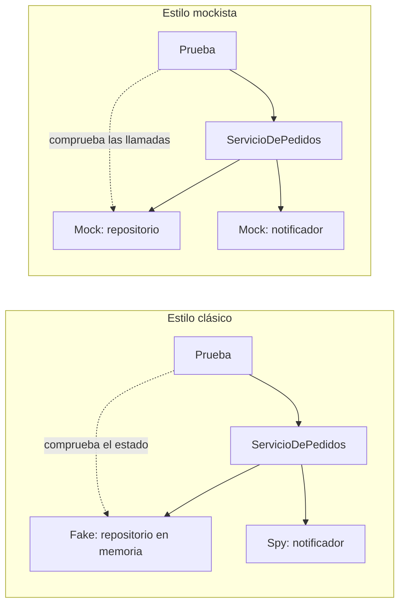

# Dobles de prueba

<!-- cspell:words Meszaros xunit Freeman Pryce Mockito mockista mockistas notificador Notificador Espia espía espías Moq clasico -->

> **Tipo de página:** explicación. Te ayuda a distinguir los tipos de dobles de prueba y a elegir cuándo usar cada uno; no es un tutorial de Mockito.

## El problema

En muchos equipos "mock" es el nombre de cualquier objeto que reemplaza a otro en una prueba. Como herramientas como Mockito (Java) o Moq (.NET) hacen fácil crear uno, se termina usando `@Mock` para todas las dependencias de todas las clases.

El resultado son pruebas que verifican **qué métodos se llamaron** en lugar de **qué resultado se obtuvo**. Cuando alguien reorganiza el código sin cambiar su comportamiento, decenas de pruebas fallan. Las pruebas, que deberían dar confianza para cambiar el código, se vuelven el principal obstáculo para cambiarlo.

## La idea central

Gerard Meszaros propuso en 2007, en *xUnit Test Patterns*, un vocabulario común. El término general es **doble de prueba** (*test double*, por analogía con el doble de riesgo del cine): cualquier objeto que reemplaza a uno de producción durante una prueba. Hay cinco tipos:

| Tipo | Qué hace |
| --- | --- |
| *Dummy* | Se pasa como parámetro pero nunca se usa |
| *Fake* | Tiene una implementación que funciona, con un atajo que la hace inadecuada para producción, como una base de datos en memoria |
| *Stub* | Devuelve respuestas preparadas para la prueba |
| *Spy* | Un *stub* que además registra cómo lo llamaron |
| *Mock* | Se programa con expectativas sobre las llamadas que debe recibir y falla si no se cumplen |

Martin Fowler explica en *Mocks Aren't Stubs* que detrás de esta diferencia hay dos formas de verificar:

- **Verificación de estado:** después de ejecutar el código, se comprueba el resultado o el estado de los objetos.
- **Verificación de comportamiento:** se comprueba que el código hizo ciertas llamadas a sus colaboradores. Es lo que hacen los *mocks*.

## Cómo se estructura

Fowler distingue dos estilos de prueba según cuándo se usan dobles:

- **Clásico:** usa objetos reales siempre que se puede, y un doble solo cuando el real es incómodo, como un servidor de correo. El tipo de doble importa poco.
- **Mockista:** usa un *mock* para cualquier colaborador con comportamiento interesante. Steve Freeman y Nat Pryce desarrollan este estilo en *Growing Object-Oriented Software, Guided by Tests* (2009), donde los *mocks* sirven para descubrir las interfaces entre objetos.



Fowler señala la consecuencia principal: las pruebas mockistas quedan más acopladas a la implementación. Cambiar cómo un método usa a sus colaboradores suele romperlas, aunque el resultado sea el mismo.

## Cuándo no usarlo

Los dobles son útiles, pero no siempre:

- **Para colaboradores rápidos y deterministas.** Si el objeto real es una clase de dominio sin E/S, como `Pedido` o una política de descuento, usarlo directamente da más confianza que reemplazarlo.
- **Un *mock* donde alcanza con comprobar el resultado.** Si puedes consultar el estado final, como el pedido guardado en un repositorio en memoria, esa prueba sobrevive mejor a los cambios internos.
- **Un *fake* que nadie mantiene.** Un repositorio en memoria que se comporta distinto del real (no valida duplicados, no ordena igual) da falsa confianza. Conviene complementarlo con alguna prueba de integración contra la base real.

## Qué se gana y qué se pierde

| Opción | Se gana | Se pierde |
| --- | --- | --- |
| Objetos reales | Máxima confianza; las pruebas no conocen la implementación | Si el colaborador es lento o tiene E/S, la prueba también |
| *Fake* | Pruebas rápidas que comprueban el estado | Hay que mantener una implementación extra |
| *Stub* y *Spy* | Control preciso de lo que devuelve o registra el colaborador | Algo de código de prueba por cada colaborador |
| *Mock* | Verifica interacciones que no dejan estado, como un evento enviado | Acoplamiento a la implementación: refactorizar rompe pruebas |

## Confusiones frecuentes

- **"Para que una prueba sea unitaria hay que usar `@Mock` en todas las dependencias."** Esa es solo la forma solitaria de prueba unitaria. Fowler llama sociables a las pruebas unitarias que usan colaboradores reales, y el estilo clásico las prefiere.
- **"Mock y stub son lo mismo."** Un *stub* entrega datos a la prueba. Un *mock* verifica que lo llamaron de cierta manera. Mockito crea objetos que pueden cumplir los dos papeles, pero la diferencia está en cómo los usa la prueba, no en la herramienta.
- **"Usar *mocks* está mal."** Son la herramienta correcta cuando la interacción es el resultado, como comprobar que se avisó al cliente cuando no hay otro estado que consultar. El problema es usarlos para todo.
- **"Un *fake* es una trampa."** Es una implementación real, más simple. El repositorio en memoria del ejemplo de [arquitectura hexagonal](../arquitectura/hexagonal.md) es un *fake*.

## Ejemplo

Dominio de pedidos con Java 21 y JUnit 5. `ServicioDePedidos` guarda el pedido y avisa al cliente, como en la página de [arquitectura hexagonal](../arquitectura/hexagonal.md). Las dos versiones compilan y se ejecutaron.

**Versión mockista**, con Mockito. Verifica las llamadas:

```java
@Test
void guardaElPedidoYAvisaAlCliente() {
    var repositorio = mock(RepositorioDePedidos.class);
    var notificador = mock(NotificadorDeClientes.class);
    var servicio = new ServicioDePedidos(repositorio, notificador);

    servicio.realizar("cliente-1", List.of(new Linea("A", 2)));

    verify(repositorio, times(1)).guardar(any());
    verify(notificador, times(1)).pedidoConfirmado(any());
}
```

Si mañana el servicio guarda en dos pasos o usa un método `guardarTodos`, la prueba falla aunque el pedido se siga guardando bien.

**Versión clásica**, con un *fake* para el repositorio y un *spy* para el notificador. Verifica el resultado:

```java
class NotificadorEspia implements NotificadorDeClientes {
    final List<Pedido> notificados = new ArrayList<>();

    @Override
    public void pedidoConfirmado(Pedido pedido) {
        notificados.add(pedido);
    }
}

class ServicioDePedidosTest {
    private final RepositorioDePedidosEnMemoria repositorio = new RepositorioDePedidosEnMemoria();
    private final NotificadorEspia notificador = new NotificadorEspia();
    private final ServicioDePedidos servicio = new ServicioDePedidos(repositorio, notificador);

    @Test
    void guardaElPedidoYAvisaAlCliente() {
        var pedido = servicio.realizar("cliente-1", List.of(new Linea("A", 2)));

        assertTrue(repositorio.buscar(pedido.id()).isPresent());
        assertEquals(List.of(pedido), notificador.notificados);
    }

    @Test
    void noAvisaSiElPedidoEsInvalido() {
        assertThrows(IllegalArgumentException.class, () -> servicio.realizar("cliente-1", List.of()));
        assertTrue(notificador.notificados.isEmpty());
    }
}
```

La prueba comprueba lo que importa: el pedido se puede recuperar y el cliente recibió exactamente ese pedido. El *spy* se usa solo para el notificador, porque enviar un aviso no deja otro estado que consultar.

En C# con .NET 8 los conceptos son los mismos: Moq o NSubstitute para *mocks*, y clases propias o `EF Core InMemory` como *fakes*, con las mismas advertencias sobre su fidelidad.

## Referencias

- Meszaros, G. (2007). *xUnit Test Patterns: Refactoring Test Code*. Addison-Wesley. ISBN 978-0-13-149505-0. Taxonomía de dobles de prueba (*Dummy*, *Fake*, *Stub*, *Spy*, *Mock*). Resumen del autor: <http://xunitpatterns.com/Test%20Double.html> (consultado el 2026-10-28; [copia archivada](https://web.archive.org/web/20260925204250/http://xunitpatterns.com/Test%20Double.html)).
- Fowler, M. (2006). *TestDouble*. <https://martinfowler.com/bliki/TestDouble.html> (consultado el 2026-10-28; [copia archivada](https://web.archive.org/web/20261021015159/https://martinfowler.com/bliki/TestDouble.html)). Definición breve de cada tipo de doble.
- Fowler, M. (2007). *Mocks Aren't Stubs*. <https://martinfowler.com/articles/mocksArentStubs.html> (consultado el 2026-10-28; [copia archivada](https://web.archive.org/web/20261015213225/https://martinfowler.com/articles/mocksArentStubs.html)). Verificación de estado y de comportamiento, estilos clásico y mockista y acoplamiento a la implementación.
- Fowler, M. (2014). *UnitTest*. <https://martinfowler.com/bliki/UnitTest.html> (consultado el 2026-10-28; [copia archivada](https://web.archive.org/web/20261021110043/https://martinfowler.com/bliki/UnitTest.html)). Pruebas unitarias solitarias y sociables.
- Freeman, S. y Pryce, N. (2009). *Growing Object-Oriented Software, Guided by Tests*. Addison-Wesley. ISBN 978-0-321-50362-6. Estilo mockista y uso de *mocks* para diseñar interfaces.

Última revisión: 2026-10-28
