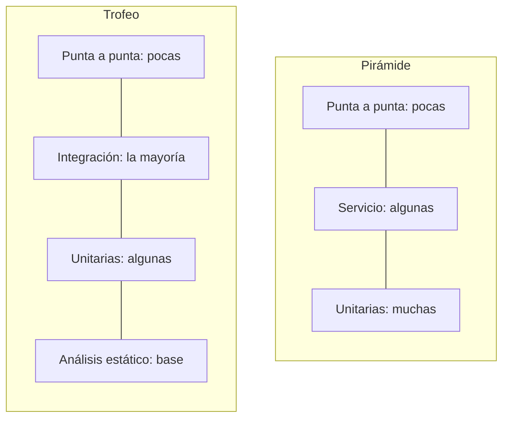

# Pirámide y trofeo de pruebas

<!-- cspell:words Cohn Crispin Dodds Rauch Marick Testcontainers subcutáneas JUnit piramide milisegundos Milisegundos Goodhart postgres -->

> **Tipo de página:** explicación. Te ayuda a decidir cómo repartir el esfuerzo entre tipos de pruebas automáticas; no es una guía de herramientas.

## El problema

Hay dos formas frecuentes de equivocarse con las pruebas automáticas.

En la primera, el equipo tiene miles de pruebas unitarias, cada clase probada en aislamiento con *mocks* para todas sus dependencias. Todas pasan en verde, pero la aplicación no arranca en producción porque nadie probó que las piezas funcionen juntas.

En la segunda, casi todas las pruebas recorren la aplicación de punta a punta a través de la interfaz. Tardan una hora, fallan de vez en cuando sin motivo aparente (pruebas inestables, en inglés *flaky tests*) y nadie confía en ellas.

Las dos situaciones tienen la misma causa: no se pensó qué tipo de prueba conviene para cada cosa.

## La idea central

Una **estrategia de pruebas** reparte el esfuerzo entre pruebas de distinto alcance, equilibrando tres factores: **velocidad**, **costo** de escribirlas y mantenerlas, y **confianza** en que el sistema funciona.

**La pirámide.** Mike Cohn la popularizó en su libro de 2009 *Succeeding with Agile*, donde la llama "pirámide de automatización de pruebas". Según Fowler, Cohn la dibujó por primera vez en una conversación con Lisa Crispin en 2003-2004. La idea es tener muchas pruebas unitarias en la base, una capa intermedia de pruebas que entran por la capa de servicios y pocas pruebas de punta a punta a través de la interfaz en la cima. La razón: las pruebas de punta a punta son frágiles, caras de escribir y lentas.

**El trofeo.** Kent C. Dodds lo propuso en 2018 a partir de la frase de Guillermo Rauch "*Write tests. Not too many. Mostly integration.*" (escribe pruebas, no demasiadas, sobre todo de integración). Tiene cuatro niveles: análisis estático en la base, unas pocas pruebas unitarias, la parte más ancha para las pruebas de integración y pocas de punta a punta arriba. Dodds aclara que lo pensó para aplicaciones JavaScript en el navegador, no para servicios de *backend*.

## Cómo se estructura



Fowler señala en 2021 que la diferencia entre las dos formas es en buena parte de vocabulario. "Prueba unitaria" y "prueba de integración" no tienen una definición única. Él distingue dos estilos de prueba unitaria:

- **Solitaria:** reemplaza todos los colaboradores de la clase por dobles de prueba.
- **Sociable:** usa los colaboradores reales cuando es práctico.

Muchas de las "pruebas de integración" del trofeo son pruebas unitarias sociables en el vocabulario de la pirámide. Las dos formas coinciden en lo importante: pocas pruebas de punta a punta y una base amplia de pruebas rápidas que se puedan ejecutar todo el tiempo.

## Cuándo no usarlo

- **Como regla de proporciones fijas.** Ni la pirámide ni el trofeo dicen "70 % unitarias". Fowler aclara que la pirámide supone que las pruebas amplias son lentas y frágiles. Si en tu sistema son rápidas, confiables y baratas de modificar, no necesitas tantas de bajo nivel.
- **El trofeo, tal cual, en un *backend*.** Su autor lo pensó para código que corre en el navegador. En un servicio Java el reparto depende de dónde está la lógica: un dominio con muchas reglas pide más pruebas sobre el dominio en memoria.
- **Sin acordar el vocabulario.** Si el equipo discute si conviene la pirámide o el trofeo sin definir antes qué es una prueba unitaria, va a discutir sobre palabras.

## Qué se gana y qué se pierde

| Tipo de prueba | Se gana | Se pierde |
| --- | --- | --- |
| Unitaria en memoria | Milisegundos por prueba; el fallo señala el lugar exacto | No prueba la configuración, la base de datos ni la red |
| Integración con dependencias reales | Confianza en que las piezas funcionan juntas | Segundos por prueba e infraestructura (contenedores, datos de prueba) |
| Punta a punta | Confianza en el recorrido real de quien usa el sistema | Lentitud, fragilidad y diagnósticos difíciles cuando fallan |

## Confusiones frecuentes

- **"El porcentaje de cobertura mide la calidad de las pruebas."** Fowler explica que la cobertura sirve para encontrar partes sin probar, pero dice poco como número: si se vuelve un objetivo, se alcanza sin esfuerzo con pruebas que casi no comprueban nada. Con pruebas pensadas con cuidado espera valores altos, y sospecharía de un 100 %. Es un caso de la ley de Goodhart: cuando una medida se vuelve objetivo, deja de ser una buena medida.
- **"La pirámide dice que las pruebas de punta a punta son malas."** Dice que sean pocas. Fowler recomienda que, cuando una prueba de alto nivel encuentra un error, primero se lo reproduzca con una prueba de bajo nivel, para que no vuelva.
- **"Prueba de punta a punta, prueba de interfaz y prueba del cliente son lo mismo."** Fowler los trata como ejes independientes: una regla de negocio puede tener una prueba escrita en el lenguaje del cliente que se ejecuta sobre un solo módulo.
- **"El trofeo reemplazó a la pirámide."** Son dos recomendaciones para contextos distintos, con definiciones distintas de sus niveles.

## Ejemplo

Dominio de pedidos con Java 21 y JUnit 5. Tres preguntas distintas se responden con tres tipos de prueba.

**¿El pedido respeta sus reglas?** Una prueba en memoria, sin Spring ni base de datos. Este fragmento compila y se ejecutó con JUnit 5:

```java
class PedidoTest {
    @Test
    void rechazaUnPedidoSinLineas() {
        assertThrows(IllegalArgumentException.class,
                () -> new Pedido(UUID.randomUUID(), "cliente-1", List.of()));
    }
}
```

**¿El repositorio guarda y recupera en PostgreSQL?** Una prueba de integración con una base real en un contenedor, usando Testcontainers. El fragmento es ilustrativo: omite los `import` y la configuración del esquema.

```java
@SpringBootTest
@Testcontainers
class RepositorioPedidosJpaTest {
    @Container
    @ServiceConnection
    static PostgreSQLContainer<?> postgres = new PostgreSQLContainer<>("postgres:16");

    @Autowired
    RepositorioPedidosJpa repositorio;

    @Test
    void guardaYRecuperaUnPedido() {
        var pedido = new Pedido(UUID.randomUUID(), "cliente-1", List.of(new Linea("A", 2)));

        repositorio.guardar(pedido);

        assertTrue(repositorio.buscar(pedido.id()).isPresent());
    }
}
```

**¿La API responde como se espera?** Una prueba que entra por HTTP con la aplicación levantada. También ilustrativa:

```java
@SpringBootTest
@AutoConfigureMockMvc
class PedidoApiTest {
    @Autowired
    MockMvc mvc;

    @Test
    void crearUnPedidoDevuelve201() throws Exception {
        mvc.perform(post("/pedidos")
                        .contentType(MediaType.APPLICATION_JSON)
                        .content("""
                                {"clienteId": "cliente-1", "lineas": [{"productoId": "A", "cantidad": 2}]}
                                """))
                .andExpect(status().isCreated());
    }
}
```

Las reglas del pedido se prueban muchas veces y en milisegundos con la primera forma. La segunda se escribe una vez por repositorio. La tercera, para los recorridos principales de la API.

En C# con .NET 8 el reparto es el mismo: xUnit para el dominio, Testcontainers para .NET con la base real y `WebApplicationFactory` para la API.

## Referencias

- Cohn, M. (2009). *Succeeding with Agile: Software Development Using Scrum*. Addison-Wesley. ISBN 978-0-321-57936-2. Presentación de la pirámide de automatización de pruebas.
- Fowler, M. (2012, revisado en 2017). *TestPyramid*. <https://martinfowler.com/bliki/TestPyramid.html> (consultado el 2026-10-28; [copia archivada](https://web.archive.org/web/20261022042157/https://martinfowler.com/bliki/TestPyramid.html)). Razones de la pirámide, capa de servicio, ejes independientes de las pruebas y origen en Cohn y Crispin.
- Fowler, M. (2021). *On the Diverse And Fantastical Shapes of Testing*. <https://martinfowler.com/articles/2021-test-shapes.html> (consultado el 2026-10-28; [copia archivada](https://web.archive.org/web/20261021123437/https://martinfowler.com/articles/2021-test-shapes.html)). Comparación de la pirámide con el trofeo y pruebas unitarias solitarias y sociables.
- Dodds, K. C. (2021). *The Testing Trophy and Testing Classifications*. <https://kentcdodds.com/blog/the-testing-trophy-and-testing-classifications> (consultado el 2026-10-28; [copia archivada](https://web.archive.org/web/20261022031114/https://kentcdodds.com/blog/the-testing-trophy-and-testing-classifications)). Origen del trofeo en 2018, la frase de Rauch y el contexto JavaScript para el que se pensó.
- Fowler, M. (2012). *TestCoverage*. <https://martinfowler.com/bliki/TestCoverage.html> (consultado el 2026-10-28; [copia archivada](https://web.archive.org/web/20261004124150/https://martinfowler.com/bliki/TestCoverage.html)). Para qué sirve la cobertura y por qué no mide la calidad de las pruebas.

Última revisión: 2026-10-28
