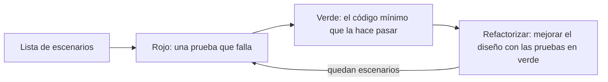

# Desarrollo guiado por pruebas (TDD)

<!-- cspell:words TDD SUnit OOPSLA Cunningham marcarEnviado refactoriza Mezclarlas descartable -->

> **Tipo de página:** explicación. Te ayuda a entender qué es TDD y cuándo conviene; no es un curso de TDD.

## El problema

Cuando las pruebas se escriben al final, suelen aparecer dos problemas. El primero es que el código ya quedó difícil de probar: crea sus propias dependencias, mezcla lógica con base de datos o expone el estado de una forma incómoda. El segundo es que las pruebas tienden a confirmar lo que el código ya hace, en lugar de comprobar lo que debería hacer.

Además, "las escribo al final" muchas veces termina en "no hubo tiempo".

## La idea central

El **desarrollo guiado por pruebas** (*Test-Driven Development*, TDD) es una forma de programar en la que escribes una prueba automática antes del código que la hace pasar. Kent Beck lo desarrolló a fines de los años noventa, como parte de *Extreme Programming*, y lo describió en 2002 en *Test-Driven Development: By Example*.

En 2023 Beck publicó un resumen de lo que llama *Canon TDD*, porque notaba que muchas críticas apuntaban a algo que no era TDD. Son cinco pasos:

1. Escribe una **lista de escenarios** que quieres cubrir.
2. Convierte **exactamente uno** de esos escenarios en una prueba concreta y ejecutable.
3. Cambia el código para que esa prueba, y todas las anteriores, pasen. Si descubres escenarios nuevos, agrégalos a la lista.
4. Opcionalmente, **refactoriza** para mejorar el diseño de la implementación.
5. Mientras la lista no esté vacía, vuelve al paso 2.

Los pasos 2 a 4 se resumen como **rojo, verde, refactorizar**: la prueba falla, la haces pasar, y después ordenas el código.

## Cómo se estructura



Beck separa dos tipos de decisiones de diseño. Al **escribir la prueba** decides la interfaz: cómo se invoca el comportamiento. Al **refactorizar** decides la implementación. Mezclarlas es uno de los errores que señala.

Fowler destaca los dos beneficios principales: obtienes código con pruebas, porque solo escribes código para hacer pasar una prueba, y pensar primero en la prueba te obliga a pensar primero en la interfaz.

## Cuándo no usarlo

- **Cuando todavía no sabes qué quieres construir.** Si estás explorando una biblioteca nueva o probando si una idea funciona, un prototipo descartable puede ser más útil. Cuando la idea se confirma, se reescribe con pruebas.
- **Código cuyo resultado se evalúa a ojo.** El diseño visual de una pantalla o un gráfico se ajusta mirándolo. Puedes probar la lógica que hay detrás, pero no el resultado visual.
- **Si el equipo omite el paso de refactorizar.** Fowler señala que es la forma más común de hacer mal TDD: sin ese paso, el resultado es código desordenado con pruebas.

## Qué se gana y qué se pierde

| Se gana | Se pierde |
| --- | --- |
| Cada comportamiento tiene al menos una prueba desde que existe | Al principio, más tiempo por cambio |
| La interfaz se diseña desde el punto de vista de quien la usa | Práctica: elegir el orden de las pruebas es una habilidad que se aprende |
| Refactorizar es seguro porque las pruebas avisan si algo se rompe | Pruebas que hay que mantener cuando cambia el comportamiento |
| Pasos pequeños: si algo falla, el error está en lo último que escribiste | Exige disciplina para no saltear pasos cuando hay apuro |

## Confusiones frecuentes

- **"TDD significa escribir todas las pruebas antes de empezar a programar."** Beck lo señala como error explícito: convertir toda la lista en pruebas de una vez lleva a rehacer trabajo cuando la primera prueba cambia una decisión. Se escribe una prueba por vez.
- **"Cada clase nueva necesita su propia clase de prueba."** Una prueba describe un comportamiento, no una clase. Fowler explica que lo que se llama "unidad" puede ser una clase o un conjunto de clases relacionadas, y que esa definición importa poco.
- **"TDD es una técnica de pruebas."** Beck lo describe como un flujo de trabajo para cambiar el comportamiento de un sistema con confianza. Las pruebas son el medio; el diseño y la confianza son el resultado.
- **"Si haces TDD tienes 100 % de cobertura y no necesitas otras pruebas."** TDD produce sobre todo pruebas de bajo nivel. Las pruebas de integración y de punta a punta (ver [pirámide y trofeo](piramide-y-trofeo.md)) siguen siendo necesarias.

## Ejemplo

Dominio de pedidos con Java 21 y JUnit 5. La regla de negocio: **un pedido se puede cancelar solo si todavía no se envió**. El código final compila y sus pruebas pasan.

**Lista de escenarios:**

- Un pedido confirmado se puede cancelar.
- Un pedido enviado no se puede cancelar.

**Primer ciclo. Rojo.** La prueba decide la interfaz: `pedido.cancelar()` y `pedido.estado()`. Todavía no compila, porque `cancelar` no existe, y eso cuenta como rojo:

```java
@Test
void sePuedeCancelarUnPedidoConfirmado() {
    var pedido = new Pedido(UUID.randomUUID(), "cliente-1", List.of(new Linea("A", 1)));

    pedido.cancelar();

    assertEquals(EstadoDePedido.CANCELADO, pedido.estado());
}
```

**Verde.** El código mínimo que la hace pasar:

```java
void cancelar() {
    estado = EstadoDePedido.CANCELADO;
}
```

**Segundo ciclo. Rojo.** El escenario que falta. La prueba falla porque hoy cualquier pedido se cancela:

```java
@Test
void noSePuedeCancelarUnPedidoEnviado() {
    var pedido = new Pedido(UUID.randomUUID(), "cliente-1", List.of(new Linea("A", 1)));
    pedido.marcarEnviado();

    assertThrows(IllegalStateException.class, pedido::cancelar);
    assertEquals(EstadoDePedido.ENVIADO, pedido.estado());
}
```

**Verde.** Se agrega la condición:

```java
void cancelar() {
    if (estado == EstadoDePedido.ENVIADO) {
        throw new IllegalStateException("No se puede cancelar un pedido enviado");
    }
    estado = EstadoDePedido.CANCELADO;
}
```

**Refactorizar.** Con las dos pruebas en verde se puede mejorar el diseño sin miedo. Aquí el código es lo bastante claro y no hace falta. Si mañana aparece el estado `ENTREGADO`, que tampoco se puede cancelar, la regla se moverá a un método `EstadoDePedido.permiteCancelar()`, y estas dos pruebas confirmarán que nada se rompió.

Mientras escribías las pruebas pudo aparecer otro escenario: ¿qué pasa si se cancela un pedido ya cancelado? Va a la lista, y el ciclo sigue.

En C# con .NET 8 el ciclo es idéntico con xUnit o NUnit.

## Referencias

- Beck, K. (2002). *Test-Driven Development: By Example*. Addison-Wesley. ISBN 978-0-321-14653-3. Descripción original de la técnica.
- Beck, K. (2023). *Canon TDD*. <https://tidyfirst.substack.com/p/canon-tdd> (consultado el 2026-10-28; [copia archivada](https://web.archive.org/web/20260606083837/https://tidyfirst.substack.com/p/canon-tdd)). Los cinco pasos, la separación entre decisiones de interfaz y de implementación, y los errores frecuentes, como escribir todas las pruebas primero.
- Fowler, M. (2005, actualizado en 2023). *TestDrivenDevelopment*. <https://martinfowler.com/bliki/TestDrivenDevelopment.html> (consultado el 2026-10-28; [copia archivada](https://web.archive.org/web/20261022122402/https://martinfowler.com/bliki/TestDrivenDevelopment.html)). Origen en *Extreme Programming*, beneficios y la omisión de la refactorización como error más común.
- Fowler, M. (2014). *UnitTest*. <https://martinfowler.com/bliki/UnitTest.html> (consultado el 2026-10-28; [copia archivada](https://web.archive.org/web/20261021110043/https://martinfowler.com/bliki/UnitTest.html)). Qué se considera una unidad.

Última revisión: 2026-10-28
