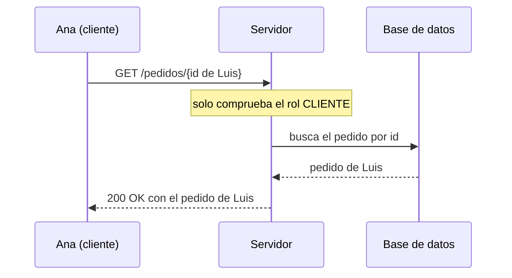

# Autorización y BOLA

<!-- cspell:words BOLA IDOR Saltzer Schroeder autenticar autenticado autorizar autorización autenticación mediación javac PreAuthorize -->

> **Tipo de página:** explicación. Te ayuda a distinguir autenticar de autorizar y a entender por qué un endpoint que comprueba el rol sigue siendo vulnerable; no es una guía de un *framework* concreto.

## El problema

Un cliente inicia sesión y consulta `GET /pedidos/{id}` con el identificador de su pedido. El servidor comprueba que hay una sesión válida y que el usuario tiene el rol `CLIENTE`. Si el cliente cambia el `id` de la URL por el de **otro** cliente, el servidor responde con ese pedido, porque nadie comprobó que le pertenece.

Es el fallo que OWASP pone en primer lugar de su lista de riesgos de seguridad en APIs de 2023, con el nombre de **autorización rota a nivel de objeto** (*Broken Object Level Authorization*, BOLA). En otros contextos se le llama IDOR.

## La idea central

**Autenticar** es saber quién eres. **Autorizar** es saber qué tienes permiso de hacer, y eso incluye **sobre qué objeto concreto**. Comprobar el rol responde a "¿puede un cliente consultar pedidos?"; no responde a "¿puede *este* cliente consultar *este* pedido?".

OWASP lo resume así: cada endpoint que recibe un identificador de objeto y actúa sobre él debe comprobar la autorización a nivel de objeto, y los servidores suelen fallar porque se fían del identificador que envía el cliente. La página advierte que comparar el identificador del usuario de la sesión con el parámetro de la petición "no es una solución suficiente".

Dos principios clásicos, del artículo de Saltzer y Schroeder (1975), explican por qué:

- **Mínimo privilegio:** "cada programa y cada usuario del sistema debería operar con el menor conjunto de privilegios necesario para completar su trabajo."
- **Mediación completa:** "cada acceso a cada objeto debe comprobarse para ver si tiene autoridad." Un endpoint que comprueba el rol pero no el objeto no media todos los accesos.

## Cómo se estructura



La corrección es llevar la identidad hasta donde se accede al dato. El `clienteId` sale de la **sesión o del token ya validado**, nunca de lo que envía el cliente, y se usa como parte de la consulta:

1. El controlador obtiene el cliente autenticado de la sesión.
2. Se lo pasa al caso de uso.
3. El repositorio busca por `id` **y** por cliente. Si el pedido existe pero es de otro, el resultado es el mismo que si no existiera.

Así la comprobación queda en un solo lugar, cerca del dato, y no depende de que cada controlador se acuerde de hacerla. OWASP recomienda además escribir pruebas de autorización y no desplegar cambios que las incumplan.

## Cuándo no usarlo

- **Recursos públicos.** Un catálogo de productos que cualquiera puede ver no necesita propietario.
- **Filtros por propietario que no existen en el modelo.** Si el recurso no pertenece a nadie, la comprobación debe expresarse con otra regla (un equipo, una organización), no con un campo que no existe.
- **Sustituirlo por identificadores difíciles de adivinar.** Ver la primera confusión de abajo.

## Qué se gana y qué se pierde

| Se gana | Se pierde |
| --- | --- |
| Un cliente no puede leer ni modificar pedidos ajenos | Cada consulta recibe un parámetro más: quién pregunta |
| La regla queda cerca del dato, en un único sitio | Pruebas de autorización que escribir y mantener |
| Comportamiento predecible: el pedido ajeno "no existe" | Hay que decidir qué se responde (`404` o `403`) y ser consistente |

## Confusiones frecuentes

- **"Si uso `UUID` en vez de enteros autoincrementales, no hace falta validar que el pedido sea del usuario."** Un `UUID` dificulta adivinar identificadores, y OWASP recomienda preferir valores aleatorios e impredecibles, pero lo presenta como una reducción del riesgo y no como un reemplazo de la comprobación de autorización. Un identificador filtrado en un enlace, un registro o un correo vuelve a abrir el acceso.
- **"Con `@PreAuthorize("hasRole('CLIENTE')")` ya está protegido."** Eso comprueba el rol, no el objeto. Es la versión del problema que se ve en el ejemplo.
- **"La interfaz solo muestra los pedidos del usuario, así que no hay problema."** El atacante no usa tu interfaz: envía las peticiones que quiera. La comprobación tiene que estar en el servidor.
- **"BOLA es lo mismo que no comprobar el rol."** OWASP las separa: si el atacante accede a una *función* que no debería tener, es otro riesgo (autorización rota a nivel de función); BOLA es acceder a un *objeto* ajeno con una función a la que sí tiene derecho.

## Ejemplo

Dominio de pedidos con Java 21. El núcleo está comprobado: se compiló con `javac` de OpenJDK 21 y se ejecutó. La anotación de Spring es ilustrativa.

El controlador vulnerable comprueba el rol y busca solo por `id`:

```java
@GetMapping("/pedidos/{id}")
@PreAuthorize("hasRole('CLIENTE')")
Pedido consultar(@PathVariable UUID id) {
    return pedidos.buscarPorId(id).orElseThrow(PedidoNoEncontrado::new);
}
```

La versión corregida toma el cliente de la identidad autenticada y lo pasa al repositorio:

```java
@GetMapping("/pedidos/{id}")
@PreAuthorize("hasRole('CLIENTE')")
Pedido consultar(@PathVariable UUID id, @AuthenticationPrincipal Cliente cliente) {
    return pedidos.buscarPorIdYCliente(id, cliente.id()).orElseThrow(PedidoNoEncontrado::new);
}
```

El repositorio expresa la regla una sola vez:

```java
Optional<Pedido> buscarPorIdYCliente(UUID id, String clienteId) {
    return buscarPorId(id).filter(p -> p.clienteId().equals(clienteId));
}
```

Ejecutado con dos pedidos, uno de `ana` y otro de `luis`:

```text
vulnerable, ana pide el pedido de luis: true
corregido,  ana pide el pedido de luis: false
corregido,  ana pide el suyo:           true
```

En una base de datos real la misma regla se escribe en la consulta (`WHERE id = :id AND cliente_id = :clienteId`), de modo que el pedido ajeno ni siquiera se lee. En .NET 8 la estructura es la misma, con el identificador del usuario tomado de `ClaimsPrincipal`.

## Referencias

- OWASP (2023). *API1:2023 Broken Object Level Authorization*. OWASP API Security Top 10. <https://api-security.owasp.org/editions/2023/en/0xa1-broken-object-level-authorization> (consultado el 2026-11-04). Descripción del riesgo, escenarios de ataque y prevención, incluida la recomendación de identificadores aleatorios.
- Saltzer, J. H. y Schroeder, M. D. (1975). The Protection of Information in Computer Systems. *Proceedings of the IEEE*, 63(9), 1278-1308. <https://doi.org/10.1109/PROC.1975.9939>. Texto en línea de los principios: <https://web.mit.edu/Saltzer/www/publications/protection/Basic.html> (consultado el 2026-11-04). Definiciones de mínimo privilegio y mediación completa; los datos de publicación se verificaron en Crossref.

Última revisión: 2026-11-04
