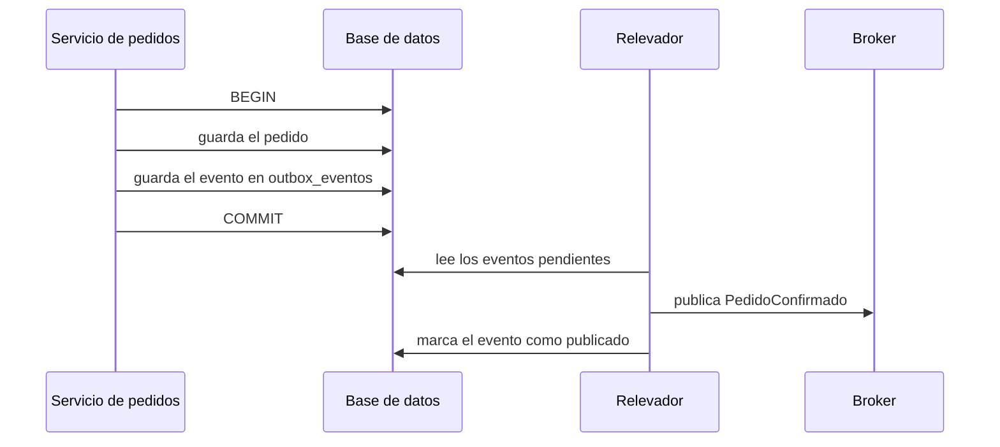

# El problema de la doble escritura y el *Transactional Outbox*

<!-- cspell:words Richardson relevador relevadores outbox fantasma at-least-once Kafka RabbitMQ jsonb timestamptz idempotentes idempotente Interprocess -->

> **Tipo de página:** explicación. Te ayuda a entender por qué guardar en la base de datos y publicar un mensaje no es una sola operación, y cómo el patrón *Transactional Outbox* lo resuelve; no es una guía de un *broker* concreto.

## El problema

Al confirmar un `Pedido`, el servicio hace dos cosas: guarda el pedido en su base de datos y publica el mensaje `PedidoConfirmado` en un *broker* (RabbitMQ, Kafka u otro) para que `Inventario` y `Envíos` reaccionen. Son dos sistemas distintos y no comparten una transacción.

Hay dos órdenes posibles y los dos fallan:

- **Guardar y luego publicar.** Si el proceso muere entre las dos líneas, el pedido queda guardado y nadie se entera.
- **Publicar y luego guardar.** Si la base de datos rechaza el `commit`, otros servicios procesan un pedido que nunca existió.

La alternativa clásica, una transacción distribuida con *two-phase commit* (2PC), muchas veces no está disponible o no es deseable, según la descripción de Richardson.

## La idea central

El patrón **Transactional Outbox** convierte la doble escritura en una sola. El servicio no publica el mensaje: lo **guarda en una tabla de la misma base de datos**, dentro de la misma transacción que cambia el pedido. Después, un proceso aparte lee esa tabla y publica los mensajes en el *broker*.

Según la descripción de Chris Richardson, el mensaje se envía si y solo si la transacción de la base de datos se confirma. Como la base de datos ya garantiza que el pedido y la fila de la tabla se guardan juntos o no se guarda ninguno, desaparecen los dos fallos de arriba.

Las piezas tienen nombre:

- **Tabla *outbox*:** la tabla con los mensajes pendientes de enviar. En una base documental, el equivalente es una propiedad dentro del propio documento.
- **Relevador de mensajes (*message relay*):** el proceso que lee la tabla y publica en el *broker*. Richardson menciona dos formas de implementarlo: leer el registro de transacciones de la base (*transaction log tailing*) o consultar la tabla cada cierto tiempo (*polling publisher*).

## Cómo se estructura



Lo importante está en el último paso. El relevador puede publicar el mensaje y morir **antes** de marcarlo como publicado. Al reiniciar lo publicará otra vez. Por eso el patrón da entrega **al menos una vez** (*at-least-once*) y no exactamente una vez: el mensaje no se pierde, pero puede llegar duplicado.

Los consumidores tienen que tolerarlo. Richardson sugiere guardar los identificadores de los mensajes ya procesados, y señala que los consumidores suelen necesitar ser idempotentes de todos modos, porque los *brokers* también pueden entregar un mensaje más de una vez. La página [idempotencia y reintentos](../apis/idempotencia-y-reintentos.md) explica la misma idea para peticiones HTTP.

El patrón también conserva el orden en que la aplicación generó los mensajes, siempre que el relevador los lea en el orden de la tabla.

## Cuándo no usarlo

- **Si perder un mensaje no importa.** Una métrica de uso o un evento de depuración no justifican una tabla, un relevador y su operación.
- **Si el *broker* y la base de datos ya comparten transacción.** Algunos sistemas integran la cola dentro de la propia base de datos; ahí el problema no existe.
- **Si el consumidor no puede ser idempotente.** El patrón garantiza que el mensaje no se pierde, no que llegue una sola vez. Un consumidor que cobra dos veces ante un duplicado seguirá fallando.
- **Si el sistema es un monolito con una sola base de datos y sin otros servicios que escuchen.** Un evento interno puede resolverse en el mismo proceso.

## Qué se gana y qué se pierde

| Se gana | Se pierde |
| --- | --- |
| Ningún mensaje se pierde si la transacción se confirma | Una tabla más y un proceso relevador que operar y vigilar |
| Ningún mensaje fantasma si la transacción se revierte | Entrega al menos una vez: hay duplicados y los consumidores deben tolerarlos |
| No hace falta 2PC | Un retraso entre el `commit` y la publicación |
| El orden de los mensajes se conserva | La tabla crece y hay que limpiarla |

## Confusiones frecuentes

- **"Si pongo `@Transactional` y publico en Kafka en la última línea del método, nunca se pierden mensajes."** `@Transactional` cubre la base de datos, no el *broker*. Si el `commit` falla después de que el mensaje salió, otros servicios procesan un pedido que no existe; si el proceso muere justo antes de publicar, el pedido existe y nadie lo sabe.
- **"El outbox da entrega exactamente una vez."** Da al menos una vez. El relevador puede publicar y morir antes de marcar el evento, y lo repetirá.
- **"El relevador tiene que ser un proceso separado."** Puede ser un hilo programado dentro del mismo servicio, mientras haga lo mismo: leer pendientes, publicar y marcar. Lo que importa es la separación entre escribir el evento y publicarlo.
- **"Con el outbox ya no hace falta pensar en el orden de los eventos."** El orden se conserva dentro de lo que el relevador lee, pero si hay varios relevadores en paralelo sobre la misma tabla, dos eventos del mismo pedido pueden publicarse en otro orden.

## Ejemplo

Dominio de pedidos con PostgreSQL. El esquema y las consultas están comprobados en PostgreSQL 18.6; el código Java es ilustrativo y no está compilado: omite los `import`, la configuración de Spring y la conexión con el *broker*.

La tabla de eventos guarda lo que hay que publicar y cuándo se publicó. El índice parcial hace barata la consulta de pendientes aunque la tabla tenga millones de filas ya publicadas:

```sql
CREATE TABLE outbox_eventos (
    id            uuid PRIMARY KEY,
    tipo          text NOT NULL,
    contenido     jsonb NOT NULL,
    creado_en     timestamptz NOT NULL DEFAULT now(),
    publicado_en  timestamptz
);

CREATE INDEX outbox_pendientes ON outbox_eventos (creado_en) WHERE publicado_en IS NULL;
```

El caso de uso guarda el pedido y el evento en la misma transacción. No toca el *broker*:

```java
@Service
class ConfirmarPedido {
    private final PedidoRepository pedidos;
    private final OutboxRepository outbox;

    ConfirmarPedido(PedidoRepository pedidos, OutboxRepository outbox) {
        this.pedidos = pedidos;
        this.outbox = outbox;
    }

    @Transactional
    void confirmar(UUID pedidoId) {
        var pedido = pedidos.findById(pedidoId).orElseThrow();
        pedido.confirmar();
        pedidos.save(pedido);
        outbox.save(EventoOutbox.de("PedidoConfirmado", pedido.id()));
    }
}
```

El relevador consulta cada cierto tiempo. `FOR UPDATE SKIP LOCKED` permite que dos instancias del relevador trabajen a la vez sin tomar el mismo evento:

```sql
BEGIN;
SELECT id, tipo, contenido
  FROM outbox_eventos
 WHERE publicado_en IS NULL
 ORDER BY creado_en
 LIMIT 100
   FOR UPDATE SKIP LOCKED;
-- publicar cada fila en el broker
UPDATE outbox_eventos SET publicado_en = now() WHERE id = :id;
COMMIT;
```

Comprobado en PostgreSQL 18.6:

- Una transacción que inserta el pedido y el evento y termina en `ROLLBACK` no deja ninguna fila en ninguna de las dos tablas.
- Una transacción que termina en `COMMIT` deja las dos filas.
- Después de publicar y marcar el evento, la consulta de pendientes devuelve cero filas.

Con `SKIP LOCKED` dos relevadores no toman la misma fila, pero el orden entre ellos deja de estar garantizado, como se explica en las confusiones. En .NET 8 la estructura es la misma, con EF Core y la misma tabla.

## Referencias

- Richardson, C. (s. f.). *Pattern: Transactional outbox*. <https://microservices.io/patterns/data/transactional-outbox.html> (consultado el 2026-11-04; [copia archivada](https://web.archive.org/web/20261023032500/https://microservices.io/patterns/data/transactional-outbox.html)). Definición del patrón, la tabla *outbox*, el relevador, los duplicados y la necesidad de consumidores idempotentes.
- Richardson, C. (2018). *Microservices Patterns*. Manning. Capítulo 3, *Interprocess communication in a microservice architecture*; el índice del capítulo en Manning lista *Transactional outbox*, *Polling publisher* y *Transaction log tailing* entre los patrones que cubre. Verificado el listado del capítulo, no el texto de la sección.

Última revisión: 2026-11-04
