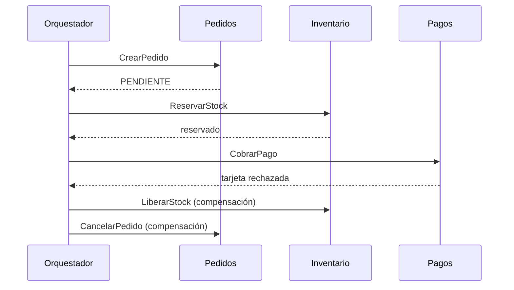

# Sagas: coreografía y orquestación

<!-- cspell:words Richardson Garcia-Molina Salem sagas saga coreografía orquestación orquestador compensatoria compensatorias aislamiento Inventario Pagos -->

> **Tipo de página:** explicación. Te ayuda a entender cómo se mantiene la consistencia de una operación de negocio que atraviesa varios servicios sin una transacción distribuida; no es una guía de un *framework* concreto.

## El problema

Un pedido toca tres servicios, cada uno con su propia base de datos: `Pedidos` lo crea, `Inventario` reserva el stock y `Pagos` cobra la tarjeta. Si el cobro falla, el stock ya está reservado y el pedido ya existe. Dentro de una sola base de datos un `ROLLBACK` deshace todo, pero aquí no hay una transacción que abarque los tres servicios.

Una transacción distribuida con *two-phase commit* (2PC) resolvería el caso, pero Richardson la descarta cuando cada servicio tiene su propia base de datos.

## La idea central

Una **saga** implementa una operación de negocio que abarca varios servicios como una secuencia coordinada de **transacciones locales**: cada servicio actualiza su propia base de datos con una transacción normal.

Si un paso falla por incumplir una regla de negocio, los pasos ya completados se deshacen con **transacciones compensatorias**. No son un `ROLLBACK`: son operaciones nuevas, escritas a mano, que revierten el efecto de negocio de un paso anterior (por ejemplo, liberar el stock reservado). El concepto viene del artículo *Sagas* de Garcia-Molina y Salem (1987), anterior a los microservicios, y la aplicación a servicios separados es posterior.

Hay dos formas de coordinar los pasos:

- **Coreografía:** cada transacción local publica un evento de dominio que dispara la siguiente transacción en otro servicio. No hay un controlador central.
- **Orquestación:** un objeto, el **orquestador**, le dice a cada participante qué transacción local ejecutar y decide qué sigue según el resultado.

## Cómo se estructura



Cuatro reglas del diseño:

1. **Cada paso tiene su compensación.** Si `ReservarStock` existe, hace falta `LiberarStock`.
2. **Las compensaciones van en orden inverso** al de los pasos completados.
3. **El paso que falló no se compensa**, porque no llegó a tener efecto.
4. **Las compensaciones también pueden fallar**, así que deben poder reintentarse. Esto lleva de nuevo a la [idempotencia](../apis/idempotencia-y-reintentos.md) y al [*outbox*](outbox-y-eventos.md): publicar eventos y guardar el estado de la saga tiene el mismo problema de doble escritura.

La diferencia práctica entre los dos estilos:

| | Coreografía | Orquestación |
| --- | --- | --- |
| Quién sabe el flujo completo | Nadie: está repartido en los eventos | El orquestador |
| Acoplamiento | Los servicios se escuchan entre sí | Los servicios solo conocen al orquestador |
| Seguir un pedido concreto | Difícil: hay que reconstruirlo desde los eventos | Fácil: el estado vive en un lugar |
| Riesgo | Dependencias cíclicas entre servicios | Que el orquestador concentre lógica de negocio |

## Cuándo no usarlo

- **Si todo cabe en una base de datos.** Dos tablas del mismo servicio se actualizan con una transacción normal; una saga solo añadiría compensaciones que escribir y probar.
- **Si un paso no tiene compensación posible.** Un correo enviado o una transferencia ya liquidada no se deshacen; hay que ordenar la saga para que esos pasos queden al final o aceptar una compensación imperfecta (un correo de disculpa).
- **Si el negocio no tolera estados intermedios visibles.** Una saga no aísla, como se explica abajo.

## Qué se gana y qué se pierde

| Se gana | Se pierde |
| --- | --- |
| Consistencia entre servicios sin 2PC ni bloqueos largos | Una compensación escrita y probada por cada paso |
| Cada servicio conserva su propia base de datos | Pérdida de aislamiento: se ven estados intermedios |
| Un fallo a mitad de camino se deshace por reglas de negocio | Más estados y más eventos que modelar y observar |

## Confusiones frecuentes

- **"Una saga da las mismas garantías que una transacción ACID."** No da aislamiento (la **I** de ACID). Mientras la saga está a mitad de camino, otros usuarios o sagas pueden ver o modificar datos intermedios, como un pedido en estado `PENDIENTE`. Richardson llama *countermeasures* a las técnicas de diseño que compensan esa falta, y las desarrolla en su libro, no en la página del patrón.
- **"La compensación es un `ROLLBACK`."** Es una operación nueva con su propio efecto. Cancelar un pedido ya confirmado deja rastro (un pedido cancelado, un reembolso), no lo borra como si nunca hubiera pasado.
- **"Orquestación es mejor que coreografía."** Depende del número de servicios y de cuánto necesites ver el flujo. Con dos o tres participantes la coreografía suele bastar; con más pasos y ramas, el flujo repartido en eventos se vuelve difícil de seguir.
- **"Si un paso falla, la saga se queda a medias."** Está diseñada para lo contrario: o termina todos los pasos o ejecuta las compensaciones. Lo que puede quedar a medias es una compensación que falla, y para eso se reintenta.

## Ejemplo

Dominio de pedidos con Java 21, sin *framework*, para mostrar solo la mecánica. Comprobado: compilado con `javac` de OpenJDK 21 y ejecutado.

Cada paso sabe ejecutarse y compensarse. El orquestador recorre los pasos; si uno lanza una excepción, compensa los ya completados en orden inverso:

```java
interface Paso {
    String nombre();
    void ejecutar();
    void compensar();
}

class Orquestador {
    private final List<Paso> pasos;

    Orquestador(List<Paso> pasos) {
        this.pasos = pasos;
    }

    boolean ejecutar() {
        var completados = new ArrayList<Paso>();
        for (var paso : pasos) {
            try {
                paso.ejecutar();
                completados.add(paso);
            } catch (RuntimeException e) {
                for (int i = completados.size() - 1; i >= 0; i--) {
                    completados.get(i).compensar();
                }
                return false;
            }
        }
        return true;
    }
}
```

Con los pasos `CrearPedido`, `ReservarStock` y `CobrarPago`, donde el cobro lanza "tarjeta rechazada", la salida es:

```text
ejecuta CrearPedido
ejecuta ReservarStock
ejecuta CobrarPago
falla CobrarPago: tarjeta rechazada
compensa ReservarStock
compensa CrearPedido
resultado=false estado=CANCELADO
```

Esto es solo la mecánica en memoria. En un sistema real el orquestador guarda en su base de datos en qué paso va cada saga, para poder retomarla si el proceso se cae, y envía los mensajes a los servicios mediante un *outbox*. En .NET 8 la estructura es la misma.

## Referencias

- Garcia-Molina, H. y Salem, K. (1987). Sagas. En *Proceedings of the 1987 ACM SIGMOD International Conference on Management of Data* (pp. 249-259). <https://doi.org/10.1145/38713.38742>. Copia accesible: <https://www.cs.cornell.edu/andru/cs711/2002fa/reading/sagas.pdf> ([copia archivada](https://web.archive.org/web/20261020131616/https://www.cs.cornell.edu/andru/cs711/2002fa/reading/sagas.pdf)). Origen del término; los datos de publicación se verificaron en Crossref, el contenido del PDF no se pudo leer en este entorno.
- Richardson, C. (s. f.). *Pattern: Saga*. <https://microservices.io/patterns/data/saga.html> (consultado el 2026-11-04; [copia archivada](https://web.archive.org/web/20261026204843/https://microservices.io/patterns/data/saga.html)). Definición, transacciones compensatorias, coreografía y orquestación, y la falta de aislamiento.
- Richardson, C. (2018). *Microservices Patterns*. Manning. Capítulo 4, *Managing transactions with sagas*. Verificado el título del capítulo, no el texto.

Última revisión: 2026-11-04
