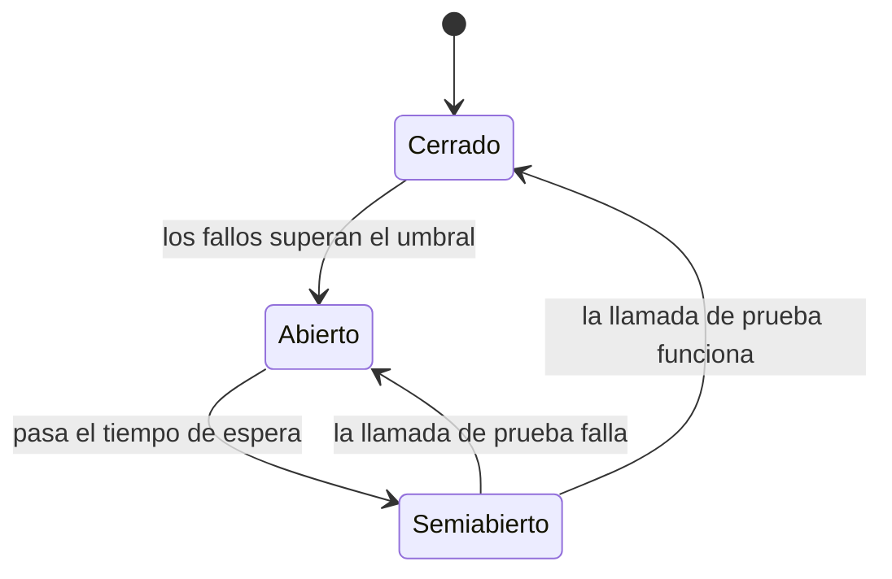

# Timeouts, reintentos y *circuit breaker*

<!-- cspell:words Nygard Brooker Fowler Resilience4j Polly jitter backoff timeout timeouts timelimiter circuit breaker half-open Pasarela PasarelaDePagos latencia percentil reintentos reintento reintentar -->

> **Tipo de página:** explicación. Te ayuda a entender cómo se protege un servicio de las llamadas lentas o fallidas a otro servicio; no es una guía de una biblioteca concreta.

## El problema

El servicio de pedidos llama a una pasarela de pagos externa. El peor fallo no es que la pasarela responda con un error enseguida, porque eso se maneja. El peor fallo es que **tarde 30 segundos en responder**: cada petición del cliente deja un hilo del servidor esperando, los hilos se agotan, y un servicio que dependía de la pasarela para una sola operación deja de atender también las operaciones que no la usan. El fallo de un servicio se propaga a quienes lo llaman, en cascada.

Hay tres herramientas básicas contra eso, y se usan juntas: los *timeouts*, los reintentos y el *circuit breaker*.

## La idea central

**Timeout.** Todas las llamadas remotas llevan un límite de tiempo explícito. Según el artículo de la AWS Builders' Library, el valor se elige decidiendo qué tasa de falsos *timeouts* es aceptable (el artículo usa 0,1 %) y mirando cuánto tarda el servicio llamado en ese percentil de latencia (p99,9 en su ejemplo). Un *timeout* demasiado corto cuenta como fallo una respuesta que iba a llegar; uno demasiado largo vuelve a bloquear los hilos.

**Reintento.** Muchos fallos son transitorios, así que repetir la llamada suele funcionar. El mismo artículo advierte que los reintentos son "egoístas": gastan más capacidad del servidor para mejorar las posibilidades de un solo cliente. Si el servicio ya está saturado, cada reintento empeora la saturación. Dos medidas lo contienen:

- **Espera exponencial (*exponential backoff*):** esperar más después de cada intento fallido en lugar de repetir de inmediato.
- ***Jitter*:** añadir aleatoriedad a la espera. Sin ella, los clientes que fallaron juntos reintentan juntos y recrean la sobrecarga.

**Circuit breaker.** Martin Fowler lo describe como un envoltorio sobre la llamada protegida que, cuando los fallos alcanzan un umbral, deja de hacerla y devuelve el error de inmediato. Tiene tres estados:

- **Cerrado:** las llamadas pasan; las que tienen éxito reinician el contador de fallos.
- **Abierto:** las llamadas fallan al instante sin llegar a la pasarela.
- **Semiabierto (*half-open*):** pasado un tiempo de espera, deja pasar una llamada de prueba. Si funciona, se cierra; si falla, vuelve a abrirse.

Fowler atribuye la popularización del patrón al libro *Release It!* de Nygard.

## Cómo se estructura



Las tres piezas se colocan alrededor de la llamada, y el orden importa:

1. El ***timeout*** acota cada intento individual.
2. El **reintento** envuelve al *timeout*: repite el intento si falló o se agotó el tiempo, con espera exponencial y *jitter*.
3. El ***circuit breaker*** decide si se intenta siquiera. Cuando está abierto, ni se llama ni se reintenta.

Además, el cliente necesita un plan para cuando la llamada falla igualmente. Fowler menciona como alternativas poner la petición en cola para más tarde o mostrar datos desactualizados. Para un pago, lo habitual es dejar el pedido en un estado pendiente de pago; eso enlaza con las [sagas](sagas.md).

Solo se reintenta lo que es seguro repetir. Una llamada con efectos, como cobrar, solo puede reintentarse si es idempotente, como explica la página de [idempotencia](../apis/idempotencia-y-reintentos.md).

## Cuándo no usarlo

- **Reintentos sobre operaciones no idempotentes.** Reintentar un cobro sin clave de idempotencia puede cobrar dos veces.
- **Reintentos en cada capa.** El artículo de AWS calcula que tres reintentos en cada una de cinco capas multiplican por 243 la carga sobre una base de datos que ya falla. Conviene limitar los reintentos y no repetirlos en todas las capas.
- **Un *circuit breaker* sobre una llamada que nunca falla de forma sostenida.** Añade un comportamiento por estados que cuesta probar y el propio artículo de AWS advierte que puede alargar la recuperación.

## Qué se gana y qué se pierde

| Se gana | Se pierde |
| --- | --- |
| Un fallo en la pasarela no agota los hilos del servicio | Hay que elegir y mantener valores de *timeout*, umbrales y tiempos |
| Los fallos transitorios se absorben con reintentos | Más carga sobre el servicio caído si se reintenta mal |
| El servicio se recupera antes porque deja de insistir mientras el circuito está abierto | Comportamiento por estados que cuesta probar |
| Respuestas rápidas de error en lugar de esperas largas | Hay que decidir qué hacer cuando falla: cola, datos viejos o error |

## Confusiones frecuentes

- **"Agregar 3 reintentos automáticos siempre mejora la disponibilidad."** Si la pasarela está saturada y 100 clientes reintentan a la vez sin espera exponencial ni *jitter*, triplicas la carga y le impides recuperarse. El artículo de AWS lo describe como una medicina potente: útil en la dosis correcta, dañina en exceso.
- **"Un *timeout* largo es más seguro porque da más margen."** Un *timeout* largo mantiene recursos ocupados mientras el servicio llamado no responde. El margen razonable sale de la latencia real del servicio, no de una cifra redonda.
- **"El *circuit breaker* sustituye a los reintentos."** Hacen cosas distintas. El reintento ayuda ante fallos aislados; el *circuit breaker* protege cuando los fallos son sostenidos. Se usan juntos.
- **"El *jitter* es un detalle."** Sin él, la espera exponencial sincroniza a los clientes: todos esperan lo mismo y vuelven a la vez.

## Ejemplo

Dominio de pedidos con Java 21 y Spring Boot, protegiendo el puerto `PasarelaDePagos`. La configuración usa los nombres de propiedades de la documentación de Resilience4j; no está compilada ni ejecutada contra una pasarela.

```yaml
resilience4j.timelimiter:
  instances:
    pasarela:
      timeoutDuration: 2s

resilience4j.retry:
  instances:
    pasarela:
      maxAttempts: 3
      waitDuration: 200ms
      enableExponentialBackoff: true
      exponentialBackoffMultiplier: 2

resilience4j.circuitbreaker:
  instances:
    pasarela:
      slidingWindowSize: 20
      failureRateThreshold: 50
      waitDurationInOpenState: 30s
      permittedNumberOfCallsInHalfOpenState: 3
```

El adaptador que implementa el puerto lleva las anotaciones. El método de respaldo deja el pedido en estado pendiente en lugar de lanzar el error al cliente:

```java
@Component
class PasarelaDePagosHttp implements PasarelaDePagos {

    @CircuitBreaker(name = "pasarela", fallbackMethod = "pagoPendiente")
    @Retry(name = "pasarela")
    @TimeLimiter(name = "pasarela")
    public CompletableFuture<ResultadoPago> cobrar(SolicitudDePago solicitud) {
        return CompletableFuture.supplyAsync(() -> cliente.cobrar(solicitud));
    }

    private CompletableFuture<ResultadoPago> pagoPendiente(SolicitudDePago solicitud, Throwable causa) {
        return CompletableFuture.completedFuture(ResultadoPago.pendiente(solicitud.pedidoId()));
    }
}
```

La documentación de Resilience4j que consulté lista `maxAttempts`, `waitDuration`, `enableExponentialBackoff` y `exponentialBackoffMultiplier` para el reintento, pero no documenta una propiedad de *jitter*. En su documentación de `Retry` la espera exponencial y la aleatoria se configuran con las fábricas `IntervalFunction.ofExponentialBackoff()` e `IntervalFunction.ofRandomized()` en código, no con una opción de YAML. Si usas la configuración de arriba, tendrás espera exponencial pero **no *jitter***; añádelo con una `IntervalFunction` propia.

En .NET 8, Polly ofrece las mismas piezas (*timeout*, reintento con *backoff* y *jitter*, y *circuit breaker*) como estrategias que se encadenan alrededor de la llamada.

## Referencias

- Brooker, M. (2019). *Timeouts, retries, and backoff with jitter*. AWS Builders' Library. <https://builder.aws.com/content/3EumjoZascWd1oZiEgL8ORlv3qE/timeouts-retries-and-backoff-with-jitter> (consultado el 2026-11-04; [copia archivada](https://web.archive.org/web/20261103170314/https://builder.aws.com/content/3EumjoZascWd1oZiEgL8ORlv3qE/timeouts-retries-and-backoff-with-jitter)). Selección de *timeouts* por percentil, reintentos como carga adicional, espera exponencial, *jitter* e idempotencia. La URL original en `aws.amazon.com/builders-library` redirige a esta; la página publicada indica la fecha del 5 de diciembre de 2019.
- Fowler, M. (2014). *CircuitBreaker*. <https://martinfowler.com/bliki/CircuitBreaker.html> (consultado el 2026-11-04; [copia archivada](https://web.archive.org/web/20261025012432/https://martinfowler.com/bliki/CircuitBreaker.html)). Estados del patrón, umbral de fallos y alternativas cuando la llamada falla.
- Nygard, M. T. (2018). *Release It! Design and Deploy Production-Ready Software* (2.ª ed.). Pragmatic Bookshelf. Capítulo 4, *Stability Antipatterns*, y capítulo 5, *Stability Patterns*. Verificados los títulos de los capítulos; no se pudo confirmar en qué sección está cada patrón.
- Resilience4j (s. f.). *Getting started* y *Retry*. <https://resilience4j.readme.io/docs/getting-started-3> y <https://resilience4j.readme.io/docs/retry> (consultados el 2026-11-04). Nombres de las propiedades de configuración.

Última revisión: 2026-11-04
